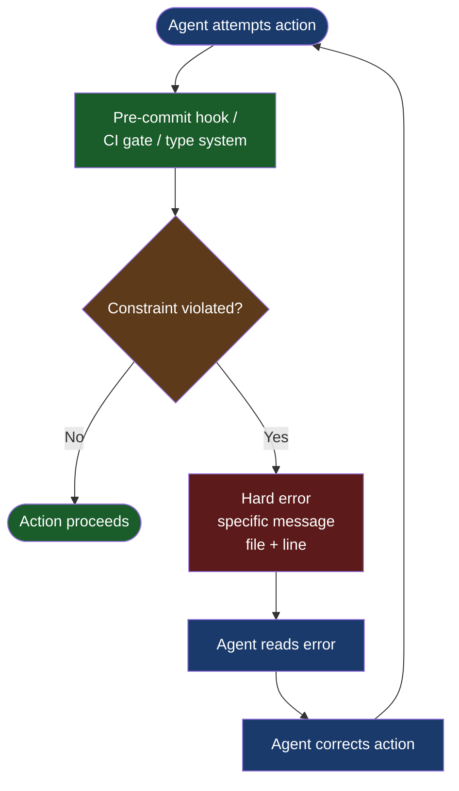

# F04 — Mechanical Architecture Constraints

## Problem

Instructions that say "don't do X" are ignored, forgotten, or misapplied — especially across sessions and by new agents that lack the prior context. When architectural rules live only in prose (system prompts, README sections, code comments), they are advisory: the agent can violate them without any tooling-level consequence. Over time, agents introduce banned import patterns, bypass layering boundaries, commit secrets, or break naming conventions — not out of malice but because nothing in the environment prevents it. Repeated human correction of mechanically-preventable errors is expensive and demoralizing.

## Solution

Encode hard architectural rules as executable checks that run automatically and fail with an error — not a warning, not a lint suggestion. Pre-commit hooks, CI gates, custom lint rules, and type-system constraints enforce rules at the tooling level regardless of what instructions say. The agent is not trusted to remember; the environment is trusted to enforce. The constraint is narrow enough not to block legitimate work, and the error message is specific enough to act on.

## Structure

<details>
<summary><b>Mechanical Architecture Constraints</b></summary>



</details>

**Key components:**

- **Pre-commit hooks** — run on `git commit`; block the commit if a rule is violated; always non-bypassable (no `--no-verify` permission for agents)
- **CI gates** — checks that run on every push/PR; required to pass before merge
- **Custom lint rules** — ESLint, pylint, or equivalent custom rules that encode architectural constraints (e.g., "no direct DB access from route handlers")
- **Type-system constraints** — branded types, opaque types, or module boundary types that make violations a compile error
- **Specific error messages** — every constraint violation emits: what was violated, which file/line, and what to do instead

## Implementation

1. Enumerate architectural rules that have been violated before or that are critical enough to enforce mechanically (start with the top 3–5, not all of them).
2. For each rule, determine the enforcement mechanism: pre-commit hook, lint rule, CI check, or type system.
3. Implement each check as a standalone script that exits non-zero on violation and emits a `file:line: rule: message` error.
4. Register hooks in the repo so they run automatically (e.g., via `.husky/`, `lefthook.yml`, or `pre-commit` config) — checked into version control, not set up manually.
5. Ensure the error message includes: what the rule is, why it exists (one sentence), and what to do instead.
6. Remove any permission that allows agents to bypass hooks (`--no-verify` must not be in the allowed commands list).
7. Test each hook by intentionally violating it; verify the error message is actionable without reading documentation.

## Signals (how to know it's working)

- Architectural violations never reach main branch — blocked at commit or CI, not caught in code review
- Agent corrects constraint violations on first read of the error message (error is specific enough)
- Human reviewers stop commenting on the same class of mechanical errors
- Constraint bypass attempts (`--no-verify`, `# noqa`, `// eslint-disable`) are absent or require explicit approval

## Anti-Patterns

- **Advisory-only constraints:** Rules live in CLAUDE.md as "please don't do X" — agents comply inconsistently, especially under task pressure.
- **Warning instead of error:** Lint rule emits a warning; agent (and CI) proceeds; violation accumulates silently.
- **Bypassable hooks:** Agents have permission to run `git commit --no-verify` — the constraint is optional in practice.
- **Overly broad rules:** A rule that fires on legitimate patterns causes agents to fight the constraint rather than follow it; eventually the rule is disabled.
- **Vague error messages:** Hook fails with "architecture violation detected" — agent cannot determine what to fix or where.

## Related Patterns

- [F03 — Executable Feedback Loop](F03-executable-feedback-loop.md) — constraints use the same feedback loop mechanism
- [F06 — Structured Repository Instructions](F06-structured-repository-instructions.md) — instructions explain the rules; constraints enforce them
- [F08 — Sandboxed Execution](F08-sandboxed-execution.md) — sandboxing is a form of mechanical constraint applied to execution scope

## Examples

**Pre-commit hook script (pseudocode):**

```
# .husky/pre-commit (or lefthook equivalent)

# Rule: no direct database access from route handlers
grep_result = grep -rn "db\." service/routes/
if grep_result is not empty:
    for each match in grep_result:
        print "ARCHITECTURE VIOLATION: {file}:{line}: Direct DB access in route handler."
        print "  Rule: Route handlers must delegate to service layer."
        print "  Fix: Move DB call to service/services/ and call it from here."
    exit 1

# Rule: no secrets in committed files
run secret-scan on staged files
if secrets found: exit 1
```

**Type-system boundary constraint (pseudocode):**

```typescript
// Opaque type prevents raw DB result from leaking into HTTP response
type DbUserId = Opaque<string, "DbUserId">
type HttpUserId = Opaque<string, "HttpUserId">

// Compiler error if agent passes DbUserId where HttpUserId is expected
function sendResponse(id: HttpUserId): void { ... }
```

**CI gate (pseudocode):**

```yaml
# .github/workflows/architecture.yml
on: [push, pull_request]
jobs:
  arch-check:
    steps:
      - run: node scripts/check-layer-boundaries.js
      - run: node scripts/check-no-circular-deps.js
```

## Sources

- **OpenAI Engineering** — AI research company; authors of GPT and Codex; coined "harness engineering." [Harness Engineering: Leveraging Codex in an Agent-First World](https://openai.com/index/harness-engineering/)
- **OpenAI Engineering** — AI research company; authors of GPT and Codex; coined "harness engineering." [Unlocking the Codex Harness](https://openai.com/index/unlocking-the-codex-harness/)
- **Anthropic Engineering** — AI safety company; authors of Claude. [Building Effective Agents](https://www.anthropic.com/engineering/building-effective-agents)
- **AWS Prescriptive Guidance** — Amazon Web Services architecture team. [Agentic AI Patterns](https://docs.aws.amazon.com/prescriptive-guidance/latest/agentic-ai-patterns/agent-patterns.html)
