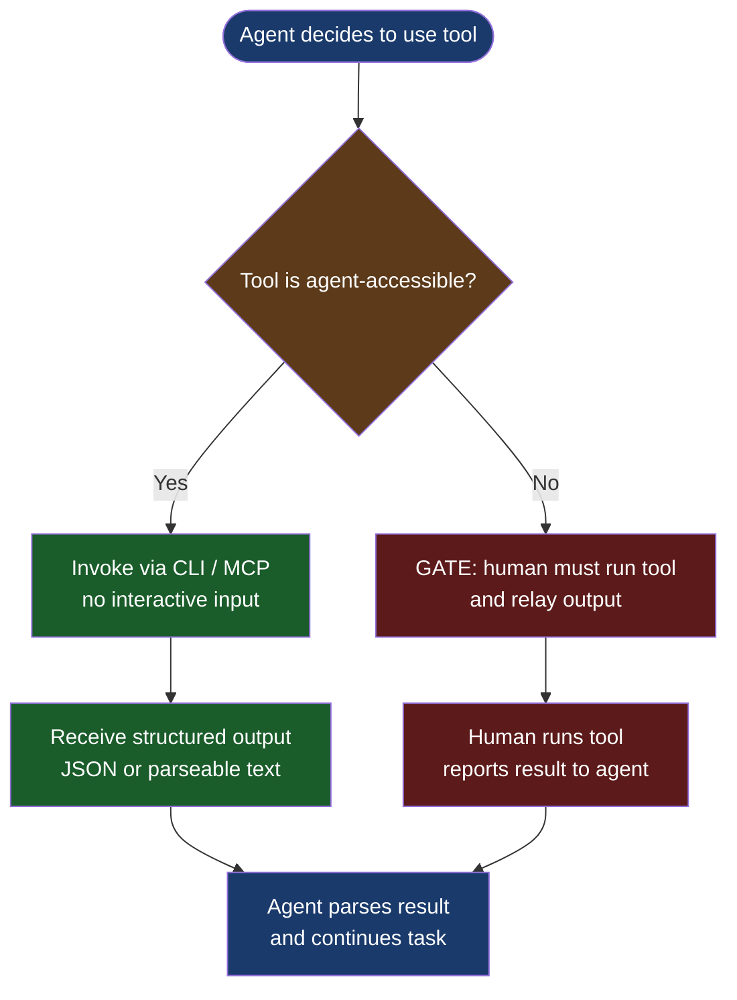

# F05 — Agent-Accessible Tools

## Problem

When tools require interactive prompts, out-of-band authentication, or human mediation to invoke, agents cannot use them autonomously. An agent that must ask a human to run a database migration, click through an OAuth flow, or interpret a tool's unstructured output is not operating autonomously — it is a drafting assistant. Every tool that requires human mediation is a bottleneck that breaks the agent's ability to complete multi-step tasks without interruption.

## Solution

Ensure every tool an agent needs is callable via CLI or MCP without interactive input, produces machine-readable output, and handles authentication within the agent's credential scope. Tools are first-class citizens of the harness: they are documented, versioned, and tested the same way code is. If a tool cannot be made agent-accessible, its use must be wrapped in a human-gate — not silently omitted from the agent's workflow.

## Structure

<details>
<summary><b>Agent-Accessible Tools</b></summary>



</details>

**Key components:**

- **CLI-invocable tools** — every tool has a non-interactive command-line interface with flags for all inputs
- **MCP server** — tools exposed via Model Context Protocol for structured, typed invocation from agents
- **Machine-readable output** — JSON or structured text; no color codes, spinner animations, or prose-wrapped results
- **Agent credential scope** — tools use credentials the agent can obtain (env vars, token files) without OAuth browser flows
- **Tool documentation** — each tool documents its inputs, outputs, error codes, and failure modes in a form agents can read

## Implementation

1. Inventory all tools the agent workflow requires; classify each as agent-accessible (non-interactive CLI or MCP) or human-mediated.
2. For each human-mediated tool, evaluate whether it can be wrapped: add `--json` output flag, replace interactive prompt with CLI args, or expose via MCP.
3. Implement a `--json` or `--output=json` flag on every internal tool that does not already have one.
4. Ensure authentication uses non-interactive mechanisms: environment variables, token files, service accounts — never browser OAuth flows.
5. For tools that cannot be made non-interactive (e.g., hardware-bound MFA), document them as explicit gates and add them to the human-gate list in CLAUDE.md.
6. Test each tool by invoking it from a script with no TTY attached (`script /dev/null -c "tool --args"`); verify it completes without hanging.
7. Add tool descriptions to CLAUDE.md: name, purpose, invocation pattern, output format, and which workflow steps use it.

## Signals (how to know it's working)

- Agent completes multi-step tasks without asking a human to run any tool
- Tool invocations are logged; no invocation results in an interactive prompt (verified via CI/no-TTY runs)
- Agent parses tool output correctly and uses it to make decisions (not just passing it through verbatim)
- New tools are added with documentation before being referenced in agent workflows

## Anti-Patterns

- **Interactive-prompt tools:** Tool asks "are you sure? [y/N]" — agent cannot respond; task hangs or fails.
- **Color-coded, animation-heavy output:** Tool uses ANSI codes and progress bars; agent reads garbled text and fails to parse results.
- **Browser-based auth:** Tool requires clicking an OAuth link; agent cannot complete auth; tool call fails silently.
- **Undocumented tools:** Tools exist but are not listed in CLAUDE.md; agent discovers them by trial and error or not at all.
- **Tool sprawl:** Dozens of overlapping tools with similar names; agent invokes the wrong one; error is ambiguous.

## Related Patterns

- [F01 — Agent-Legible Repository](F01-agent-legible-repository.md) — tools must be discoverable via the repo map
- [F06 — Structured Repository Instructions](F06-structured-repository-instructions.md) — tool catalog belongs in repository instructions
- [F07 — Agent Skills / Procedures](F07-agent-skills-procedures.md) — skills compose tool calls into reusable procedures
- [F08 — Sandboxed Execution](F08-sandboxed-execution.md) — tools that modify state should be sandboxed during development

## Examples

**MCP server tool definition (pseudocode):**

```json
{
  "name": "run_tests",
  "description": "Run mocha tests for a specific module. Returns structured pass/fail results.",
  "inputSchema": {
    "filter": "string — file path or test name pattern",
    "timeout": "number — milliseconds (default 30000)"
  },
  "outputSchema": {
    "passed": "number",
    "failed": "number",
    "failures": [{ "file": "string", "line": "number", "message": "string" }]
  }
}
```

**Tool inventory in CLAUDE.md (pseudocode):**

```
## Available Tools

| Tool        | How to invoke         | Output format | Used in              |
|-------------|-----------------------|---------------|----------------------|
| /sl-build   | skill invocation      | structured    | after code changes   |
| /sl-test    | skill invocation      | structured    | after code changes   |
| gh pr create| gh CLI / MCP          | JSON          | PR creation workflow |
| db-migrate  | node scripts/migrate  | JSON          | schema change tasks  |
```

**Non-interactive wrapper (pseudocode):**

```bash
# Before: interactive, not agent-accessible
deploy-tool  # prompts: "Deploy to prod? [y/N]"

# After: agent-accessible
deploy-tool --env=staging --confirm --output=json
# → {"status": "success", "deployed": "v1.2.3", "url": "https://..."}
```

## Sources

- **OpenAI Engineering** — AI research company; authors of GPT and Codex; coined "harness engineering." [Harness Engineering: Leveraging Codex in an Agent-First World](https://openai.com/index/harness-engineering/)
- **OpenAI Engineering** — AI research company; authors of GPT and Codex; coined "harness engineering." [Open-Source Codex Orchestration: Symphony](https://openai.com/index/open-source-codex-orchestration-symphony/)
- **Anthropic Engineering** — AI safety company; authors of Claude. [Building Effective Agents](https://www.anthropic.com/engineering/building-effective-agents)
- **Google Cloud Architecture Center** — Google's cloud architecture team. [Choose a Design Pattern for Agentic AI](https://docs.cloud.google.com/architecture/choose-design-pattern-agentic-ai-system)
