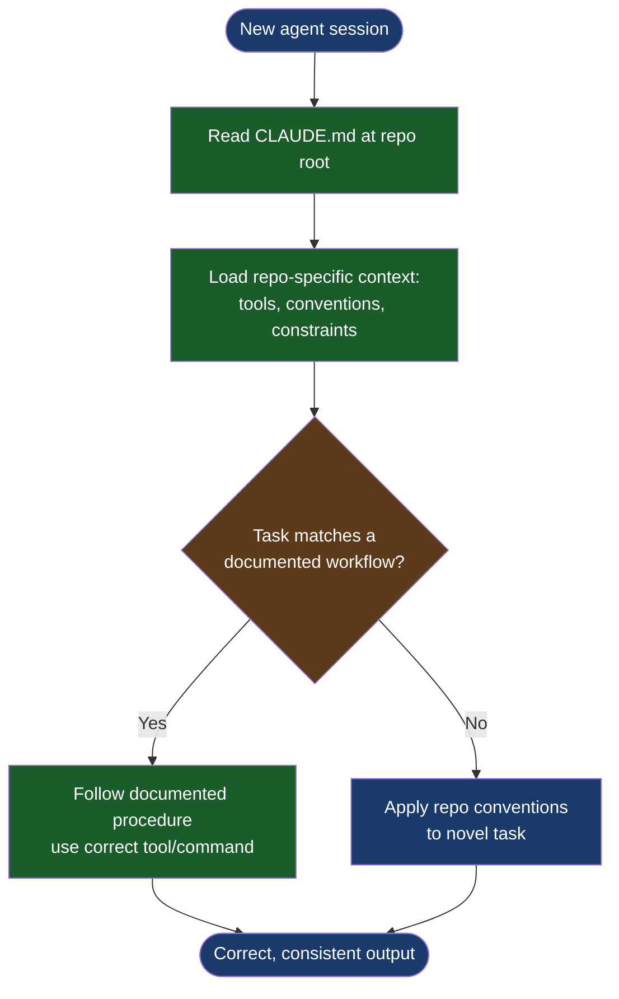

# F06 — Structured Repository Instructions

## Problem

Without explicit, repo-specific instructions, agents fall back on general training knowledge — which may be correct for standard projects but wrong for this codebase's conventions, architecture, tooling choices, and constraints. Generic behavior produces generic output: agents use the wrong build command, ignore established patterns, reinvent solved problems, and make locally-wrong decisions that are globally reasonable. The more unusual the repo's conventions, the more expensive this gap becomes.

## Solution

Maintain a structured instruction file at the repository root (CLAUDE.md, AGENTS.md, or equivalent) that is read by every agent session. The file encodes repo-specific conventions, constraints, tooling commands, architectural rules, and workflow procedures. Instructions are organized by concern, kept current, and specific — not generic advice that applies to any codebase. When the same instruction appears in multiple prompts, it belongs here instead.

## Structure

<details>
<summary><b>Structured Repository Instructions</b></summary>



</details>

**Key components:**

- **Root-level instruction file** — CLAUDE.md or AGENTS.md; read automatically at session start
- **Concern-organized sections** — code style, testing, build, commit, deploy, architecture rules; each section self-contained
- **Skill-first table** — lists which commands must be invoked via skills rather than directly
- **Repo structure map** — directory table linking folders to purposes and build targets
- **Staleness discipline** — instructions are reviewed and updated when conventions change; stale rules are more harmful than no rules

## Implementation

1. Create `CLAUDE.md` at the repository root if it does not exist. Commit it.
2. Structure the file with H2 sections per concern: General Principles, Repo Structure, Build, Testing, Code Style, Commit/Push, Architecture Rules, Available Tools.
3. For each section, write only repo-specific content — delete any instruction that applies equally to all TypeScript (or Python, etc.) projects.
4. Add a Skill-First table: two columns, "instead of running X directly, use skill Y."
5. Add the repo structure table: directory → purpose → build command (see [F01](F01-agent-legible-repository.md)).
6. Add a "Common Phrases" or "Vocabulary" section for any project-specific shorthand ("ship it", "Lord Coco", etc.).
7. Establish a review cadence: after every significant architectural change, update CLAUDE.md in the same PR.
8. Add a "Last reviewed" date at the file bottom; any section not reviewed in 90 days should be flagged for audit.

## Signals (how to know it's working)

- Agents use the correct build and test commands on first attempt (no "command not found" from using wrong tool)
- Agents follow repo conventions (naming, layering, file placement) without being corrected
- Human reviewers stop leaving the same recurring comments on agent PRs (the rule has been encoded)
- When a new convention is introduced, encoding it in CLAUDE.md immediately changes agent behavior in the next session

## Anti-Patterns

- **Generic advice:** CLAUDE.md contains "write clean, readable code" and "follow SOLID principles" — this tells the agent nothing it doesn't already know.
- **Stale instructions:** CLAUDE.md describes the old build system after a migration; agents follow wrong commands and spend context debugging.
- **Missing skill-first table:** Agents run `npm run build` directly instead of `/sl-build`; hooks don't fire; output is inconsistent.
- **Over-long monolith:** 1,000-line CLAUDE.md with everything in one section; agent context budget exhausted reading it; key rules buried.
- **Duplicated in prompts:** Same instruction appears in both CLAUDE.md and every task prompt; maintenance burden doubles; they drift and contradict.

## Related Patterns

- [F01 — Agent-Legible Repository](F01-agent-legible-repository.md) — CLAUDE.md is both the instruction file and the repo map
- [F04 — Mechanical Architecture Constraints](F04-mechanical-architecture-constraints.md) — instructions explain rules; constraints enforce them
- [F07 — Agent Skills / Procedures](F07-agent-skills-procedures.md) — skills are referenced from instructions; the skill-first table lives here

## Examples

**CLAUDE.md skeleton (pseudocode):**

```markdown
# Project Instructions

## Skill-First Rule
Never run these directly — use the skill:
| Instead of…          | Use skill…  |
|----------------------|-------------|
| npm run build-backend| /sl-build   |
| git commit           | /clihook-commit |
| npx prettier --write | /sl-formatting  |

## Repo Structure
| Folder         | Purpose         | Build tag |
|----------------|-----------------|-----------|
| service/       | Backend Express | backend   |
| shared/        | Shared types    | shared    |
| src/components/| SAPUI5 frontend | ui        |

## Architecture Rules
- Route handlers must not access DB directly — delegate to service layer.
- Do not import from `service/` into `shared/`.
- Feature flags use `isFeatureFlagActive()` — no direct env var reads.

## Code Style
- Config: .prettierrc.js — all modified files must be Prettier-compliant.
- Run /sl-formatting before committing.
```

## Sources

- **OpenAI Engineering** — AI research company; authors of GPT and Codex; coined "harness engineering." [Harness Engineering: Leveraging Codex in an Agent-First World](https://openai.com/index/harness-engineering/)
- **OpenAI Engineering** — AI research company; authors of GPT and Codex; coined "harness engineering." [Unlocking the Codex Harness](https://openai.com/index/unlocking-the-codex-harness/)
- **Anthropic Engineering** — AI safety company; authors of Claude. [Building Effective Agents](https://www.anthropic.com/engineering/building-effective-agents)
- **AWS Prescriptive Guidance** — Amazon Web Services architecture team. [Agentic AI Patterns](https://docs.aws.amazon.com/prescriptive-guidance/latest/agentic-ai-patterns/agent-patterns.html)
