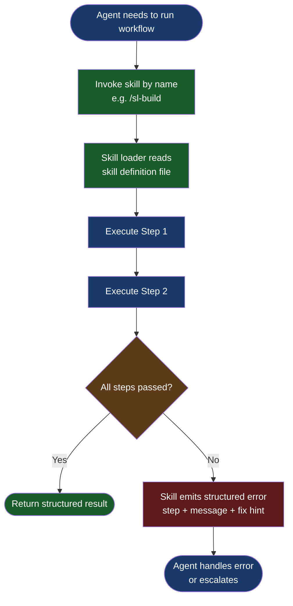

# F07 — Agent Skills / Procedures

## Problem

Without packaged procedures, agents reinvent multi-step workflows from scratch on every invocation — using different tool sequences, different flag combinations, and different verification steps each time. Inconsistency accumulates: one session runs tests before committing, the next skips them. One session uses the right build command, the next uses the wrong one. The cognitive load of remembering every multi-step workflow also consumes context budget that should go to the actual task. When workflows change, there is no single place to update them.

## Solution

Package repeated multi-step workflows as named, invocable skills — discrete procedure files that an agent calls by name rather than reconstructing from memory. A skill encodes the exact sequence of steps, the correct tools, the verification checks, and the failure handling for a given workflow. Skills are versioned alongside the code they operate on. When a workflow changes, updating the skill file updates every agent that uses it.

## Structure

<details>
<summary><b>Agent Skills / Procedures</b></summary>



</details>

**Key components:**

- **Skill definition file** — a markdown or structured file that encodes the workflow: trigger, steps, inputs, outputs, failure modes
- **Skill name / trigger** — a short, memorable name the agent types to invoke (e.g., `/sl-build`, `/sl-test`, `/clihook-commit`)
- **Skill-first table** — in CLAUDE.md, maps banned raw commands to their skill replacements
- **Skill versioning** — skill files are committed alongside the code; changes go through the same review process as code
- **Skill registry** — a discoverable list of available skills so agents can find them without memorization

## Implementation

1. Identify repeated multi-step workflows in your agent's history: build sequences, test invocations, commit procedures, deploy steps, PR creation.
2. For each workflow, write a skill definition file in `.claude/skills/<skill-name>/` containing: purpose, trigger phrase, step sequence, expected outputs, error handling.
3. Register each skill in the skill-first table in CLAUDE.md (see [F06](F06-structured-repository-instructions.md)).
4. Prohibit the raw commands that skills replace: add them to the "never run directly" list and (where possible) the pre-commit hook's banned-command list.
5. Give each skill a structured output contract: what it returns on success, what it emits on failure (step, error, fix hint).
6. Version skills alongside the code: if a build script changes, update the `/sl-build` skill in the same PR.
7. Periodically review skills for staleness — a skill that no longer matches the actual workflow is worse than no skill.

## Signals (how to know it's working)

- Agents invoke workflows by skill name consistently, not by reconstructing the steps from memory each time
- Build/test/commit outputs are consistent across sessions and agents (same flags, same sequence, same verification)
- When a workflow changes, one file update (the skill) propagates the change to all agents
- New agents onboard to workflows by reading the skill registry, not by asking how to run things

## Anti-Patterns

- **Memory-only procedures:** Workflow steps live only in the system prompt or in prior conversation turns — lost on session reset.
- **Skill drift:** Skill file describes the old workflow; the actual commands have changed; agents follow the skill and get errors.
- **Overloaded skills:** One skill does too many things ("do the whole release"); fails in the middle with no recovery path; agent cannot identify which step failed.
- **Undiscoverable skills:** Skills exist in `.claude/skills/` but are not listed in CLAUDE.md; agents never find them and reinvent the workflow.
- **Raw command permissions:** CLAUDE.md says "use /sl-build" but agents also have permission to run `npm run build-backend` directly; the skill is bypassed.

## Related Patterns

- [F05 — Agent-Accessible Tools](F05-agent-accessible-tools.md) — skills compose tool calls; tools must be accessible for skills to work
- [F06 — Structured Repository Instructions](F06-structured-repository-instructions.md) — the skill-first table lives in repository instructions
- [F03 — Executable Feedback Loop](F03-executable-feedback-loop.md) — skills wrap the feedback loop commands (build, test, lint)

## Examples

**Skill definition file (pseudocode):**

```markdown
# Skill: /sl-build

## Purpose
Build one or more project targets. Infers which targets to build from changed files.
Never run build commands directly — always use this skill.

## Trigger
/sl-build [target]
Targets: backend | shared | mocha | ui

## Steps
1. Detect changed files if no target provided
2. Map changed files to build target(s) using the folder→tag table
3. Run tsc --noEmit for each target
4. Run the appropriate npm build script
5. Return structured result

## Outputs
Success: { "status": "ok", "targets": ["backend"], "duration_ms": 4200 }
Failure: { "status": "error", "step": 3, "target": "backend",
           "errors": [{ "file": "...", "line": 42, "message": "..." }] }

## Failure handling
On type error: surface the structured error; do not proceed to the next step.
On build script error: emit the full stderr; do not suppress.
```

**Skill registry entry in CLAUDE.md (pseudocode):**

```
## Available Skills

| Skill              | Purpose                          | Replaces                       |
|--------------------|----------------------------------|--------------------------------|
| /sl-build          | Build backend/shared/mocha/ui    | npm run build-*                |
| /sl-test           | Run mocha tests for changed files| npm run test-mocha-*           |
| /clihook-commit    | Stage and commit with hooks      | git commit                     |
| /sl-formatting     | Run Prettier on modified files   | npx prettier --write           |
| /sl-create-pr      | Create PR with template          | gh pr create                   |
```

## Sources

- **OpenAI Engineering** — AI research company; authors of GPT and Codex; coined "harness engineering." [Harness Engineering: Leveraging Codex in an Agent-First World](https://openai.com/index/harness-engineering/)
- **OpenAI Engineering** — AI research company; authors of GPT and Codex; coined "harness engineering." [Open-Source Codex Orchestration: Symphony](https://openai.com/index/open-source-codex-orchestration-symphony/)
- **Anthropic Engineering** — AI safety company; authors of Claude. [Building Effective Agents](https://www.anthropic.com/engineering/building-effective-agents)
