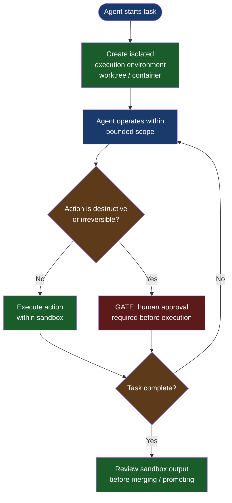

# F08 — Sandboxed Execution

## Problem

An agent operating without execution isolation can cause irreversible damage: overwriting production data, deleting files outside the task's scope, sending real API requests during test runs, or polluting shared state in ways that break other work. The probability of a catastrophic action is low per task but non-trivial over thousands of agent invocations. Without sandboxing, the consequence of a single wrong action — a misread path, an incorrect flag, a hallucinated command — can be irreversible. Human oversight of every action is not scalable; mechanical containment is the correct solution.

## Solution

Isolate agent execution so that the blast radius of any single wrong action is bounded. Isolation operates at multiple levels: filesystem (worktrees, temporary directories), network (localhost-only, blocked egress to production), credentials (read-only or scoped tokens), and process (containers, restricted shells). Destructive operations that cannot be sandboxed require an explicit human confirmation gate. The principle is: make mistakes recoverable by default, and make irreversible actions require deliberate escalation.

## Structure

<details>
<summary><b>Sandboxed Execution</b></summary>



</details>

**Key components:**

- **Git worktree** — isolated copy of the repo on a separate branch; agent writes to the worktree, not main working directory
- **Scoped credentials** — read-only tokens for production systems; write access limited to the sandbox environment
- **Network isolation** — agent's outbound network is blocked or restricted to known-safe endpoints (no production APIs during dev)
- **Destruction gate** — explicit confirmation required before any operation that cannot be undone (drop table, force push, delete file outside task scope)
- **Sandbox teardown** — worktree/container is removed after task; no long-lived sandbox accumulates state across tasks

## Implementation

1. Use git worktrees for all parallel agent work: spawn each agent in its own worktree on a dedicated branch (`/sl-worktree`).
2. Configure agent permissions to exclude destructive commands by default: no `rm -rf`, no `git push --force`, no `git reset --hard` without explicit permission.
3. Use read-only credentials for production systems during development tasks; provide write credentials only when the task explicitly requires writing to production.
4. Add a confirmation gate for any command on the destructive operations list: the agent must stop and ask before executing.
5. Run tests in isolated environments: no shared databases between test runs; use transactions that roll back, or ephemeral containers.
6. Define blast radius boundaries in CLAUDE.md: "agents may not modify files outside the task's designated directories without explicit approval."
7. After task completion, validate the sandbox diff before merging: review what changed, ensure nothing outside scope was touched.

## Signals (how to know it's working)

- Agent mistakes are recoverable: wrong file writes, incorrect commands, and failed experiments leave no permanent damage
- Test runs never affect each other (no flaky tests caused by shared state)
- Production systems are never touched during development tasks (verified by access logs)
- When a destructive operation is needed, it requires and receives explicit human approval every time

## Anti-Patterns

- **Single shared working directory:** Multiple agents write to the same directory; their changes collide; one agent's partial work corrupts another's.
- **Privileged credentials in dev:** Agent uses production write credentials during development; a wrong command modifies live data.
- **No destruction gate:** Agent is allowed to run `rm -rf` or `git push --force` autonomously; a single hallucinated path causes irreversible loss.
- **Persistent sandbox state:** Worktree from a previous task is reused; stale state causes the new task to behave incorrectly.
- **Test state leakage:** Tests share a database and leave dirty data; tests pass individually but fail together; agent cannot reproduce failures.

## Related Patterns

- [F04 — Mechanical Architecture Constraints](F04-mechanical-architecture-constraints.md) — destruction gates are a form of mechanical constraint
- [F03 — Executable Feedback Loop](F03-executable-feedback-loop.md) — isolated test runs require sandbox isolation to be reliable
- [F08 is the execution-scope complement to Family J (Security)] — see `[Family J](../J-security/README.md)` for credential and network security patterns

## Examples

**Worktree isolation (pseudocode):**

```
# Parent agent spawns worktree-isolated subagent:
/sl-worktree spawn
  → creates: .claude/worktrees/<task-slug>/
  → branch: feature/<task-slug>
  → subagent writes only within this worktree
  → parent reviews diff before merge
  → worktree removed after task
```

**Destructive operations list (pseudocode, in CLAUDE.md):**

```
## Operations Requiring Human Approval (Gates)
Agents must STOP and ask before executing:
- rm -rf <any path>
- git push --force / git push --force-with-lease
- git reset --hard
- DROP TABLE / DELETE FROM (without WHERE)
- Any write to a production environment
- Any credential rotation
```

**Scoped credential pattern (pseudocode):**

```
# Development tasks use read-only token:
DB_TOKEN=read-only-dev-token  # in .env.development

# Production write operations require explicit gate:
# Agent asks human to approve; human provides short-lived token
DB_TOKEN=<human-provided-write-token>  # never stored in repo
```

## Sources

- **OpenAI Engineering** — AI research company; authors of GPT and Codex; coined "harness engineering." [Harness Engineering: Leveraging Codex in an Agent-First World](https://openai.com/index/harness-engineering/)
- **OpenAI Engineering** — AI research company; authors of GPT and Codex; coined "harness engineering." [Unrolling the Codex Agent Loop](https://openai.com/index/unrolling-the-codex-agent-loop/)
- **Anthropic Engineering** — AI safety company; authors of Claude. [Building Effective Agents](https://www.anthropic.com/engineering/building-effective-agents)
- **AWS Prescriptive Guidance** — Amazon Web Services architecture team. [Agentic AI Patterns](https://docs.aws.amazon.com/prescriptive-guidance/latest/agentic-ai-patterns/agent-patterns.html)
