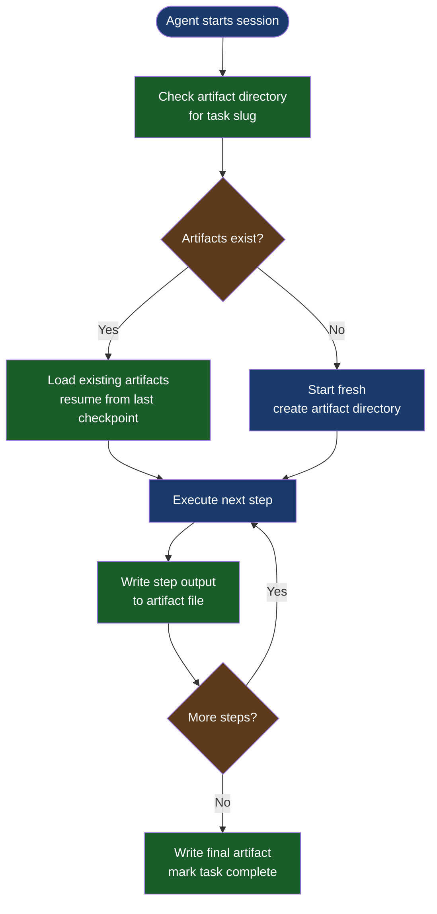

# F09 — Persistent Task Artifacts

## Problem

Agent context windows are finite and session-scoped. Intermediate outputs held only in context — partial analyses, drafted plans, research findings, generated code — are lost when the session ends, the context is compacted, or the agent is replaced. Long-horizon tasks that span multiple sessions require re-doing work that was already done, re-reading files that were already read, and re-making decisions that were already made. Without persistent artifacts, every session starts from scratch regardless of prior investment.

## Solution

Write intermediate and final outputs to disk as named files in a designated, discoverable artifact directory outside the protected config folder. Artifacts are written proactively during execution — not just at task end — and follow a naming convention that allows any agent to locate them by path, not by memory. Artifacts survive session end, context reset, and agent replacement. The artifact directory is treated as the task's external memory.

## Structure

<details>
<summary><b>Persistent Task Artifacts</b></summary>



</details>

**Key components:**

- **Artifact root directory** — a designated path outside the protected config folder (e.g., `~/claude-data/`) that accumulates outputs
- **Task-scoped subdirectory** — each task gets its own folder under the artifact root, named by task slug (e.g., `~/claude-data/plans/feature-x/`)
- **Naming convention** — file names encode their type and sequence: `plan.md`, `decisions.md`, `outputs/step-02-analysis.md`
- **README at artifact root** — describes the structure, naming convention, and how to navigate to a task's artifacts
- **Stale artifact cleanup** — completed or abandoned tasks are archived or deleted; stale artifacts cause navigation confusion

## Implementation

1. Designate an artifact root directory (e.g., `~/claude-data/`) and commit a README.md there describing the structure.
2. Define the naming convention: task slug as the directory name; fixed filenames for canonical files (`plan.md`, `decisions.md`); numbered filenames for sequential outputs (`outputs/01-analysis.md`).
3. Establish the write protocol: agents write artifacts at phase boundaries, not only at task end; partial artifacts are preferable to no artifacts.
4. Encode the artifact root path in CLAUDE.md so agents know where to look and write without asking.
5. Add a session-start protocol: first action is to check the artifact directory for the current task and load any existing state.
6. Add a session-end protocol: last action is to write a handoff note (`outputs/handoff.md`) with: last completed step, next step, open blockers.
7. Implement stale artifact cleanup: completed tasks are moved to an `archive/` subdirectory after a defined period.

## Signals (how to know it's working)

- A new session resumes a multi-session task within 2 minutes by reading artifacts, with no re-briefing from the human
- Agents do not re-do work already captured in an artifact (verified by comparing artifact content to agent actions)
- Artifact directory is navigable: a human can find any task's outputs in under 30 seconds using the naming convention
- Context usage for task resumption is lower than for fresh starts (fewer re-reads of source files already analyzed)

## Anti-Patterns

- **Context-only outputs:** Agent holds research findings in working memory; session compaction discards them; next session re-does the research.
- **Wrong artifact location:** Artifacts written to a path inside `.claude/` (the protected config folder) rather than `~/claude-data/`; they accumulate in the config repo.
- **Opaque naming:** Artifacts named `output1.md`, `output2.md` with no task slug; agent cannot determine which artifacts belong to which task.
- **End-only writes:** Agent writes artifacts only at task completion; interrupted tasks leave no artifacts; recovery requires starting over.
- **Artifact bloat:** Every micro-thought written to disk; artifact directory becomes noisy; navigation cost exceeds benefit; agents load all artifacts and blow the context budget.

## Related Patterns

- [F02 — Repository-Local System of Record](F02-repository-local-system-of-record.md) — the plan file is the primary artifact; F09 covers all outputs
- [F01 — Agent-Legible Repository](F01-agent-legible-repository.md) — the artifact root needs a README so agents can navigate it
- [F08 — Sandboxed Execution](F08-sandboxed-execution.md) — artifacts from sandboxed tasks must survive sandbox teardown

## Examples

**Artifact directory layout:**

```
~/claude-data/
├── README.md                         ← root navigation, naming convention
├── plans/
│   ├── feature-auth-refactor/
│   │   ├── plan.md                   ← system of record (F02)
│   │   ├── decisions.md              ← why choices were made
│   │   └── outputs/
│   │       ├── 01-analysis.md        ← step 1 output
│   │       ├── 02-impl-notes.md      ← step 2 output
│   │       └── handoff.md            ← session-end handoff note
│   └── bug-fix-token-expiry/
│       └── plan.md
└── agents/
    └── research-agent-run-01/
        └── findings.md
```

**Session-end handoff note (pseudocode):**

```markdown
# Handoff: feature-auth-refactor
Date: 2026-08-24
Session ended: context limit reached

## Last completed step
Phase 2, Step 2.3 — Implemented token refresh logic in service/auth/token.ts.
Build passes. Tests pass for auth module.

## Next step
Phase 2, Step 2.4 — Update route handler in service/routes/auth.ts to use new token service.
Reference: service/auth/token.ts:refreshToken()

## Open blockers
None.
```

## Sources

- **OpenAI Engineering** — AI research company; authors of GPT and Codex; coined "harness engineering." [Harness Engineering: Leveraging Codex in an Agent-First World](https://openai.com/index/harness-engineering/)
- **OpenAI Engineering** — AI research company; authors of GPT and Codex; coined "harness engineering." [Unrolling the Codex Agent Loop](https://openai.com/index/unrolling-the-codex-agent-loop/)
- **Anthropic Engineering** — AI safety company; authors of Claude. [Building Effective Agents](https://www.anthropic.com/engineering/building-effective-agents)
