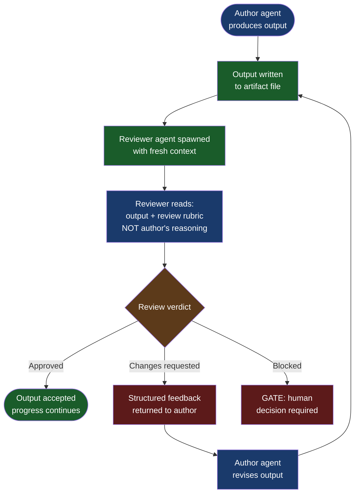

# F10 — Agent-to-Agent Review

## Problem

An agent that produces and reviews its own output is subject to systematic blind spots: it cannot easily see what it has missed, it tends to confirm its own reasoning, and it inherits whatever misconceptions were in its original framing of the task. Human review of all agent output is not scalable for high-volume or autonomous workflows. The result is that errors the agent is structurally incapable of catching on its own — logical gaps, missed edge cases, incorrect assumptions — reach production or require expensive human correction downstream.

## Solution

Route high-stakes agent outputs through a second agent for review before acceptance. The reviewer agent is given a different context from the author: it sees the output and a review rubric, but not the author's reasoning chain, so it cannot rubber-stamp. Review failures block progress — they are not annotations. The pattern is most valuable for code changes, plans, security-sensitive logic, and any output where the cost of a missed error is high.

## Structure

<details>
<summary><b>Agent-to-Agent Review</b></summary>



</details>

**Key components:**

- **Author agent** — produces the primary output (code, plan, analysis); isolated from review context
- **Reviewer agent** — fresh context; receives the output and a structured review rubric; does not inherit the author's framing
- **Review rubric** — a specific checklist of what to evaluate (correctness, security, conventions, test coverage, edge cases)
- **Structured review output** — verdict (approved / changes requested / blocked), specific findings with file+line references, and fix suggestions
- **Review gate** — review failures block the workflow; the output does not proceed until findings are addressed

## Implementation

1. Identify which output types in your workflow justify a second-agent review: code changes above a complexity threshold, security-sensitive logic, plans that will execute autonomously, API contract changes.
2. Define a review rubric for each output type: a structured checklist of what to evaluate (not "is it good" but specific criteria).
3. Implement the reviewer spawn as a distinct step in the workflow: author writes output → skill invokes reviewer → reviewer receives output + rubric (not author's chat history).
4. Require the reviewer's output to be structured: verdict field, findings array (each with location and severity), and suggested fixes.
5. Wire the review gate: workflow proceeds only on "approved" verdict; "changes requested" returns structured feedback to the author; "blocked" escalates to human.
6. Prevent context contamination: reviewer must not have access to the author agent's reasoning chain — only the output and the rubric.
7. Log review outcomes in the task's artifact directory for audit purposes.

## Signals (how to know it's working)

- Reviewer catches errors the author did not (measured by tracking pre-review vs. post-review defect rates)
- Review findings are specific and actionable — not "this could be better" but "line 42: missing null check for X"
- Author revisions address reviewer findings in the next iteration (no re-opened findings)
- Human reviewers downstream see fewer recurring error types (the review pattern is catching them earlier)

## Anti-Patterns

- **Shared context reviewer:** Reviewer has access to the author's full reasoning chain; it confirms rather than independently evaluates — rubber-stamping.
- **Advisory review:** Review findings are returned as suggestions; workflow proceeds regardless; findings are ignored; the gate is theater.
- **Vague rubric:** Reviewer is asked to "check for correctness" with no specific criteria; review quality is inconsistent and unhelpful.
- **Symmetric agents:** Author and reviewer use identical prompts and context; they produce identical blind spots; the review adds no signal.
- **Review on everything:** Trivial changes go through full review; overhead exceeds value; teams disable the review to avoid the slowdown.

## Related Patterns

- [F03 — Executable Feedback Loop](F03-executable-feedback-loop.md) — automated checks run before agent-to-agent review; review focuses on what automation cannot catch
- [F09 — Persistent Task Artifacts](F09-persistent-task-artifacts.md) — review outputs are persisted as artifacts; author reads them in the next session
- [F11 — Capability-Gap Feedback](F11-capability-gap-feedback.md) — repeated review failures on the same issue signal a capability gap in the author agent

## Examples

**Review rubric for code changes (pseudocode):**

```markdown
## Code Review Rubric

For each changed file, evaluate:
1. Correctness — does the logic match the stated intent?
2. Edge cases — are null, empty, and error cases handled?
3. Layer boundaries — does the code respect the architecture rules in CLAUDE.md?
4. Test coverage — are the new/changed paths covered by tests?
5. Security — any injection, auth bypass, or data exposure risks?
6. Type safety — are all types explicit and correct?

Output format:
{
  "verdict": "approved" | "changes_requested" | "blocked",
  "findings": [
    { "file": "...", "line": 42, "severity": "error|warning",
      "finding": "...", "suggestion": "..." }
  ]
}
```

**Reviewer spawn (pseudocode):**

```
# After author agent writes output:
spawn reviewer-agent
  context: [output files] + [review rubric]
  NOT included: author agent's conversation history
  NOT included: author agent's plan or reasoning
  instruction: "Review the attached output against the rubric. Return structured verdict."
```

**Review log artifact:**

```
~/claude-data/plans/feature-x/outputs/
├── 03-impl-draft.md          ← author output
├── 03-review-verdict.json    ← reviewer structured output
└── 03-impl-final.md          ← author revision after review
```

## Sources

- **OpenAI Engineering** — AI research company; authors of GPT and Codex; coined "harness engineering." [Harness Engineering: Leveraging Codex in an Agent-First World](https://openai.com/index/harness-engineering/)
- **OpenAI Engineering** — AI research company; authors of GPT and Codex; coined "harness engineering." [Open-Source Codex Orchestration: Symphony](https://openai.com/index/open-source-codex-orchestration-symphony/)
- **Anthropic Engineering** — AI safety company; authors of Claude. [Building Effective Agents](https://www.anthropic.com/engineering/building-effective-agents)
- **Google Cloud Architecture Center** — Google's cloud architecture team. [Choose a Design Pattern for Agentic AI](https://docs.cloud.google.com/architecture/choose-design-pattern-agentic-ai-system)
