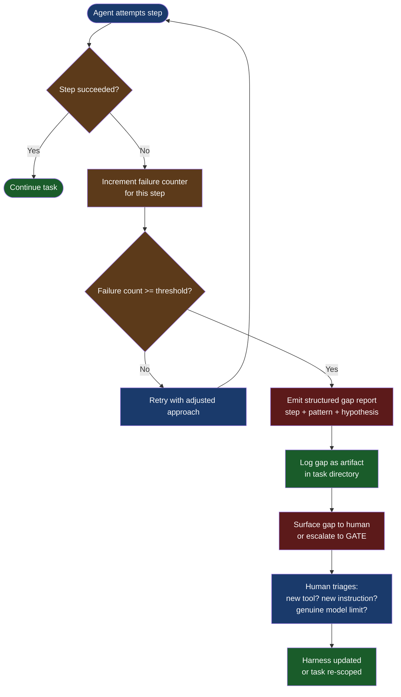

# F11 — Capability-Gap Feedback

## Problem

When an agent cannot complete a step — due to a missing tool, an incomplete instruction, a task that genuinely exceeds its current capability, or a harness gap — it has two failure modes: (1) silent retry loop, where it keeps attempting the same step with minor variations until it hits a loop limit or the user notices; or (2) confident wrong output, where it produces something plausible but incorrect rather than admitting it cannot proceed. Both modes are worse than stopping and surfacing the gap. Silent retries waste compute and time; confident wrong output creates downstream errors that are expensive to trace back to their root cause.

## Solution

Engineer the harness to detect when an agent has failed on the same step N times, and surface the gap explicitly rather than allowing continued retry. The gap report is structured and actionable: it states what was attempted, how many times, what error pattern was observed, and what harness change would resolve it (new tool needed, instruction gap, capability limit). Gap reports are logged as artifacts and treated as backlog items for harness improvement — not as agent failures to hide.

## Structure

<details>
<summary><b>Capability-Gap Feedback</b></summary>



</details>

**Key components:**

- **Failure counter** — per-step attempt counter; resets on success; triggers gap report at threshold (default: 3 consecutive failures)
- **Gap report** — structured document: step description, failure count, observed error pattern, hypothesis (missing tool / instruction gap / model limit), and suggested harness fix
- **Gap log** — persisted artifact in the task directory; accumulates across sessions; provides a harness improvement backlog
- **Escalation gate** — on gap report, agent stops retrying and either surfaces to human or halts pending triage
- **Gap triage** — human or harness owner classifies the gap: add a tool (F05), update instructions (F06), add a skill (F07), or re-scope the task

## Implementation

1. Implement a retry counter for the agent's inner loop: track consecutive failures per step by step ID or description.
2. Set a failure threshold (typically 2–3 retries before gap report); hard-code it in the agent's loop logic or skill.
3. Define the gap report schema: `{ step, attempts, error_pattern, hypothesis, suggested_fix }`.
4. On threshold breach, have the agent write the gap report to `~/claude-data/plans/<task-slug>/outputs/gap-report-<step>.md` before stopping.
5. After writing the artifact, the agent must surface the gap to the human (not silently halt) and wait.
6. Create a gap triage process: human reads the report and classifies it as: tool gap → add to F05 backlog; instruction gap → update CLAUDE.md; model limit → re-scope or escalate.
7. Track resolved gaps: when a harness fix closes a gap, note it in the gap report artifact for future reference.

## Signals (how to know it's working)

- Agents stop retrying after N failures and surface a structured gap report instead of looping indefinitely
- Gap reports are specific enough to determine the correct fix (new tool vs. new instruction vs. task re-scope)
- The harness improvement backlog (accumulated gap reports) shrinks over time as gaps are closed
- Confident wrong output incidents decrease because agents surface uncertainty rather than producing plausible-but-incorrect results

## Anti-Patterns

- **Silent retry loop:** Agent retries the same step 20 times with minor prompt variations; never surfaces the failure; human notices only after the context limit is hit.
- **Generic gap report:** "I was unable to complete this step" with no error pattern, no attempt count, no hypothesis — untriageable.
- **Gap suppression:** Agent produces plausible output rather than admitting it cannot complete the step; downstream error is traced back hours later.
- **No gap log:** Gap is surfaced in chat but not written to an artifact; next session has no record of the known gap; the same failure repeats.
- **Infinite threshold:** Failure threshold set so high (e.g., 10 retries) that gap detection provides no practical benefit.

## Related Patterns

- [F03 — Executable Feedback Loop](F03-executable-feedback-loop.md) — the feedback loop provides the signal that triggers gap detection
- [F05 — Agent-Accessible Tools](F05-agent-accessible-tools.md) — most tool-gap reports resolve by adding an agent-accessible tool
- [F06 — Structured Repository Instructions](F06-structured-repository-instructions.md) — instruction-gap reports resolve by updating CLAUDE.md
- [F09 — Persistent Task Artifacts](F09-persistent-task-artifacts.md) — gap reports are a specific type of persistent artifact
- [F10 — Agent-to-Agent Review](F10-agent-to-agent-review.md) — repeated review failures on the same issue are a signal to invoke gap reporting

## Examples

**Structured gap report (pseudocode):**

```markdown
# Gap Report: feature-auth-refactor / Phase 2 Step 2.4
Date: 2026-08-24
Step: Update route handler to use new token service
Attempts: 3
Status: UNRESOLVED — escalated to human

## Observed error pattern
Each attempt produced a TypeScript error:
  service/routes/auth.ts:58:12: error TS2339:
  Property 'refreshToken' does not exist on type 'TokenService'.

## What was tried
1. Imported TokenService from service/auth/token.ts — type error persists
2. Used type assertion — error suppressed but output likely incorrect
3. Re-read token.ts — refreshToken is defined but not exported

## Hypothesis
INSTRUCTION GAP: CLAUDE.md does not mention that token.ts exports are managed
via a barrel file (service/auth/index.ts). The correct import path is different.

## Suggested fix
Update CLAUDE.md: "Import from service/auth/index.ts, not from individual files."
Or: export refreshToken directly from token.ts (code change).

## Action required
Human triage: confirm which fix is correct, then unblock.
```

**Failure counter in skill (pseudocode):**

```
step_failures = {}

function execute_step(step_id, step_fn):
    result = step_fn()
    if result.success:
        step_failures[step_id] = 0
        return result
    else:
        step_failures[step_id] = (step_failures[step_id] ?? 0) + 1
        if step_failures[step_id] >= 3:
            write_gap_report(step_id, result.error)
            surface_to_human("Gap detected — see gap report")
            halt()
        return result
```

## Sources

- **OpenAI Engineering** — AI research company; authors of GPT and Codex; coined "harness engineering." [Harness Engineering: Leveraging Codex in an Agent-First World](https://openai.com/index/harness-engineering/)
- **OpenAI Engineering** — AI research company; authors of GPT and Codex; coined "harness engineering." [Unrolling the Codex Agent Loop](https://openai.com/index/unrolling-the-codex-agent-loop/)
- **Anthropic Engineering** — AI safety company; authors of Claude. [Building Effective Agents](https://www.anthropic.com/engineering/building-effective-agents)
- **Google Cloud Architecture Center** — Google's cloud architecture team. [Choose a Design Pattern for Agentic AI](https://docs.cloud.google.com/architecture/choose-design-pattern-agentic-ai-system)
- **AWS Prescriptive Guidance** — Amazon Web Services architecture team. [Agentic AI Patterns](https://docs.aws.amazon.com/prescriptive-guidance/latest/agentic-ai-patterns/agent-patterns.html)
