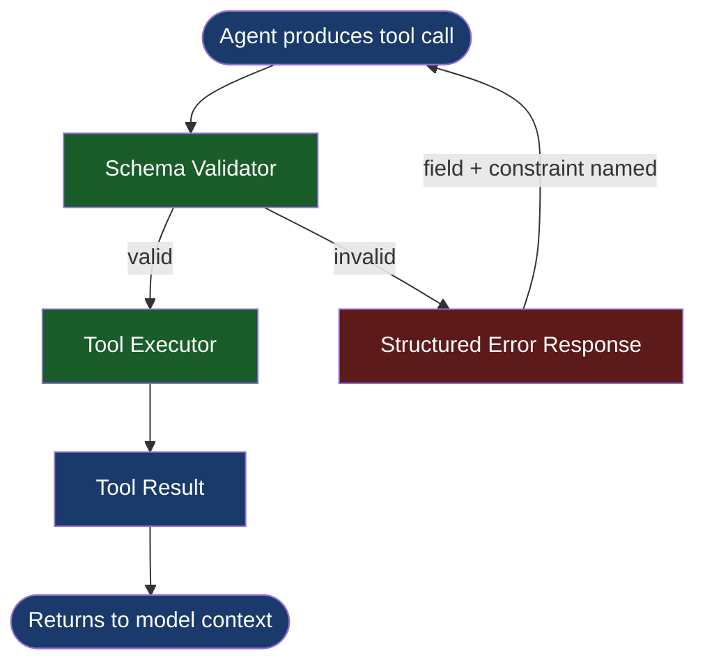

# G01 — Typed/Schema-Constrained Tool

**Status:** stable
**Related families:** F — Harness, H — Deterministic Control, O — Output
**Also see:** [G02 — Narrow Tool Interface](G02-narrow-tool-interface.md) | [G08 — Tool Result Validation](G08-tool-result-validation.md)

---

## Problem

When a tool accepts free-form or loosely typed parameters, the model can produce calls that are syntactically valid but semantically wrong — passing a string where an enum is expected, omitting required fields, or sending values outside an acceptable range. These errors propagate silently: the tool either crashes with an unstructured exception or returns a malformed result that the model must then re-parse, amplifying hallucination risk at every step.

## Context

Applies whenever a tool is exposed to an LLM-driven agent. Most relevant when:
- Parameters have bounded valid sets (statuses, operation types, resource identifiers)
- Invalid inputs could trigger destructive or expensive downstream operations
- Multiple models or agent versions share the same tool interface

## Solution

Declare every parameter with a strict schema — type, enum values, pattern constraints, min/max ranges, and required/optional flags. Validate at the boundary before execution begins. Reject invalid calls with a structured, typed error that names the offending field and the constraint violated. Never silently coerce an invalid value into a valid one.

## Structure

<details>
<summary><b>Schema Validation Flow</b></summary>



</details>

## Implementation Notes

- Use JSON Schema (draft-07 or later) or equivalent typed schema language (Zod, Pydantic, TypeSpec) to declare tool parameters.
- Emit validation errors in a structured format: `{ "error": "validation_failed", "field": "status", "constraint": "must be one of [active, archived, pending]" }`.
- Do not invent a valid value when the model passes an invalid one — reject and explain.
- Enums beat strings: if only five statuses are valid, declare them as an enum, not `type: string`.
- Range constraints prevent runaway queries: always set `minimum`/`maximum` on numeric parameters, especially limits and offsets.
- Write tool descriptions for the model: describe what each parameter means and what values it accepts, not just the type annotation.

## Forces & Tradeoffs

| Force | Tension |
|-------|---------|
| Strict schemas prevent invalid calls | More upfront schema authoring work; schemas must be kept in sync with the underlying API |
| Structured errors help the model self-correct | Error messages consume context window tokens |
| Enums remove ambiguity | Enums become stale when valid values change; requires schema versioning discipline |
| Reject-at-boundary is safe | Silent coercion is more forgiving for minor typos but masks real model errors |

## Examples

```
// pseudocode — tool parameter schema
tool search_records {
  parameters: {
    status: enum["active", "archived", "pending"]   // not: string
    limit:  integer, min=1, max=100                 // not: integer (unbounded)
    sort_by: enum["created_at", "updated_at", "name"]
    query:  string, pattern=/^[a-zA-Z0-9 _-]{1,200}$/  // not: string (any)
  }
  required: [status]
}

// on invalid call: { status: "deleted" }
// return: { error: "validation_failed", field: "status",
//           constraint: "must be one of [active, archived, pending]" }
// NOT: silently map "deleted" -> "archived"
```

## Verification

- Call the tool with each required field omitted — confirm a structured validation error is returned.
- Call with an out-of-range numeric value — confirm rejection, not clamping.
- Call with an invalid enum value — confirm the error names the field and lists valid options.
- Call with all valid parameters — confirm normal execution.
- Check that no validation error ever returns an unstructured exception stack trace.

## Related Patterns

- [G02 — Narrow Tool Interface](G02-narrow-tool-interface.md) — narrowing responsibility reduces the parameter surface that needs schema coverage
- [G08 — Tool Result Validation](G08-tool-result-validation.md) — validates outputs; G01 validates inputs; both are required for a fully safe boundary
- [G06 — Tool Gate](G06-tool-gate.md) — schema validation is a prerequisite for a meaningful gate; invalid inputs should never reach the gate

## Sources

- **Anthropic Engineering** — AI safety company; authors of Claude. [Building Effective Agents](https://www.anthropic.com/engineering/building-effective-agents)
- **AWS Prescriptive Guidance** — Amazon Web Services architecture team; defines tool gate and narrow tool interface patterns. [Tool Scope / MCP Strategy](https://docs.aws.amazon.com/prescriptive-guidance/latest/mcp-strategies/mcp-tool-strategy-scope.html)
- **OpenAI Engineering** — AI research company; authors of GPT and Codex. [A Practical Guide to Building AI Agents](https://openai.com/business/guides-and-resources/a-practical-guide-to-building-ai-agents/)
