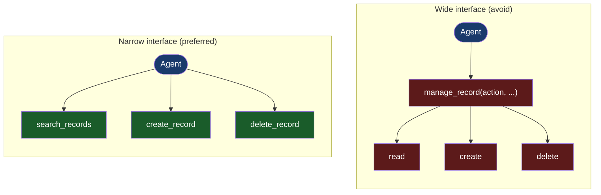

# G02 — Narrow Tool Interface

**Status:** stable
**Related families:** F — Harness, J — Security
**Also see:** [G01 — Typed/Schema-Constrained Tool](G01-typed-schema-constrained-tool.md) | [G03 — Tool Gateway](G03-tool-gateway.md) | [G05 — Read/Write Separation](G05-read-write-separation.md)

---

## Problem

A tool with many responsibilities or a `mode`/`action` multiplexer forces the model to reason about internal routing that the schema cannot express. The model must choose the correct mode, pass the correct parameters for that mode, and ignore parameters that are irrelevant — all without any schema guidance. This produces high rates of incorrect invocations, silent no-ops, and parameter confusion.

## Context

Applies when designing any tool that could be tempted to do more than one thing. Especially relevant when:
- An existing API endpoint handles multiple operations via a `type` or `action` discriminator
- Multiple tools share a parameter name with different semantics
- The tool set is growing and new operations keep being added to existing tools

## Solution

Give each tool exactly one responsibility. Define its parameters only for that one operation. If a resource supports read, create, update, and delete — those are four tools, not one tool with an `action` parameter. Name tools with a consistent verb-noun convention (`search_records`, `create_record`, `delete_record`) so the model can reason about intent without reading documentation.

## Structure

<details>
<summary><b>Narrow vs. Wide Tool Interface</b></summary>



</details>

## Implementation Notes

- One tool, one verb. If you find yourself adding an `action` or `mode` parameter, split the tool.
- Verb-noun naming: `search_`, `get_`, `create_`, `update_`, `delete_`, `list_`. Avoid generic names like `run`, `execute`, `call`.
- Parameters that only apply in some modes are a design smell — they signal a tool that should be split.
- Narrow interfaces reduce context-window pressure: each tool description is shorter, more focused, and easier for the model to match to intent.
- When wrapping an underlying API that uses a discriminator, create one tool per discriminator value and map internally — do not expose the discriminator to the model.
- Narrow does not mean anemic: a tool may accept several parameters as long as all of them are relevant to its single responsibility.

## Forces & Tradeoffs

| Force | Tension |
|-------|---------|
| Narrow tools are easier to reason about | More tools in the catalog; discovery requires G09 Progressive Exposure |
| Single responsibility means cleaner schemas | Some operations are genuinely coupled; forcing a split creates awkward call sequences |
| Verb-noun names are self-documenting | Name collisions become possible in large tool sets; namespacing helps |
| Splitting by operation makes auditing easier | More tools means more surface area to maintain |

## Examples

```
// pseudocode — narrow tool set for a record resource

tool search_records {
  parameters: { query: string, status: enum["active","archived"], limit: integer }
}

tool get_record {
  parameters: { record_id: string }
}

tool create_record {
  parameters: { title: string, owner_id: string, tags: string[] }
}

tool delete_record {
  parameters: { record_id: string }
  // requires Tool Gate (G06) before execution
}

// NOT:
// tool manage_record { action: enum["search","get","create","delete"], ... }
```

## Verification

- Each tool in the set has exactly one verb in its name.
- No tool has a parameter named `action`, `mode`, `type`, or `operation` that routes to different behaviors.
- Tool descriptions are ≤ 100 words each.
- A developer unfamiliar with the system can identify a tool's purpose from its name alone.

## Related Patterns

- [G01 — Typed/Schema-Constrained Tool](G01-typed-schema-constrained-tool.md) — narrow interfaces have smaller parameter sets that are easier to constrain fully
- [G03 — Tool Gateway](G03-tool-gateway.md) — a gateway can enforce narrowness as a policy across all registered tools
- [G05 — Read/Write Separation](G05-read-write-separation.md) — the most important application of narrowness: read and write are always separate tools
- [G09 — Tool Discovery/Progressive Exposure](G09-tool-discovery-progressive-exposure.md) — narrow tool sets benefit from progressive exposure to avoid overwhelming context

## Sources

- **AWS Prescriptive Guidance** — Amazon Web Services architecture team; defines tool gate and narrow tool interface patterns. [Tool Scope / MCP Strategy](https://docs.aws.amazon.com/prescriptive-guidance/latest/mcp-strategies/mcp-tool-strategy-scope.html) | [Agentic AI Patterns](https://docs.aws.amazon.com/prescriptive-guidance/latest/agentic-ai-patterns/agent-patterns.html)
- **Anthropic Engineering** — AI safety company; authors of Claude. [Building Effective Agents](https://www.anthropic.com/engineering/building-effective-agents)
- **Microsoft Azure Architecture Center** — Microsoft's cloud architecture team. [AI Agent Design Patterns](https://learn.microsoft.com/en-us/azure/architecture/ai-ml/guide/ai-agent-design-patterns)
