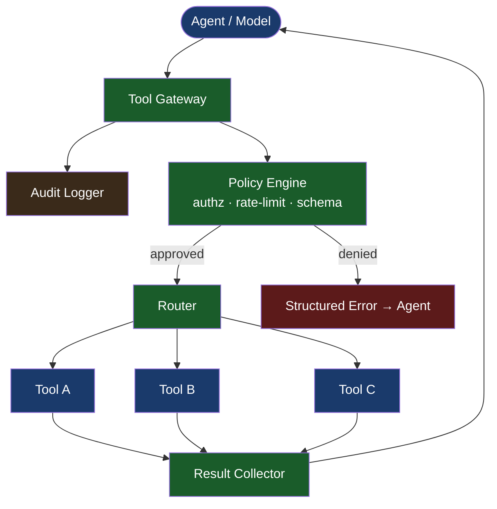

# G03 — Tool Gateway

**Status:** stable
**Related families:** F — Harness, J — Security, H — Deterministic Control
**Also see:** [G01 — Typed/Schema-Constrained Tool](G01-typed-schema-constrained-tool.md) | [G05 — Read/Write Separation](G05-read-write-separation.md) | [G06 — Tool Gate](G06-tool-gate.md)

---

## Problem

When an agent invokes tools directly, there is no central point to enforce policy — auditing, rate-limiting, authentication, schema validation, and access control must be re-implemented in every tool. As the tool set grows, enforcement diverges and gaps appear. A compromised or confused model can invoke any registered tool without any cross-cutting check.

## Context

Applies when:
- An agent has access to more than a handful of tools
- Multiple policies (auth, rate limits, logging, approval) must apply across all tools
- The tool set is shared across multiple agents or agent versions
- Security or compliance requires a tamper-evident audit trail of all tool invocations

## Solution

Place a single gateway component between the model and all tool executors. Every tool call passes through the gateway, which enforces cross-cutting policies before routing to the appropriate tool. The gateway is the only component authorized to invoke tool executors directly. Tools themselves contain no policy logic — they assume the gateway has already validated the call.

## Structure

<details>
<summary><b>Tool Gateway Architecture</b></summary>



</details>

## Implementation Notes

- The gateway must enforce policy, not merely route. A gateway that passes every call through unchanged is just indirection.
- Separate concerns within the gateway: authentication, authorization, schema validation, rate limiting, and logging are distinct stages — implement them as a pipeline, not a monolith.
- Every tool invocation must be logged before execution begins, not after. Log the full parameters (redacting sensitive fields) and the policy decision.
- The gateway should return structured errors — the same format as tool errors — so the model can reason about denials the same way it reasons about tool failures.
- Do not expose the full underlying API surface through the gateway as a pass-through. The gateway should register only the tools appropriate for the current agent context (see G09).
- The gateway is not a substitute for tool-level schema validation (G01). Both layers are necessary: the gateway enforces cross-cutting policy; each tool enforces its own input contract.

## Forces & Tradeoffs

| Force | Tension |
|-------|---------|
| Central enforcement eliminates policy drift | Gateway is a single point of failure; must be highly reliable |
| Unified audit log simplifies compliance | All tool traffic passes through one component — a bottleneck under high load |
| Policy changes apply to all tools at once | Tight coupling: a gateway bug affects every tool simultaneously |
| Enforces least-privilege access | Requires maintaining a mapping of which tools each agent role may invoke |

## Examples

```
// pseudocode — gateway pipeline

function gateway_invoke(agent_context, tool_name, params):
  log_attempt(agent_context, tool_name, redact(params))

  authz_result = policy_engine.check(agent_context.role, tool_name)
  if not authz_result.allowed:
    return { error: "authz_denied", reason: authz_result.reason }

  schema_result = schema_registry.validate(tool_name, params)
  if not schema_result.valid:
    return { error: "validation_failed", field: schema_result.field,
             constraint: schema_result.constraint }

  rate_result = rate_limiter.check(agent_context.id, tool_name)
  if not rate_result.allowed:
    return { error: "rate_limited", retry_after: rate_result.retry_after }

  result = tool_registry.execute(tool_name, params)
  log_result(agent_context, tool_name, result.status)
  return result
```

## Verification

- Invoke a tool that the agent's role is not authorized for — confirm `authz_denied` error.
- Invoke a tool with an invalid parameter — confirm `validation_failed` before tool executor is called.
- Confirm every invocation produces a log entry with timestamp, tool name, agent identity, and decision.
- Bypass attempt: call a tool executor directly (outside the gateway) — confirm the executor rejects calls not originating from the gateway.

## Related Patterns

- [G01 — Typed/Schema-Constrained Tool](G01-typed-schema-constrained-tool.md) — gateway validates schemas; individual tools also enforce their own contracts
- [G05 — Read/Write Separation](G05-read-write-separation.md) — the gateway can enforce that write tools require elevated authorization
- [G06 — Tool Gate](G06-tool-gate.md) — the gateway can intercept destructive calls and route them through a confirmation step
- [G09 — Tool Discovery/Progressive Exposure](G09-tool-discovery-progressive-exposure.md) — the gateway controls which tools are visible in the current context

## Sources

- **AWS Prescriptive Guidance** — Amazon Web Services architecture team; defines tool gate and narrow tool interface patterns. [Agentic AI Patterns](https://docs.aws.amazon.com/prescriptive-guidance/latest/agentic-ai-patterns/agent-patterns.html)
- **Microsoft Azure Architecture Center** — Microsoft's cloud architecture team. [AI Agent Design Patterns](https://learn.microsoft.com/en-us/azure/architecture/ai-ml/guide/ai-agent-design-patterns)
- **Google Cloud Architecture Center** — Google's cloud architecture team. [Choose a Design Pattern for Agentic AI](https://docs.cloud.google.com/architecture/choose-design-pattern-agentic-ai-system)
