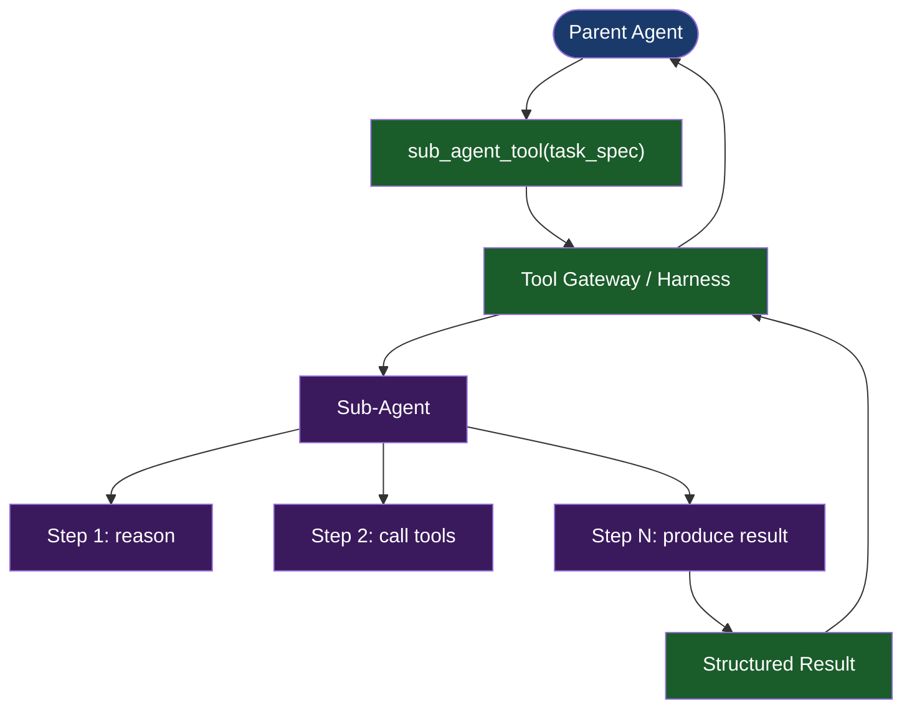

# G04 — Agent-as-Tool

**Status:** stable
**Related families:** F — Harness, H — Deterministic Control
**Also see:** [G02 — Narrow Tool Interface](G02-narrow-tool-interface.md) | [G03 — Tool Gateway](G03-tool-gateway.md)

---

## Problem

When a parent agent needs to delegate a complex subtask to a sub-agent, invoking the sub-agent inline as a function call provides no interface contract. The parent cannot reason about the sub-agent's latency, failure modes, or output shape. Error handling is ad hoc. The sub-agent's internal reasoning loop is exposed to the parent's context window, polluting it with intermediate steps.

## Context

Applies when:
- A subtask requires multi-step reasoning, tool use, or specialized capability that the parent agent should not perform inline
- The sub-agent may take variable time or may fail and need to be retried
- The parent must remain responsive (orchestrating, not blocked) while the subtask runs
- The same sub-agent capability is reused across multiple parent agents or contexts

Use only when intelligent branching is actually necessary inside the sub-agent. If the task is a simple deterministic computation, use a regular tool (G07) instead.

## Solution

Wrap the sub-agent behind a tool interface. The parent calls a tool with a well-defined input schema and receives a structured result. The sub-agent's internal loop, tool calls, and intermediate outputs are hidden behind this interface. The tool description tells the parent what the sub-agent does, what inputs it needs, and what shape of result it returns — not how it achieves the result.

## Structure

<details>
<summary><b>Agent-as-Tool Boundary</b></summary>



</details>

## Implementation Notes

- The tool schema for a sub-agent should describe the task in terms of inputs and outputs, not internal steps. Example: `{ task: string, context: object, max_steps: integer }`.
- Sub-agent results must be structured and bounded. Return a typed result object, not a free-text dump of the sub-agent's scratchpad.
- Implement a timeout at the tool boundary. The parent should receive a `{ error: "timeout" }` after a reasonable deadline, not block indefinitely.
- Sub-agent failures are tool failures: return a structured error that the parent can act on (retry, escalate, fall back).
- The parent agent should not need to know which model or version powers the sub-agent — that is an implementation detail hidden by the interface.
- Avoid nesting more than two layers of agent-as-tool without a strong architectural reason; deep nesting makes failure tracing and latency management difficult.
- Only use agent-as-tool when the sub-agent genuinely needs to branch, reason, and use tools dynamically. If the subtask is deterministic, use a regular deterministic tool (G07).

## Forces & Tradeoffs

| Force | Tension |
|-------|---------|
| Clean interface hides complexity | Interface design takes upfront thought; wrong abstractions are expensive to change |
| Sub-agent can use its own tool set independently | Harder to debug when the sub-agent fails — its internal trace is hidden |
| Parent stays uncluttered by sub-agent reasoning | Less visibility; may need separate observability instrumentation |
| Reusable across multiple parent agents | Sub-agent must be general enough; specialization adds proliferation |
| Enables parallel sub-agent execution | Parallel agents require coordination and result merging logic |

## Examples

```
// pseudocode — parent agent calls sub-agent as a tool

tool research_topic {
  description: "Delegates deep research on a topic to a specialized research agent.
                Returns a structured summary with key findings and sources."
  parameters: {
    topic:      string          // the research question
    depth:      enum["brief", "detailed"]
    max_steps:  integer, default=10
  }
  returns: {
    summary:    string
    findings:   Finding[]
    confidence: float           // 0.0–1.0
    error?:     string
  }
}

// parent agent loop:
result = call_tool("research_topic", { topic: user_query, depth: "detailed" })
if result.error:
  handle_failure(result.error)
else:
  use_findings(result.findings)
```

## Verification

- The parent agent's context window does not contain the sub-agent's intermediate reasoning steps.
- Sub-agent timeout returns a structured `{ error: "timeout" }`, not an exception.
- The same sub-agent tool can be called by a different parent agent without modification.
- Sub-agent result is a typed object — no free-text prose that the parent must re-parse.

## Related Patterns

- [G02 — Narrow Tool Interface](G02-narrow-tool-interface.md) — the agent-as-tool interface should itself be narrow: one sub-agent per specialized capability
- [G03 — Tool Gateway](G03-tool-gateway.md) — the gateway can enforce timeout, auth, and rate-limiting on sub-agent tool calls
- [G07 — Deterministic Tool Execution](G07-deterministic-tool-execution.md) — prefer deterministic tools over agent-as-tool when branching logic is not needed
- [G08 — Tool Result Validation](G08-tool-result-validation.md) — sub-agent results must be validated before re-entering the parent's context

## Sources

- **Anthropic Engineering** — AI safety company; authors of Claude. [Building Effective Agents](https://www.anthropic.com/engineering/building-effective-agents)
- **AWS Prescriptive Guidance** — Amazon Web Services architecture team; defines tool gate and narrow tool interface patterns. [Agentic AI Patterns](https://docs.aws.amazon.com/prescriptive-guidance/latest/agentic-ai-patterns/agent-patterns.html)
- **OpenAI Engineering** — AI research company; authors of GPT and Codex. [A Practical Guide to Building AI Agents](https://openai.com/business/guides-and-resources/a-practical-guide-to-building-ai-agents/)
