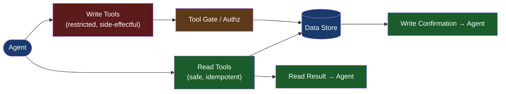

# G05 — Read/Write Separation

**Status:** stable
**Related families:** J — Security, F — Harness
**Also see:** [G02 — Narrow Tool Interface](G02-narrow-tool-interface.md) | [G06 — Tool Gate](G06-tool-gate.md) | [G03 — Tool Gateway](G03-tool-gateway.md)

---

## Problem

When a single tool can both read state and mutate it, the model cannot express read intent without risking a write. A query that the model intends as exploratory may silently trigger a side effect. Auditing becomes impossible — every call to the tool is a potential mutation. Access control cannot distinguish read-only consumers from write-authorized actors.

## Context

Applies to any tool that touches persistent state: databases, file systems, message queues, external APIs, configuration stores. Especially critical when:
- The same data resource is accessed by multiple agents with different privilege levels
- Audit trails or compliance requirements apply to mutations
- The model needs to explore or confirm state before deciding whether to act

## Solution

Define separate tools for read operations and mutating operations. No single tool call may both return data and change state. Read tools are always safe to call — they are idempotent, produce no side effects, and may be exposed more broadly. Write tools are restricted, require schema validation (G01), and may require a gate (G06) before execution.

## Structure

<details>
<summary><b>Read/Write Tool Separation</b></summary>



</details>

## Implementation Notes

- Naming convention makes the split visible: `get_*`, `list_*`, `search_*` for reads; `create_*`, `update_*`, `delete_*`, `send_*` for writes.
- Read tools should be callable with no consequences for the caller — no rate limits on reads that would prevent exploration, no audit log entries that suggest mutation.
- Write tools should produce a structured confirmation result that the model can inspect: `{ success: true, affected_id: "...", timestamp: "..." }`.
- Apply the principle of least privilege through the gateway (G03): read-only agent roles receive only the read tool set.
- Never add an optional `dry_run` parameter to a write tool as a substitute for separation. Dry-run parameters are forgotten by the model; separate read tools are structurally enforced.
- If a workflow requires read-then-write, design it as two sequential tool calls. The model's reasoning between the calls is the explicit confirmation that a write is intended.

## Forces & Tradeoffs

| Force | Tension |
|-------|---------|
| Read safety enables free exploration | More tools in the catalog; pairing read and write tools for each resource doubles the count |
| Structural separation enforces intent | Some APIs expose combined read-modify-write atomically; wrapping these requires extra care |
| Access control becomes straightforward | Read-only roles require the gateway to filter the tool set dynamically |
| Audit trail for writes is clean | Requires discipline when an operation is genuinely a query that also increments a counter |

## Examples

```
// pseudocode — separated tool set for a document resource

// READ (safe to call freely)
tool get_document {
  parameters: { document_id: string }
  returns:    { id, title, content, status, created_at }
}

tool list_documents {
  parameters: { status: enum["draft","published"], limit: integer }
  returns:    Document[]
}

// WRITE (restricted, logged, may require gate)
tool create_document {
  parameters: { title: string, content: string, owner_id: string }
  returns:    { id: string, created_at: string }
}

tool update_document {
  parameters: { document_id: string, title?: string, content?: string }
  returns:    { id: string, updated_at: string }
}

tool delete_document {
  parameters: { document_id: string }
  // always requires Tool Gate (G06) before execution
}

// NOT:
// tool manage_document { action: enum["get","list","create","update","delete"], ... }
```

## Verification

- Every tool in the catalog is classifiable as read or write with no ambiguity.
- Calling every read tool in sequence produces no observable state change in the data store.
- A read-only agent role cannot invoke any write tool (confirmed via the gateway's authz check).
- Write tool confirmation results include a structured record of what changed (affected ID, timestamp).

## Related Patterns

- [G02 — Narrow Tool Interface](G02-narrow-tool-interface.md) — read/write separation is the most critical application of narrowness
- [G03 — Tool Gateway](G03-tool-gateway.md) — the gateway enforces that write tools require elevated authorization
- [G06 — Tool Gate](G06-tool-gate.md) — destructive write tools require a confirmation gate before execution
- [G10 — Idempotent Action Wrapper](G10-idempotent-action-wrapper.md) — write tools should be idempotent; G05 creates the clear surface where G10 applies

## Sources

- **AWS Prescriptive Guidance** — Amazon Web Services architecture team; defines tool gate and narrow tool interface patterns. [Agentic AI Patterns](https://docs.aws.amazon.com/prescriptive-guidance/latest/agentic-ai-patterns/agent-patterns.html) | [Tool Scope / MCP Strategy](https://docs.aws.amazon.com/prescriptive-guidance/latest/mcp-strategies/mcp-tool-strategy-scope.html)
- **Anthropic Engineering** — AI safety company; authors of Claude. [Building Effective Agents](https://www.anthropic.com/engineering/building-effective-agents)
- **Microsoft Azure Architecture Center** — Microsoft's cloud architecture team. [AI Agent Design Patterns](https://learn.microsoft.com/en-us/azure/architecture/ai-ml/guide/ai-agent-design-patterns)
