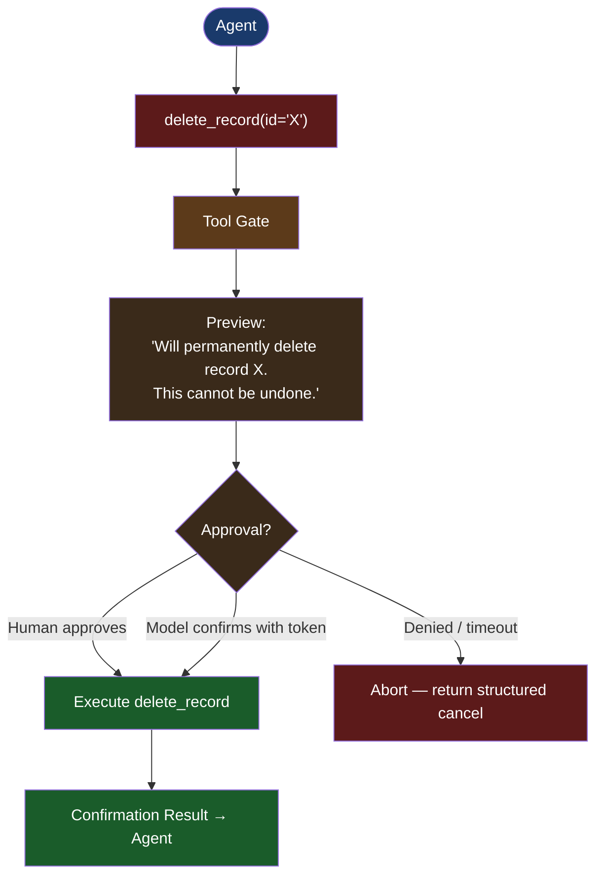

# G06 — Tool Gate

**Status:** stable
**Related families:** J — Security, H — Deterministic Control, F — Harness
**Also see:** [G03 — Tool Gateway](G03-tool-gateway.md) | [G05 — Read/Write Separation](G05-read-write-separation.md) | [G10 — Idempotent Action Wrapper](G10-idempotent-action-wrapper.md)

---

## Problem

Destructive or irreversible actions — deleting records, sending messages, transferring funds, provisioning infrastructure — can be triggered by a single hallucinated or misunderstood parameter. By the time the error is detected, the action has already occurred and cannot be undone. The model's confidence is not correlated with correctness; high-confidence wrong calls are common.

## Context

Applies to any tool that produces irreversible or difficult-to-reverse side effects:
- Deletions (data, resources, accounts)
- External communications (emails, notifications, webhooks)
- Financial operations (payments, transfers)
- Infrastructure mutations (deploys, configuration changes, permission grants)
- Bulk operations affecting many records at once

The gate is not needed for read operations or for clearly reversible writes (e.g., creating a draft that can be discarded).

## Solution

Insert a mandatory confirmation step between the model's decision to act and actual execution. When the model calls a gated tool, the system returns a confirmation request — a structured preview of what will happen — rather than executing immediately. Execution only proceeds when an explicit confirmation signal is provided: either from a human approver or from the model re-invoking the tool with a confirmed intent token. The gate is enforced by the harness or gateway, not by the tool itself.

## Structure

<details>
<summary><b>Tool Gate Confirmation Flow</b></summary>



</details>

## Implementation Notes

- The gate preview must describe the action in plain language, not just echo parameters. "Will permanently delete record X owned by user Y, created 2024-01-15" is more useful than `{ id: "X" }`.
- Gated tools should return a structured preview object on first call and execute on confirmation — not accept a boolean `confirmed: true` parameter (which the model can hallucinate).
- Use a short-lived confirmation token with a TTL (e.g., 60 seconds) to prevent stale approvals from executing much later.
- Log both the gate trigger and the approval/denial decision as separate audit entries.
- The gate enforces that a human is in the loop for actions beyond a defined risk threshold. Define thresholds explicitly: e.g., any deletion, any bulk operation over N records, any external communication.
- For fully automated pipelines where human approval is not available, the model must provide a structured re-confirmation with explicit acknowledgment of the irreversibility — never a pass-through.
- Bulk operations require the gate to show scope: "Will delete 47 records matching status=archived" — never "will delete records."

## Forces & Tradeoffs

| Force | Tension |
|-------|---------|
| Prevents irreversible mistakes | Adds a round-trip latency to every gated action; slows automated pipelines |
| Humans can catch model errors before execution | Not all pipelines have a human in the loop; fully automated agents need an alternative |
| Gate previews surface implicit assumptions | Preview generation requires the tool to compute the impact before acting — extra work |
| Explicit audit trail of approvals | Approval fatigue: too many gates and users approve without reading |

## Examples

```
// pseudocode — two-phase gated delete

// Phase 1: model calls delete_record
tool delete_record {
  parameters: { record_id: string, confirm_token?: string }
}

// Gate intercepts first call (no confirm_token):
// Returns:
{
  status:       "pending_confirmation",
  preview:      "Will permanently delete record 'Q3 Report' (id: abc123), owned by alice@...",
  confirm_token: "tok_7f3a...",  // expires in 60s
  expires_at:    "2024-01-15T14:00:00Z"
}

// Phase 2: human or model re-invokes with token
delete_record({ record_id: "abc123", confirm_token: "tok_7f3a..." })
// Now executes; returns:
{ status: "deleted", id: "abc123", deleted_at: "2024-01-15T13:59:55Z" }

// If model calls without token again after timeout:
{ error: "confirmation_expired", retry: true }
```

## Verification

- Call a gated tool without a confirmation token — confirm execution does not occur and a preview is returned.
- Call with an expired token — confirm `confirmation_expired` error and no execution.
- Call with a valid token — confirm execution occurs and produces a structured result.
- Attempt to call a non-gated tool through the gate flow — confirm normal (non-gated) execution.
- Check audit log: gate trigger and approval decision are separate log entries.

## Related Patterns

- [G03 — Tool Gateway](G03-tool-gateway.md) — the gateway intercepts gated tool calls and routes them through the gate flow
- [G05 — Read/Write Separation](G05-read-write-separation.md) — gates apply only to write tools; separation makes gatable tools easy to identify
- [G10 — Idempotent Action Wrapper](G10-idempotent-action-wrapper.md) — even gated tools benefit from idempotency to handle re-confirmations safely

## Sources

- **AWS Prescriptive Guidance** — Amazon Web Services architecture team; defines tool gate and narrow tool interface patterns. [Agentic AI Patterns](https://docs.aws.amazon.com/prescriptive-guidance/latest/agentic-ai-patterns/agent-patterns.html)
- **Anthropic Engineering** — AI safety company; authors of Claude. [Building Effective Agents](https://www.anthropic.com/engineering/building-effective-agents)
- **OpenAI Engineering** — AI research company; authors of GPT and Codex. [A Practical Guide to Building AI Agents](https://openai.com/business/guides-and-resources/a-practical-guide-to-building-ai-agents/)
