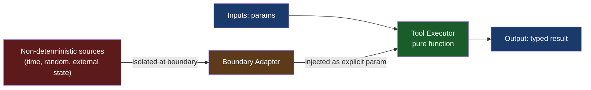

# G07 — Deterministic Tool Execution

**Status:** stable
**Related families:** H — Deterministic Control, F — Harness
**Also see:** [G01 — Typed/Schema-Constrained Tool](G01-typed-schema-constrained-tool.md) | [G04 — Agent-as-Tool](G04-agent-as-tool.md) | [G08 — Tool Result Validation](G08-tool-result-validation.md)

---

## Problem

When tool execution is non-deterministic — varying results for the same inputs due to hidden state, ambient globals, random sampling, or time-dependent behavior — the agent cannot reason reliably about what a tool call will produce. Retries on failure produce different results, making debugging impossible. Reproducibility is lost; the same agent run with the same inputs produces different outcomes.

## Context

Applies to all tools in an agent system. Especially critical when:
- Tools are retried on failure (non-determinism causes retries to silently diverge)
- Results are compared or cached across runs
- Debugging requires trace reproducibility
- Compliance requires that the same input always produces the same auditable output

## Solution

Tool execution must be a pure function of its inputs. Given the same parameters, a tool produces the same result. Eliminate hidden state, ambient globals, random seeds, and time-dependent behavior from tool logic. Where a tool must interact with inherently non-deterministic external systems (e.g., a live API), isolate and document the non-determinism at the boundary — never let it leak into the tool's core logic.

## Structure

<details>
<summary><b>Deterministic Tool Execution Model</b></summary>



</details>

## Implementation Notes

- No ambient globals: tool logic must not read from global mutable state, environment variables that change between calls, or thread-local storage that the caller did not set.
- No hidden randomness: if a tool needs randomness (e.g., generating an ID), accept the seed as a parameter or use a deterministic ID scheme (UUIDv5, hash-based).
- No implicit time: if a tool's behavior depends on the current time, accept a `timestamp` parameter. Never call `now()` inside tool logic.
- External calls are the primary source of non-determinism. Isolate them: wrap the external call in an adapter, inject the adapter as a dependency, and mock it in tests.
- Errors must also be deterministic: the same invalid input must produce the same typed error every time — not different error messages depending on which server handled the request.
- This pattern does not forbid tools that call external services. It requires that the tool's own logic be deterministic given what the external service returns.
- Prefer deterministic tools over agent-as-tool (G04) when the task does not require dynamic reasoning. A deterministic tool is always cheaper, faster, and more debuggable.

## Forces & Tradeoffs

| Force | Tension |
|-------|---------|
| Reproducibility enables debugging | Injecting time and randomness as parameters requires callers to manage these |
| Determinism enables caching and memoization | Caching is only safe if the tool is truly deterministic; false determinism causes stale cache hits |
| Tests are reliable | External dependencies must be mockable; requires dependency injection discipline |
| Non-determinism is isolated at the boundary | Boundary adapters add indirection; more code to maintain |

## Examples

```
// pseudocode — deterministic vs. non-deterministic tool

// NON-DETERMINISTIC (avoid):
tool create_record {
  parameters: { title: string, owner_id: string }
  body:
    id = random_uuid()           // hidden non-determinism
    now = current_timestamp()    // ambient time
    db.insert({ id, title, owner_id, created_at: now })
    return { id, created_at: now }
}

// DETERMINISTIC (preferred):
tool create_record {
  parameters: {
    title:      string
    owner_id:   string
    idempotency_key: string      // caller provides; deterministic ID generation
    created_at: timestamp        // caller provides; no ambient time
  }
  body:
    id = deterministic_id(idempotency_key)  // hash-based, reproducible
    db.insert({ id, title, owner_id, created_at })
    return { id, created_at }
}
```

## Verification

- Call the tool with the same parameters twice — confirm identical results (or confirm the non-determinism is documented and isolated to an explicit boundary).
- Remove all ambient globals from the tool's execution environment and confirm it still functions correctly.
- Inject a mock for all external service calls — confirm the tool's logic is fully testable in isolation.
- Check that error messages for the same invalid input are identical across multiple calls.

## Related Patterns

- [G01 — Typed/Schema-Constrained Tool](G01-typed-schema-constrained-tool.md) — schema constraints eliminate one class of non-determinism (varying behavior based on input type)
- [G04 — Agent-as-Tool](G04-agent-as-tool.md) — use deterministic tools in preference to agent-as-tool whenever branching logic is not needed
- [G08 — Tool Result Validation](G08-tool-result-validation.md) — deterministic outputs are easier to validate; validation failures indicate a contract breach
- [G10 — Idempotent Action Wrapper](G10-idempotent-action-wrapper.md) — determinism is a prerequisite for idempotency: same inputs must produce same effects

## Sources

- **AWS Prescriptive Guidance** — Amazon Web Services architecture team; defines tool gate and narrow tool interface patterns. [Agentic AI Patterns](https://docs.aws.amazon.com/prescriptive-guidance/latest/agentic-ai-patterns/agent-patterns.html)
- **Anthropic Engineering** — AI safety company; authors of Claude. [Building Effective Agents](https://www.anthropic.com/engineering/building-effective-agents)
- **Google Cloud Architecture Center** — Google's cloud architecture team. [Choose a Design Pattern for Agentic AI](https://docs.cloud.google.com/architecture/choose-design-pattern-agentic-ai-system)
