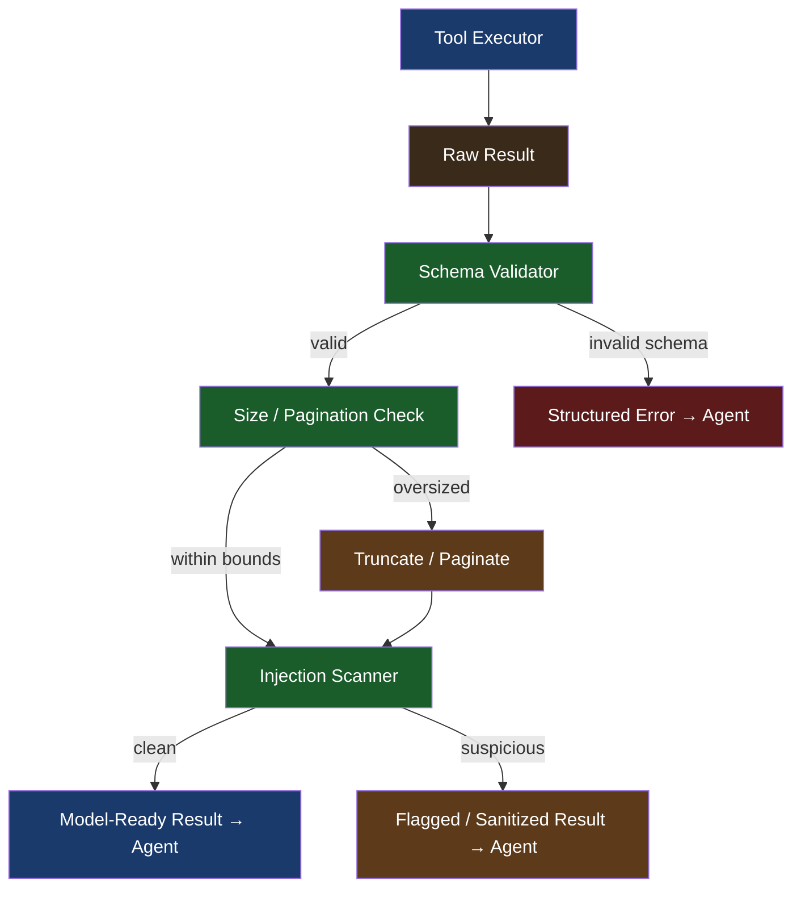

# G08 — Tool Result Validation

**Status:** stable
**Related families:** O — Output, H — Deterministic Control, F — Harness
**Also see:** [G01 — Typed/Schema-Constrained Tool](G01-typed-schema-constrained-tool.md) | [G07 — Deterministic Tool Execution](G07-deterministic-tool-execution.md)

---

## Problem

When tool output re-enters the model's context window without validation, malformed or unexpected results propagate silently. The model treats the tool's output as ground truth and reasons on top of it — hallucinating plausible interpretations of garbage data, or accepting a poisoned result injected via an adversarial external source (prompt injection). Errors that should have been caught at the boundary instead corrupt all downstream reasoning.

## Context

Applies whenever a tool returns a result that will be used as input to further model reasoning. Especially critical when:
- Tools call external services or read from external data sources (highest injection risk)
- Tool results are large and the model may selectively attend to portions
- Results are chained — the output of one tool is passed as input to the next
- The tool may fail partially (returns a partial result alongside an error)

## Solution

Validate every tool result against a declared output schema before it is returned to the model. Reject results that do not conform. Truncate or paginate results that exceed a size bound. Strip or escape content that contains model-directive patterns (prompt injection). Return a typed, bounded, validated result — or a structured error — never raw unvalidated output.

## Structure

<details>
<summary><b>Tool Result Validation Pipeline</b></summary>



</details>

## Implementation Notes

- Declare an output schema for every tool, not just an input schema. The output schema is the contract the tool makes with the model.
- Enforce a maximum token budget for tool results. Results that exceed the budget must be paginated, summarized, or truncated — never passed in full to a context window that cannot handle them.
- Injection scanning: look for model-directive patterns in externally-sourced content (`ignore previous instructions`, `system:`, `<|im_start|>`, etc.). Flag or strip these before the result enters the context.
- Partial results from failed tools must be clearly marked: `{ status: "partial", data: [...], error: "fetch_timeout", missing_fields: ["owner"] }`. Never return a partial result that looks like a complete one.
- Type coercion during validation is dangerous: a result that passes only after coercion is a contract violation. Return a validation error and let the caller decide.
- Validation should run in the harness or gateway layer, not inside the tool itself. The tool returns raw output; the harness validates before forwarding.

## Forces & Tradeoffs

| Force | Tension |
|-------|---------|
| Validation prevents downstream corruption | Every tool needs an output schema — schema maintenance burden |
| Size bounds protect context windows | Truncation may lose information the model needed; pagination adds round trips |
| Injection scanning reduces attack surface | Scanner false positives may strip legitimate content |
| Typed errors enable model self-correction | Structured errors consume context tokens; terse errors may not give enough detail |

## Examples

```
// pseudocode — result validation in harness

function validate_tool_result(tool_name, raw_result):
  schema = output_schema_registry.get(tool_name)
  if not schema:
    return { error: "no_output_schema", tool: tool_name }

  validation = schema.validate(raw_result)
  if not validation.valid:
    return { error: "output_schema_violation", field: validation.field,
             expected: validation.expected, got: validation.got }

  if token_count(raw_result) > MAX_RESULT_TOKENS:
    raw_result = paginate(raw_result, page=0, page_size=MAX_RESULT_TOKENS)
    raw_result._truncated = true
    raw_result._next_page = 1

  raw_result = injection_scanner.sanitize(raw_result)

  return raw_result

// output schema example for search_records:
output_schema search_records {
  results:  Record[]  // typed, not object[]
  total:    integer
  page:     integer
  has_more: boolean
}
```

## Verification

- Inject a malformed result (missing required field) — confirm the model receives a validation error, not the malformed result.
- Inject an oversized result — confirm the model receives a paginated or truncated result, not the full payload.
- Inject a result containing a prompt injection pattern — confirm the pattern is stripped or the result is flagged before reaching the model.
- Call a tool that succeeds — confirm the result passes validation and reaches the model unmodified.

## Related Patterns

- [G01 — Typed/Schema-Constrained Tool](G01-typed-schema-constrained-tool.md) — G01 validates inputs; G08 validates outputs — both boundaries must be validated
- [G07 — Deterministic Tool Execution](G07-deterministic-tool-execution.md) — deterministic tools produce consistent outputs that are easier to validate
- [G04 — Agent-as-Tool](G04-agent-as-tool.md) — sub-agent results must be validated before re-entering the parent's context; G08 applies at the agent-as-tool boundary too

## Sources

- **Anthropic Engineering** — AI safety company; authors of Claude. [Building Effective Agents](https://www.anthropic.com/engineering/building-effective-agents)
- **AWS Prescriptive Guidance** — Amazon Web Services architecture team; defines tool gate and narrow tool interface patterns. [Agentic AI Patterns](https://docs.aws.amazon.com/prescriptive-guidance/latest/agentic-ai-patterns/agent-patterns.html)
- **OpenAI Engineering** — AI research company; authors of GPT and Codex. [Harness Engineering](https://openai.com/index/harness-engineering/)
