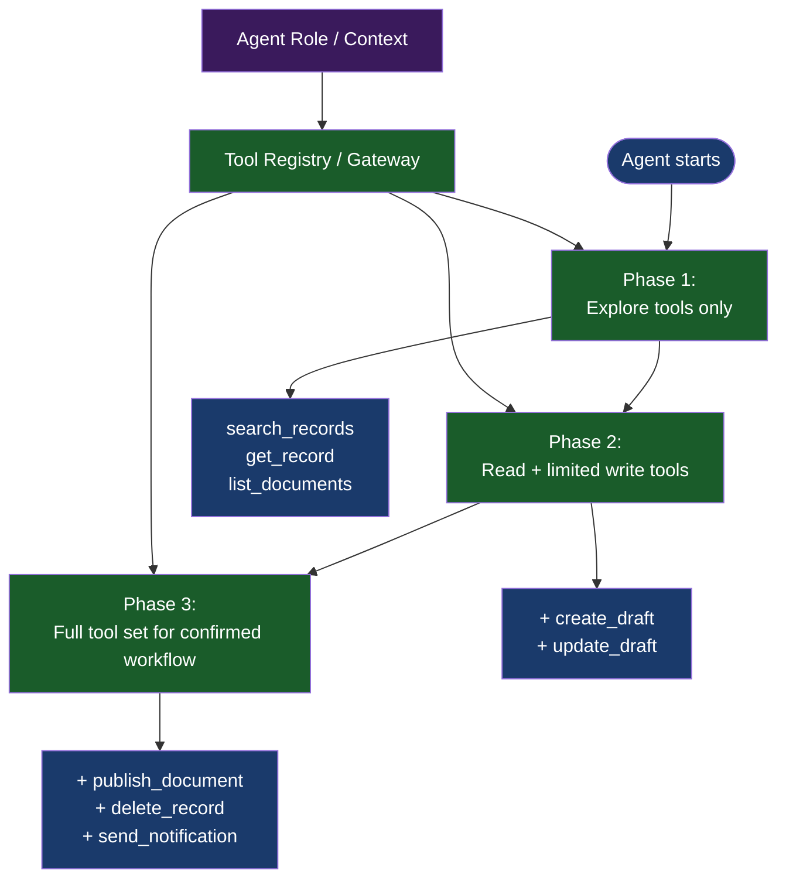

# G09 — Tool Discovery / Progressive Exposure

**Status:** stable
**Related families:** F — Harness, H — Deterministic Control
**Also see:** [G02 — Narrow Tool Interface](G02-narrow-tool-interface.md) | [G03 — Tool Gateway](G03-tool-gateway.md)

---

## Problem

When all tools are exposed to the model simultaneously, the context window fills with tool descriptions that are irrelevant to the current task. The model picks the wrong tool by proximity — choosing the closest-named tool rather than the correct one. Large tool sets overwhelm the model's attention, increase latency, and raise cost without improving capability. In security-sensitive systems, exposing all tools at all times also leaks capability to contexts where it should not be available.

## Context

Applies when:
- The total tool set contains more than a handful of tools (typically more than ~10)
- Tools have different relevance depending on task phase or user role
- Some tools are dangerous and should only be visible when a specific workflow has been entered
- The system serves multiple agent roles with different capability profiles

## Solution

Reveal tools incrementally to match capability to context. At any given moment, expose only the tools relevant to the current task phase, user role, and workflow state. As the agent progresses through a workflow, new tools are unlocked and irrelevant tools are removed from the context. The mechanism for deciding which tools to expose is separate from the tools themselves — it lives in the harness or gateway.

## Structure

<details>
<summary><b>Progressive Tool Exposure by Workflow Phase</b></summary>



</details>

## Implementation Notes

- Tool exposure is a function of: (1) agent role, (2) current workflow phase, (3) confirmed context (e.g., a user has started a deletion workflow). Maintain this state in the harness, not in the model's context.
- Write tool descriptions for the model, not the developer. A description should say what the tool does in the context of the current task, not what the underlying API endpoint does.
- Avoid exposing more than 10–15 tools simultaneously. If the task genuinely requires more, use a meta-tool or tool discovery tool that lets the model search the catalog.
- A tool discovery tool is itself a read-only, narrow tool: `find_tools({ task_description: string }) → Tool[]`. It lets the model request relevant tools without seeing all of them at once.
- When a tool is no longer relevant (e.g., the exploration phase is complete), remove it from the tool list rather than keeping it with a note that it should not be used.
- Dangerous tools (delete, send, publish) are exposed only after an explicit workflow entry point — they are not present at the start of a session.

## Forces & Tradeoffs

| Force | Tension |
|-------|---------|
| Smaller tool sets reduce distraction and cost | Requires workflow state management in the harness |
| Contextual exposure improves tool selection accuracy | Agent may need a tool that has not been exposed yet; requires a discovery mechanism |
| Security: dangerous tools invisible until needed | Workflow state must be tamper-resistant; a compromised context could unlock tools prematurely |
| Model cannot pick wrong tool if it cannot see it | Over-restrictive exposure may make the agent unable to complete legitimate tasks |

## Examples

```
// pseudocode — tool registry with context-aware exposure

function get_tools_for_context(agent_role, workflow_state):
  base_tools = ["search_records", "get_record", "list_documents", "find_tools"]

  if agent_role == "editor":
    base_tools += ["create_draft", "update_draft"]

  if workflow_state.phase == "publish_confirmed":
    base_tools += ["publish_document"]

  if workflow_state.phase == "delete_confirmed" and agent_role == "admin":
    base_tools += ["delete_record"]

  return tool_registry.get(base_tools)

// tool discovery tool:
tool find_tools {
  description: "Search the tool catalog for tools relevant to a task.
                Returns tool names and descriptions. Does not execute tools."
  parameters: { task_description: string, limit: integer, default=5 }
  returns: ToolDescription[]
}
```

## Verification

- At session start, confirm dangerous tools (delete, send) are not in the exposed tool list.
- Confirm a non-admin role cannot see admin-only tools, even with a direct request.
- Confirm the `find_tools` discovery tool returns relevant tools for a natural-language query.
- Advance the workflow to a confirmed phase — confirm the relevant tools appear.
- Exit the workflow phase — confirm those tools are removed from the next tool list.

## Related Patterns

- [G02 — Narrow Tool Interface](G02-narrow-tool-interface.md) — narrow tools are easier to manage and expose selectively; wide tools must always be present
- [G03 — Tool Gateway](G03-tool-gateway.md) — the gateway controls which tools are exposed in the current context
- [G05 — Read/Write Separation](G05-read-write-separation.md) — read tools are always safe to expose; write tools are the primary candidates for progressive exposure

## Sources

- **AWS Prescriptive Guidance** — Amazon Web Services architecture team; defines tool gate and narrow tool interface patterns. [Agentic AI Patterns](https://docs.aws.amazon.com/prescriptive-guidance/latest/agentic-ai-patterns/agent-patterns.html) | [Tool Scope / MCP Strategy](https://docs.aws.amazon.com/prescriptive-guidance/latest/mcp-strategies/mcp-tool-strategy-scope.html)
- **Anthropic Engineering** — AI safety company; authors of Claude. [Building Effective Agents](https://www.anthropic.com/engineering/building-effective-agents)
- **OpenAI Engineering** — AI research company; authors of GPT and Codex. [A Practical Guide to Building AI Agents](https://openai.com/business/guides-and-resources/a-practical-guide-to-building-ai-agents/)
