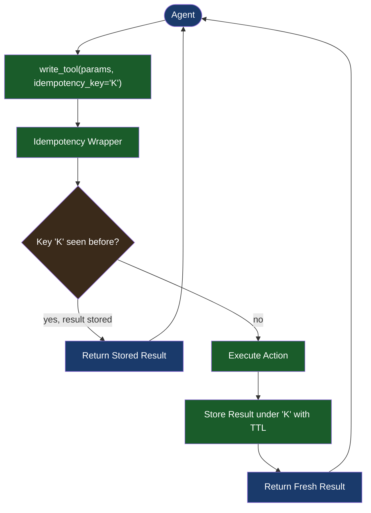

# G10 — Idempotent Action Wrapper

**Status:** stable
**Related families:** H — Deterministic Control, F — Harness
**Also see:** [G06 — Tool Gate](G06-tool-gate.md) | [G07 — Deterministic Tool Execution](G07-deterministic-tool-execution.md) | [G05 — Read/Write Separation](G05-read-write-separation.md)

---

## Problem

Agents retry tool calls on failure. Network timeouts, model loops, and re-planning can cause the same tool to be invoked multiple times with the same intent. If the underlying action is not idempotent — sending an email, charging a card, creating a record — each retry produces an additional side effect. One model hesitation becomes two emails sent, two charges processed, or two records created. The duplicates are often invisible until the damage is discovered downstream.

## Context

Applies to all write tools (G05) where the underlying operation is not naturally idempotent. Especially critical for:
- External communications (email, SMS, webhooks, notifications)
- Financial operations (payments, refunds, transfers)
- Resource creation (database records, infrastructure, accounts)
- Bulk operations (batch writes, scheduled jobs)

Read tools (G05) are naturally idempotent and do not need this pattern.

## Solution

Wrap the action in an idempotency layer. The caller provides an idempotency key with each call. The wrapper records the key and result of the first successful execution. Subsequent calls with the same key return the original result without re-executing the action. The key is short-lived (TTL-based), tied to the agent session or transaction, and deterministically derivable from the operation's intent so the model can reliably produce the same key on retry.

## Structure

<details>
<summary><b>Idempotent Action Wrapper Flow</b></summary>



</details>

## Implementation Notes

- Idempotency key design: the key must be deterministically derivable from the operation's intent, not from a random UUID generated at call time (which changes on retry). Use a hash of: `(session_id, tool_name, primary_params)` — the stable, meaningful parts of the call.
- Key TTL: short enough to expire abandoned operations (e.g., 24 hours), long enough to cover expected retry windows (e.g., not 30 seconds if the agent may pause for an hour).
- Store the full result, not just a success flag. On retry, return the original result — including the original ID, timestamp, and status. The model should not notice the difference between a fresh call and a cached one.
- Failures are not stored. Only successful results are cached. A failed call should be retried with the same key; the wrapper will re-execute.
- The wrapper layer is separate from the tool. The tool itself need not know about idempotency. The wrapper is applied at the harness or gateway level.
- Accept `idempotency_key` as an explicit parameter in the tool schema. This makes the key visible to the caller and the model — it is not hidden infrastructure.
- If the underlying API already supports idempotency keys (e.g., Stripe, many REST APIs), pass through to it. Do not maintain a second layer unless the external layer is insufficient.

## Forces & Tradeoffs

| Force | Tension |
|-------|---------|
| Prevents double-execution on retry | Requires persistent key storage; adds a lookup on every write call |
| Same result on retry keeps model reasoning consistent | Stale cached results may not reflect external state changes |
| Model can retry freely without coordination | Key generation strategy must be correct; wrong keys cause misses or collisions |
| Key expiry prevents unbounded storage growth | Short TTLs cause re-execution when retries span longer than expected |

## Examples

```
// pseudocode — idempotent action wrapper

function idempotent_execute(tool_name, params, idempotency_key, ttl=86400):
  cached = idempotency_store.get(idempotency_key)
  if cached:
    return cached.result  // return stored result, do not re-execute

  result = tool_registry.execute(tool_name, params)

  if result.success:
    idempotency_store.set(
      key    = idempotency_key,
      result = result,
      ttl    = ttl
    )

  return result

// key derivation at call site:
key = hash(session_id + ":" + tool_name + ":" + params.recipient + ":" + params.template_id)
idempotent_execute("send_notification", params, idempotency_key=key)
```

## Verification

- Call the same write tool twice with the same idempotency key — confirm the action executes only once (one email sent, one record created) and both calls return the same result.
- Call with the same key after the TTL expires — confirm re-execution occurs.
- Call with different keys for different operations — confirm both execute independently.
- Simulate a network failure on first call (no result stored) — confirm retry with the same key re-executes successfully.

## Related Patterns

- [G05 — Read/Write Separation](G05-read-write-separation.md) — idempotency applies to write tools; separation makes the boundary clear
- [G06 — Tool Gate](G06-tool-gate.md) — gated tools also benefit from idempotency: a re-confirmation with the same token should not re-execute
- [G07 — Deterministic Tool Execution](G07-deterministic-tool-execution.md) — determinism is a prerequisite: idempotency requires that the same inputs always produce the same storable result

## Sources

- **Anthropic Engineering** — AI safety company; authors of Claude. [Building Effective Agents](https://www.anthropic.com/engineering/building-effective-agents)
- **AWS Prescriptive Guidance** — Amazon Web Services architecture team; defines tool gate and narrow tool interface patterns. [Agentic AI Patterns](https://docs.aws.amazon.com/prescriptive-guidance/latest/agentic-ai-patterns/agent-patterns.html)
- **OpenAI Engineering** — AI research company; authors of GPT and Codex. [A Practical Guide to Building AI Agents](https://openai.com/business/guides-and-resources/a-practical-guide-to-building-ai-agents/)
