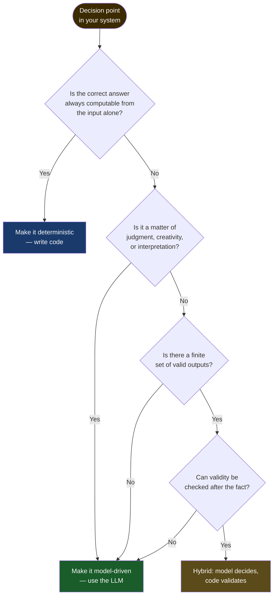

# Guide: Deterministic vs. Model-Driven Decision Guide

## Purpose

Use this guide when designing a new feature or workflow step and deciding: should this decision be made by the model (probabilistic, flexible, judgment-based) or by deterministic code (fixed rules, validators, state machines)? Getting this boundary wrong is one of the most common architectural errors in agent systems.

---

## The Core Principle

> If you can write a function that always gives the correct answer for a given input, do not ask a model to do it. Models are for judgment; code is for rules.

---

## Decision Tree

For each decision point in your agent system, work through this tree.

<b>Deterministic vs. Model-Driven Decision Flow</b>

---

## Classification Matrix

| Characteristic | Deterministic | Model-Driven | Hybrid |
|---|---|---|---|
| Correct answer is computable | Yes | No | Partially |
| Requires understanding natural language | No | Yes | Sometimes |
| Output is from a finite valid set | Yes | Not necessarily | Yes (validated) |
| Failure is a security/safety issue | Use deterministic | Avoid as sole control | Model generates, code validates |
| Performance requirements | Microseconds | Seconds | Model + validator |
| Auditability requirement | Full trace | Probabilistic | Trace the validation |
| Consistency requirement (same input = same output) | Mandatory | Not possible | Validated consistency |

---

## Examples by Category

### Always Deterministic

These should NEVER rely on the model alone, regardless of how well the model seems to handle them in testing.

| Decision | Why Deterministic | Implementation |
|---|---|---|
| Is this user authorized to perform this action? | Security-critical, binary, computable | Auth middleware, RBAC check |
| Does this JSON match the expected schema? | Binary validity, no judgment | JSON Schema validator |
| Has this file been modified since last check? | Computable from filesystem state | File hash comparison |
| Is this request within rate limits? | Counter + threshold, no judgment | Rate limiter |
| Which step comes next in the workflow? | Defined by state machine | State machine transition |
| Does this import violate architectural boundaries? | Rule-based, enumerable | Linter / import checker |
| Is this output valid code? | Parseable = valid | Parser / compiler |

### Always Model-Driven

These should NEVER be fully deterministic — they require judgment that code cannot provide.

| Decision | Why Model-Driven | Implementation |
|---|---|---|
| What is the user asking for? | Natural language understanding | LLM interpretation |
| Which approach best solves this problem? | Requires creativity and trade-off analysis | LLM reasoning |
| Is this explanation clear and helpful? | Subjective quality assessment | LLM evaluation |
| How should this be refactored? | Design judgment | LLM with constraints |
| What additional context is needed? | Situational awareness | LLM meta-reasoning |

### Hybrid (Model + Validation)

The model makes the decision, but code validates the output.

| Decision | Model Part | Validation Part |
|---|---|---|
| Generate a SQL query for this request | LLM writes the SQL | Parser validates syntax; allow-list validates tables |
| Choose which tool to call | LLM picks the tool | Code validates tool exists and parameters match schema |
| Write code to fix this bug | LLM writes the fix | Compiler + tests validate correctness |
| Summarize this document | LLM produces summary | Length validator + fact-checker on key claims |
| Route this request to the right agent | LLM classifies intent | Code validates the target agent exists |

---

## Red Flags: Wrong Boundary

### Signs you made something model-driven that should be deterministic

- You're adding prompt instructions to enforce a binary rule ("NEVER allow unauthorized access")
- The same failure recurs despite repeated prompt fixes
- A failure in this decision is a security or compliance incident
- The "decision" is really a lookup (if X then Y)
- Testing requires checking that the model "usually" gets it right (not always)

### Signs you made something deterministic that should be model-driven

- Your rules have so many exceptions that the rule engine is approaching LLM complexity
- You're maintaining a regex that keeps breaking on new input formats
- Users complain the system is too rigid or misunderstands their intent
- You're building an NLP parser from scratch for something the model handles naturally
- The "correct answer" depends on context that cannot be fully enumerated

---

## Migration Paths

### From model-driven to deterministic (when you discover it should be enforced)

1. Observe that the model fails on this decision in a pattern (not randomly)
2. Confirm the correct answer is always computable from available inputs
3. Write a deterministic check that runs AFTER the model's decision
4. If the check ever disagrees with the model, the check wins
5. Once validated, optionally remove the model from this decision path entirely

### From deterministic to model-driven (when the rules become unmaintainable)

1. Observe that the rule set has grown beyond reasonable maintenance
2. Confirm that failures in this decision are NOT security/safety critical
3. Replace the rule engine with a model call + output validation
4. Keep the most critical rules as hard validators on the model's output
5. Monitor for regression

---

## Related Patterns

- [H01 — Deterministic Override](../patterns/H01-deterministic-override.md) — code overrides model decisions when correctness is provable
- [H02 — Programmatic Gate](../patterns/H02-programmatic-gate.md) — blocking invalid transitions
- [H03 — Structural Test](../patterns/H03-structural-test.md) — verifying structural properties deterministically
- [H05 — Typed Boundary](../patterns/H05-typed-boundary.md) — enforcing types at system boundaries
- [H06 — Schema Validator](../patterns/H06-schema-validator.md) — validating output structure
- [H07 — Authorization Outside Model](../patterns/H07-authorization-outside-model.md) — never trusting the model for auth

---

## Sources

- AWS — [System Design and Security Recommendations](https://docs.aws.amazon.com/prescriptive-guidance/latest/agentic-ai-security/best-practices-system-design.html)
- AWS — [Agent Patterns](https://docs.aws.amazon.com/prescriptive-guidance/latest/agentic-ai-patterns/agent-patterns.html)
- OpenAI — [Harness Engineering](https://openai.com/index/harness-engineering/)
- OWASP — [Top 10 for Agentic Applications 2026](https://genai.owasp.org/resource/owasp-top-10-for-agentic-applications-for-2026/)
