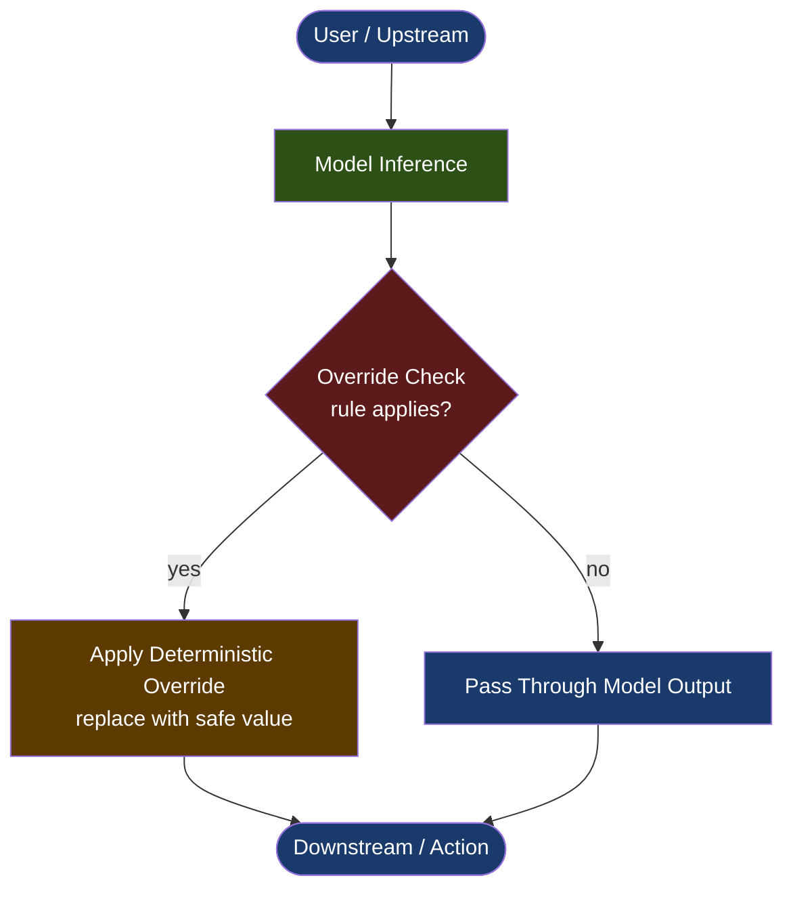

# H01 — Deterministic Override

**One-line summary:** Model output is unconditionally replaced by a code rule when that rule applies.

## Problem

A model may generate plausible-looking output that violates a must-hold rule — wrong status code, out-of-range value, disallowed action. Relying on the prompt to prevent this fails silently: the model may comply most of the time, but "most of the time" is not acceptable for rules that must hold 100%. When a violation occurs there is no crash, no error, just wrong behavior reaching downstream systems.

## Solution

After the model produces output, a deterministic post-processing step inspects the result and substitutes a safe, correct value whenever the rule is violated. The model output is treated as a suggestion; the override layer makes the final decision. No path through the system exists that bypasses the override.

## Solution Structure

<details>
<summary><b>Deterministic Override — control flow</b></summary>



</details>

## When to Use

- A field in model output must always satisfy a hard constraint (range, enum membership, non-null).
- A safety shutoff must engage regardless of what the model says (e.g., rate limit, recursion cap).
- The overriding rule is simple enough to express as a pure function.
- Downstream systems consume model output directly with no further validation layer.

## When NOT to Use

- The rule requires semantic judgment the model is better placed to make.
- The correction is complex enough that applying it blindly may produce incoherent output (use [H02-programmatic-gate](H02-programmatic-gate.md) to block rather than silently replace).
- The override would hide bugs in the model that should be surfaced and fixed.

## Implementation Notes

- Log every override event with the original value and the replacement so violations are visible and measurable.
- Do not silently coerce values that should be errors — distinguish "safe default" overrides from "error" overrides.
- Keep the override function pure and side-effect-free so it can be unit tested in isolation.
- Overrides applied after streaming output begins may be too late; apply before emitting to the caller.
- Chain multiple single-responsibility override rules rather than one monolithic function.

## Related Patterns

- [H02-programmatic-gate](H02-programmatic-gate.md): Gate blocks execution; Override replaces output — use Gate when there is no safe substitute value.
- [H06-schema-validator](H06-schema-validator.md): Schema validation detects violations; Override corrects them — they are complementary.
- [H08-non-ai-fallback-path](H08-non-ai-fallback-path.md): Fallback replaces the entire AI path; Override replaces a field within the AI path.

## Related Families

- [Family D — Verification](../D-verification/README.md): Verification strategies detect invalid output; Override acts on that detection.
- [Family O — Output](../O-output/README.md): Output shaping patterns operate in the same post-inference layer as Override.

## Example

**Before (Prompt-as-Policy anti-pattern):**

```
# prompt fragment
Always return a severity level between 1 and 5.
```

The model returns `severity: 7` on an unusual input. No code catches it. Downstream alert logic misfires.

**After (Deterministic Override):**

```
# pseudocode

function applyOverrides(modelOutput):
    if modelOutput.severity not in [1, 2, 3, 4, 5]:
        log.warn("severity override", original=modelOutput.severity)
        modelOutput.severity = clamp(modelOutput.severity, min=1, max=5)
    return modelOutput

result = callModel(prompt)
result = applyOverrides(result)
emit(result)
```

The override is a pure function, logged, and tested independently of the model.

## Sources

- **AWS Prescriptive Guidance** — Amazon Web Services architecture team; particularly strong on deterministic control patterns. [Agentic AI Patterns](https://docs.aws.amazon.com/prescriptive-guidance/latest/agentic-ai-patterns/agent-patterns.html)
- **OpenAI Engineering** — AI research company; coined harness engineering; advocates enforcing architectural invariants mechanically. [Harness Engineering](https://openai.com/index/harness-engineering/)
- **Anthropic Engineering** — AI safety company; authors of Claude. [Building Effective Agents](https://www.anthropic.com/engineering/building-effective-agents)
