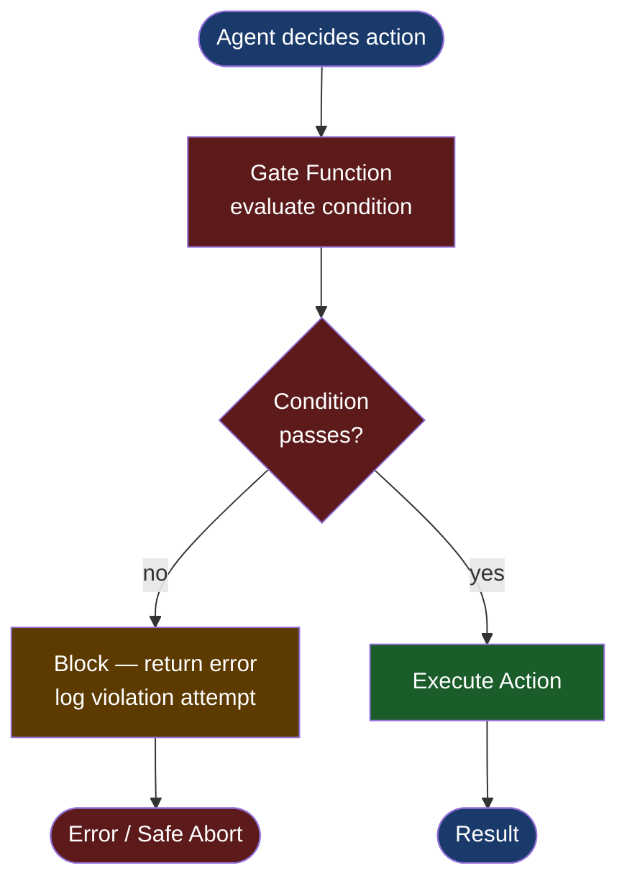

# H02 — Programmatic Gate

**One-line summary:** A hard code check runs before any action is allowed to proceed.

## Problem

An agent may decide to take an action that must never happen under certain conditions — deleting data it does not own, calling an endpoint outside its allowed scope, executing a tool when a quota is exhausted. Asking the model to refuse is probabilistic. A single failure is a security or correctness incident. The model cannot be the last line of defense for actions with irreversible or high-impact consequences.

## Solution

Before every consequential action, a deterministic gate function evaluates a condition. If the condition fails, execution halts — no action is taken, an error is returned, and the model is not consulted. The gate is implemented in code, not in the prompt, and cannot be bypassed by any model output.

## Solution Structure

<details>
<summary><b>Programmatic Gate — control flow</b></summary>



</details>

## When to Use

- The action is irreversible (delete, publish, charge, send).
- The condition can be expressed as a pure Boolean function of available state.
- A quota, rate limit, or resource cap must be enforced.
- The scope of allowed actions is statically or dynamically enumerable.
- A security boundary separates what the agent may touch from what it may not.

## When NOT to Use

- The condition requires semantic judgment that cannot be reduced to a predicate.
- The gate would fire so frequently it degrades usability — reconsider the agent's scope instead.
- The action is fully reversible and the cost of a false positive (blocking a safe action) is high.

## Implementation Notes

- Gates must be evaluated server-side or in trusted code — never in the model's context.
- Violations must be logged with full context (action attempted, calling identity, timestamp) for auditability.
- A gate that throws an uncaught exception is equivalent to no gate — handle errors explicitly.
- Test gates with adversarial inputs, not just happy-path inputs.
- Compose multiple single-concern gates rather than one compound gate — easier to reason about and test.
- When a gate blocks, the error message returned to the model should be informative enough to guide retry, but must not leak internal policy details to untrusted callers.

## Related Patterns

- [H01-deterministic-override](H01-deterministic-override.md): Override replaces output; Gate blocks execution — use Gate when there is no safe substitute.
- [H07-authorization-outside-model](H07-authorization-outside-model.md): Authz checks are a specific subtype of gate focused on identity and permissions.
- [H03-structural-test](H03-structural-test.md): Tests verify gate logic is correct; the gate itself is the runtime enforcement.

## Related Families

- [Family G — Tool Gate](../../G-tool-action-design/README.md): A tool gate is this pattern applied at the tool interface boundary.
- [Family J — Security](../../J-security-trust/README.md): Security threat models identify which conditions require gates.

## Example

**Before (Prompt-as-Policy anti-pattern):**

```
# prompt fragment
Only delete records that belong to the current tenant.
```

A misconfigured context sets the wrong tenant ID. The model deletes records from another tenant. No code catches it.

**After (Programmatic Gate):**

```
# pseudocode

function deleteRecordGate(recordId, callerTenantId):
    record = db.fetch(recordId)
    if record is null:
        raise NotFoundError(recordId)
    if record.tenantId != callerTenantId:
        auditLog.write("gate_blocked", action="delete", recordId=recordId,
                       callerTenant=callerTenantId, ownerTenant=record.tenantId)
        raise ForbiddenError("record does not belong to caller tenant")
    db.delete(recordId)

# Agent tool wrapper
function tool_deleteRecord(args, context):
    deleteRecordGate(args.recordId, context.tenantId)   # gate runs first
```

The gate is a pure function with its own unit tests. The model never sees the tenant ownership logic.

## Sources

- **AWS Prescriptive Guidance** — Amazon Web Services architecture team; particularly strong on deterministic control patterns. [Agentic AI Patterns](https://docs.aws.amazon.com/prescriptive-guidance/latest/agentic-ai-patterns/agent-patterns.html) | [System Design and Security](https://docs.aws.amazon.com/prescriptive-guidance/latest/agentic-ai-security/best-practices-system-design.html)
- **OpenAI Engineering** — AI research company; coined harness engineering; advocates enforcing architectural invariants mechanically. [Harness Engineering](https://openai.com/index/harness-engineering/)
- **Anthropic Engineering** — AI safety company; authors of Claude. [Building Effective Agents](https://www.anthropic.com/engineering/building-effective-agents)
- **Microsoft Azure Architecture Center** — Microsoft's cloud architecture team. [AI Agent Design Patterns](https://learn.microsoft.com/en-us/azure/architecture/ai-ml/guide/ai-agent-design-patterns)
