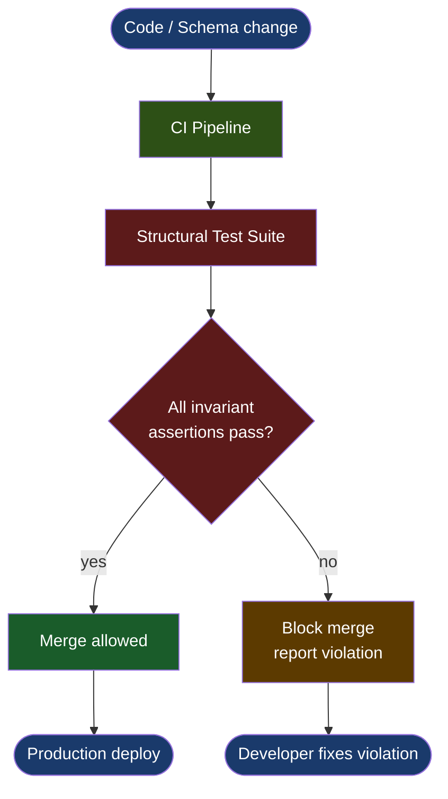

# H03 — Structural Test

**One-line summary:** An automated test asserts a must-hold invariant so violations are caught before deployment.

## Problem

A must-hold invariant is documented in a comment, a prompt, or a design doc — but never asserted by runnable code. When a future change violates the invariant, no automated check fires. The violation ships to production. Structural invariants that are only described in prose are routinely broken by developers who never read that prose, or by models that misinterpret it.

## Solution

Write an automated test — unit, integration, or static-analysis rule — that directly asserts the invariant. The test runs in CI. A failing test blocks merge. The invariant is now enforced by the build pipeline, not by human vigilance or prompt compliance. The test is the living documentation of the rule.

## Solution Structure

<details>
<summary><b>Structural Test — enforcement flow</b></summary>



</details>

## When to Use

- An invariant must hold across all code paths and all future changes.
- The invariant is structural — about types, shapes, naming conventions, module boundaries, dependency rules.
- A linter or static analysis rule can express the constraint.
- The property can be tested with deterministic inputs and expected outputs.
- You want the enforcement to be self-documenting and reviewable in code review.

## When NOT to Use

- The invariant only makes sense at runtime with live data (use [H02-programmatic-gate](H02-programmatic-gate.md) instead).
- Writing a test requires so much scaffolding that the test becomes a maintenance burden exceeding the risk.
- The rule is a soft guideline, not an absolute requirement — a lint warning is more appropriate than a hard failure.

## Implementation Notes

- Name tests to describe the invariant, not the mechanism: `test_agent_output_never_contains_pii` not `test_filter_function`.
- Structural tests that use snapshots drift silently when the snapshot is updated without review — prefer explicit assertions.
- Linter rules (custom ESLint, Ruff, Semgrep, etc.) can enforce structural constraints at lower cost than full tests.
- Test the test: verify it fails when the invariant is violated, not just when it passes.
- OpenAI's harness engineering guidance recommends structural tests as the primary enforcement mechanism for must-hold architectural rules.
- Separate invariant tests from behavioral tests — they have different failure semantics and different owners.

## Related Patterns

- [H02-programmatic-gate](H02-programmatic-gate.md): Gate enforces at runtime; Structural Test enforces at build time — use both for defense in depth.
- [H06-schema-validator](H06-schema-validator.md): Schema validation is a structural test applied at a data boundary.
- [H04-policy-hook](H04-policy-hook.md): Policy hooks can be driven by rules verified with structural tests.

## Related Families

- [Family D — Verification](../../D-verification-evaluation/README.md): Structural tests are the cheapest verification step; D covers richer runtime verification strategies.

## Example

**Before (Prompt-as-Policy anti-pattern):**

```
# prompt fragment
Never include the user's email address in tool call arguments.
```

A new developer adds a `sendWelcome(userEmail)` tool. The model passes the email. No test catches it.

**After (Structural Test):**

```
# pseudocode — static analysis rule (runs in CI)

rule NO_PII_IN_TOOL_ARGS:
    for each tool_definition in agentToolRegistry:
        for each param in tool_definition.parameters:
            assert param.name not in PII_FIELD_NAMES,
                "Tool '{tool}' parameter '{param}' matches PII field list. " +
                "Remove or rename. See: docs/pii-policy.md"

# unit test — verifies runtime filter
function test_output_filter_strips_email():
    rawOutput = { "message": "Hello", "email": "user@example.com" }
    filtered = piiFilter(rawOutput)
    assert "email" not in filtered
    assert filtered["message"] == "Hello"
```

Both checks run in CI. The static rule catches new tools at definition time; the unit test catches filter regressions.

## Sources

- **OpenAI Engineering** — AI research company; coined harness engineering; advocates enforcing architectural invariants mechanically. [Harness Engineering](https://openai.com/index/harness-engineering/)
- **Anthropic Engineering** — AI safety company; authors of Claude. [Building Effective Agents](https://www.anthropic.com/engineering/building-effective-agents)
- **AWS Prescriptive Guidance** — Amazon Web Services architecture team; particularly strong on deterministic control patterns. [Agentic AI Patterns](https://docs.aws.amazon.com/prescriptive-guidance/latest/agentic-ai-patterns/agent-patterns.html)
