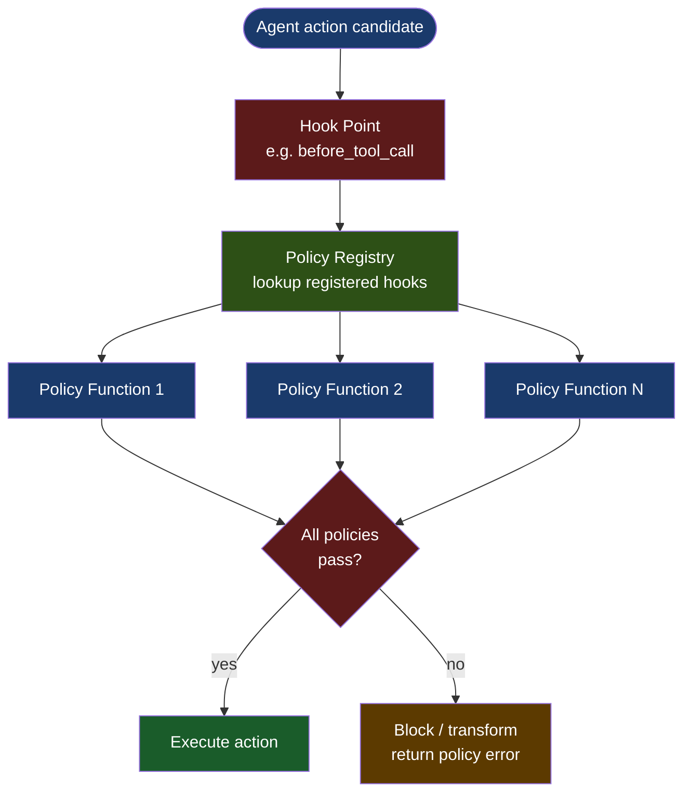

# H04 — Policy Hook

**One-line summary:** A pluggable enforcement hook evaluates policy outside the model at a defined extension point.

## Problem

Enforcement rules change over time — new regulatory requirements, new tenant configurations, new safety criteria. Hard-coding each rule into agent logic creates a brittle system where every policy change requires a code change and a redeploy. Using prompts to carry policy rules means the rules are invisible to automated testing and can be silently overridden by prompt injection or context truncation.

## Solution

Define a named hook point in the agent execution pipeline. At that point, dispatch to a registered policy function (or chain of functions) that evaluates the current context and returns allow/deny/transform. Policy implementations are registered separately from agent logic, can be updated independently, and are called deterministically — the model never sees or influences the policy decision itself.

## Solution Structure

<details>
<summary><b>Policy Hook — dispatch flow</b></summary>



</details>

## When to Use

- Policy rules change at a different cadence than core agent logic.
- Multiple policies apply to the same action and need independent enable/disable control.
- Different tenants or deployment contexts require different enforcement rules.
- You need auditable, testable policy enforcement that is decoupled from prompt content.
- Compliance or security teams need to own policy definitions without touching agent code.

## When NOT to Use

- There is only one static rule that never changes — a simpler [H02-programmatic-gate](H02-programmatic-gate.md) is sufficient.
- Policy evaluation requires model-quality reasoning — use a separate judge model invocation, but still gate on its deterministic output.
- The overhead of hook dispatch is prohibitive in a latency-critical hot path.

## Implementation Notes

- Policy hooks must run in trusted, isolated code — never in the same execution context as untrusted input.
- Hook chains should fail closed: if any policy returns an error or times out, the default is deny.
- Version policy functions and log which version evaluated each decision for auditability.
- Provide a dry-run or audit mode that evaluates all hooks and records results without blocking execution.
- Policy errors must be surfaced to operators, not silently swallowed.
- Keep each policy function single-purpose; compose complex policies from simple ones.

## Related Patterns

- [H02-programmatic-gate](H02-programmatic-gate.md): A gate is a single hard check; a Policy Hook is a composable, pluggable system of checks.
- [H07-authorization-outside-model](H07-authorization-outside-model.md): Authz is a policy domain that benefits from the hook pattern.
- [H03-structural-test](H03-structural-test.md): Each registered policy function should have structural tests verifying its behavior.

## Related Families

- [Family J — Security](../J-security/README.md): Security policies (authz, rate limiting, data isolation) are primary consumers of the hook pattern.
- [Family G — Tool Gate](../G-tool-gate/README.md): Tool gates are policy hooks specialized to the tool-call boundary.

## Example

**Before (Prompt-as-Policy anti-pattern):**

```
# prompt fragment
Do not call the billing API if the user's account is suspended.
```

The model misreads the suspension flag in a complex context. A suspended user's billing call goes through.

**After (Policy Hook):**

```
# pseudocode

# Policy definition (owned by billing team, deployed independently)
function policy_noCallsForSuspendedAccounts(context, action):
    if action.toolName == "billing_api":
        account = accountService.get(context.userId)
        if account.status == "suspended":
            return PolicyResult.deny("account suspended", code="ACCT_SUSPENDED")
    return PolicyResult.allow()

# Hook registration (at startup)
policyRegistry.register("before_tool_call", policy_noCallsForSuspendedAccounts)

# Agent harness (generic — never changes when policies change)
function executeToolCall(context, action):
    result = policyRegistry.evaluate("before_tool_call", context, action)
    if result.isDeny:
        log.audit("policy_blocked", policy=result.policyName, reason=result.reason)
        raise PolicyError(result.reason, code=result.code)
    return toolRunner.execute(action)
```

The billing team updates `policy_noCallsForSuspendedAccounts` without touching the agent harness.

## Sources

- **AWS Prescriptive Guidance** — Amazon Web Services architecture team; particularly strong on deterministic control patterns. [System Design and Security](https://docs.aws.amazon.com/prescriptive-guidance/latest/agentic-ai-security/best-practices-system-design.html)
- **Microsoft Azure Architecture Center** — Microsoft's cloud architecture team. [AI Agent Design Patterns](https://learn.microsoft.com/en-us/azure/architecture/ai-ml/guide/ai-agent-design-patterns)
- **Google Cloud Architecture Center** — Google's cloud architecture team. [Choose a Design Pattern for Agentic AI](https://docs.cloud.google.com/architecture/choose-design-pattern-agentic-ai-system)
- **OpenAI Engineering** — AI research company; coined harness engineering; advocates enforcing architectural invariants mechanically. [Harness Engineering](https://openai.com/index/harness-engineering/)
