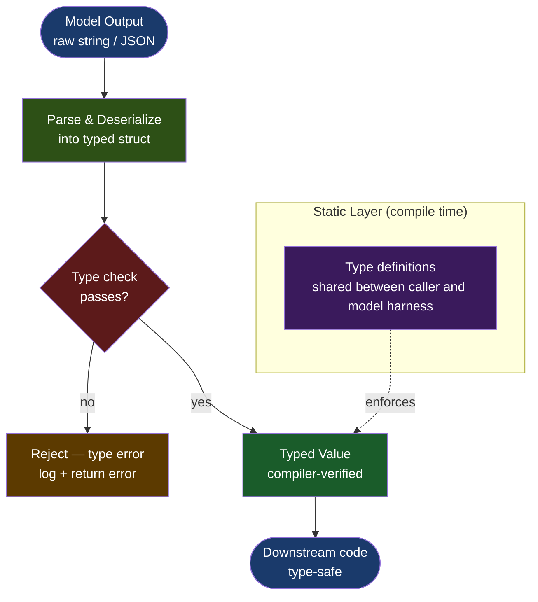

# H05 — Typed Boundary

**One-line summary:** Static types eliminate an entire class of invalid states at the interface boundary.

## Problem

Agent interfaces often pass data as untyped strings, loosely-typed JSON, or `any`-typed objects. A model can produce a structurally valid JSON blob that contains semantically wrong fields — a string where a number is required, a missing required key, an enum value outside the allowed set. These errors propagate silently until they cause downstream failures, sometimes far from the agent boundary where they could have been caught.

## Solution

Define the agent's input and output contracts as strongly-typed data structures. Use the host language's static type system — TypeScript interfaces, Python dataclasses with strict type hints, Rust structs, Protobuf schemas — to express the contract. A type error at the boundary is a compile-time or parse-time failure, not a runtime surprise. The type definition is the executable specification; it cannot drift from the code.

## Solution Structure

<details>
<summary><b>Typed Boundary — enforcement layers</b></summary>



</details>

## When to Use

- The agent boundary is between two components in the same codebase or type system.
- The output shape is known and fixed (not dynamically structured).
- You want compile-time guarantees that all callers handle the contract correctly.
- The language supports structural typing, generics, or discriminated unions that can express the contract precisely.
- The interface is versioned and you need to detect breaking changes at build time.

## When NOT to Use

- The output is inherently free-form (prose, code, arbitrary JSON) — use [H06-schema-validator](H06-schema-validator.md) instead.
- The type system of the receiving component differs from the emitting component and no shared schema exists.
- Adding types would require a large refactor that exceeds the risk being mitigated.

## Implementation Notes

- Use `unknown` / `object` as the receive type and immediately parse into a typed struct — never use `any`.
- Code-generate types from a canonical schema (JSON Schema, Protobuf, OpenAPI) so the model's output format and the type definition cannot drift independently.
- Discriminated unions (tagged unions / sum types) are particularly valuable for expressing mutually exclusive agent outcomes.
- In Python, use `pydantic` or `dataclasses` with `strict=True` rather than plain `dict` at boundaries.
- Types catch structural errors; they do not catch semantic errors — combine with [H06-schema-validator](H06-schema-validator.md) for value-level validation.
- Include the type definition in the model's tool schema or structured output spec so the model is guided toward producing valid output.

## Related Patterns

- [H06-schema-validator](H06-schema-validator.md): Schema validation is runtime enforcement of the same contract that types enforce statically.
- [H01-deterministic-override](H01-deterministic-override.md): Override handles type-valid but value-invalid output; Typed Boundary rejects type-invalid output.
- [H03-structural-test](H03-structural-test.md): Structural tests verify that type boundaries are not bypassed with unsafe casts.

## Related Families

- [Family O — Output](../O-output/README.md): Output shaping patterns define the contract that Typed Boundary enforces.
- [Family D — Verification](../D-verification/README.md): Type checking is the cheapest form of output verification.

## Example

**Before (untyped boundary):**

```
# pseudocode — untyped

result = callModel(prompt)          # returns: any / dict
action = result["action"]           # KeyError if model omits it
severity = result["severity"]       # might be "high" instead of 3
doThing(action, severity)           # crashes or silently misbehaves
```

**After (Typed Boundary):**

```
# pseudocode — typed boundary

# Shared type definition (also used in model's structured output schema)
type AgentDecision = {
    action: enum["approve", "reject", "escalate"],
    severity: integer(min=1, max=5),
    reason: string(maxLength=500)
}

# Boundary parse — fails fast on type violations
function parseAgentDecision(raw: unknown) -> AgentDecision:
    decision = AgentDecision.parse(raw)   # throws TypeParseError on violation
    return decision

# Caller
rawOutput = callModel(prompt, outputSchema=AgentDecision.schema())
decision = parseAgentDecision(rawOutput)   # type-safe from here on
doThing(decision.action, decision.severity)
```

The compile-time type system prevents callers from accessing fields that don't exist. The parse step enforces the contract at runtime.

## Sources

- **OpenAI Engineering** — AI research company; coined harness engineering; advocates enforcing architectural invariants mechanically. [Harness Engineering](https://openai.com/index/harness-engineering/)
- **Anthropic Engineering** — AI safety company; authors of Claude. [Building Effective Agents](https://www.anthropic.com/engineering/building-effective-agents)
- **Microsoft Azure Architecture Center** — Microsoft's cloud architecture team. [AI Agent Design Patterns](https://learn.microsoft.com/en-us/azure/architecture/ai-ml/guide/ai-agent-design-patterns)
