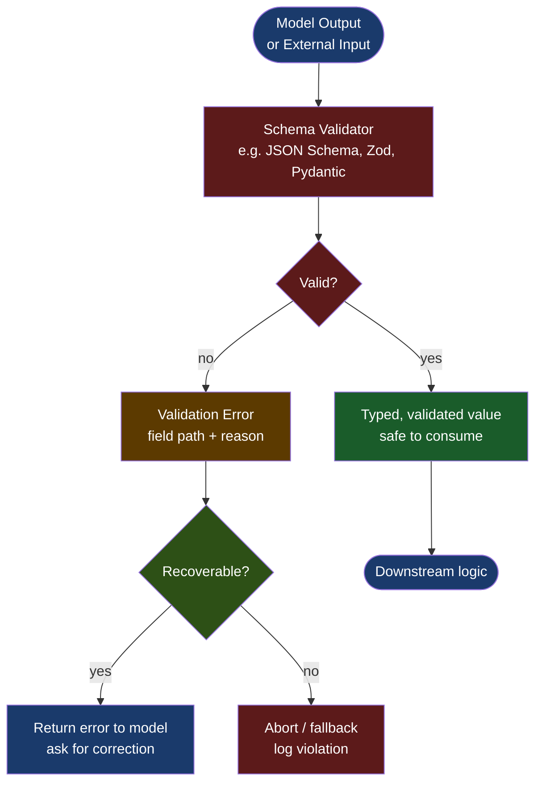

# H06 — Schema Validator

**One-line summary:** A runtime schema check at the input or output boundary rejects non-conforming data.

## Problem

A model produces output that is type-valid but value-invalid — a required field is empty, an integer is out of range, an enum value is misspelled, a nested object is missing a required key. Static types catch structural violations but not value violations. Downstream code that trusts model output without validation will process corrupt data, trigger downstream errors, or silently produce wrong results.

## Solution

At every input and output boundary, validate data against a declarative schema before it is consumed. The schema expresses required fields, value ranges, enum membership, format constraints, and cross-field rules. Validation is deterministic: the same data always produces the same pass/fail result. Validation errors are surfaced immediately at the boundary, not discovered later.

## Solution Structure

<details>
<summary><b>Schema Validator — boundary enforcement</b></summary>



</details>

## When to Use

- Model output is consumed by code that cannot tolerate malformed input.
- External data enters the system from an untrusted source (user upload, API call, tool result).
- The output contract has required fields, value constraints, or format requirements.
- You need to provide actionable error messages back to the model so it can self-correct.
- Multiple downstream consumers rely on the same output shape.

## When NOT to Use

- Validation adds latency to a hot path and the data source is already fully trusted and typed.
- The output is inherently free-form text with no structured contract to validate against.
- Runtime validation would duplicate compile-time guarantees already provided by [H05-typed-boundary](H05-typed-boundary.md) with no additional coverage.

## Implementation Notes

- Use a widely-adopted schema library: JSON Schema + ajv (JS/TS), Zod (TS), Pydantic (Python), Joi (JS), or Marshmallow (Python).
- Include the schema in the model's tool definition or structured output spec so the model is guided toward valid output before validation runs.
- Return structured validation errors with field paths, not just "invalid input" — this enables automated self-correction loops.
- Set a maximum retry budget for self-correction: 2–3 attempts, then fall back or abort.
- Validate inputs too, not just outputs — garbage in produces garbage out regardless of output validation.
- Schema definitions are code: version them, test them, and review them in PRs.

## Related Patterns

- [H05-typed-boundary](H05-typed-boundary.md): Static types enforce structural correctness; Schema Validator enforces value correctness — they are complementary layers.
- [H01-deterministic-override](H01-deterministic-override.md): Override corrects value violations; Schema Validator detects them — use together for coerce-or-reject logic.
- [H08-non-ai-fallback-path](H08-non-ai-fallback-path.md): Repeated schema validation failure is a signal to engage the fallback path.

## Related Families

- [Family O — Output](../O-output/README.md): Schema validation applied at the output boundary is a core O-family concern; both families claim it.
- [Family D — Verification](../D-verification/README.md): Schema validation is the cheapest runtime verification step; D covers richer verification strategies.

## Example

**Before (no validation):**

```
# pseudocode

result = callModel(prompt)
# result might be: { "amount": "fifty", "currency": null, "recipient": "" }
processPayment(result.amount, result.currency, result.recipient)
# crashes or charges wrong amount
```

**After (Schema Validator):**

```
# pseudocode

PaymentSchema = {
    type: "object",
    required: ["amount", "currency", "recipient"],
    properties: {
        amount:    { type: "number", minimum: 0.01, maximum: 1000000 },
        currency:  { type: "string", enum: ["USD", "EUR", "GBP"] },
        recipient: { type: "string", minLength: 1, maxLength: 200 }
    }
}

MAX_RETRIES = 2

function callModelWithValidation(prompt, schema, retries=0):
    rawOutput = callModel(prompt)
    errors = schema.validate(rawOutput)
    if errors is empty:
        return rawOutput
    if retries < MAX_RETRIES:
        correctionPrompt = buildCorrectionPrompt(prompt, rawOutput, errors)
        return callModelWithValidation(correctionPrompt, schema, retries + 1)
    raise ValidationExhaustedError(lastErrors=errors)

payment = callModelWithValidation(paymentPrompt, PaymentSchema)
processPayment(payment.amount, payment.currency, payment.recipient)
```

The schema is declarative, versioned, and tested independently. Validation errors are structured and actionable.

## Sources

- **AWS Prescriptive Guidance** — Amazon Web Services architecture team; particularly strong on deterministic control patterns. [Agentic AI Patterns](https://docs.aws.amazon.com/prescriptive-guidance/latest/agentic-ai-patterns/agent-patterns.html) | [System Design and Security](https://docs.aws.amazon.com/prescriptive-guidance/latest/agentic-ai-security/best-practices-system-design.html)
- **OpenAI Engineering** — AI research company; coined harness engineering; advocates enforcing architectural invariants mechanically. [Harness Engineering](https://openai.com/index/harness-engineering/)
- **Anthropic Engineering** — AI safety company; authors of Claude. [Building Effective Agents](https://www.anthropic.com/engineering/building-effective-agents)
- **Google Cloud Architecture Center** — Google's cloud architecture team. [Choose a Design Pattern for Agentic AI](https://docs.cloud.google.com/architecture/choose-design-pattern-agentic-ai-system)
