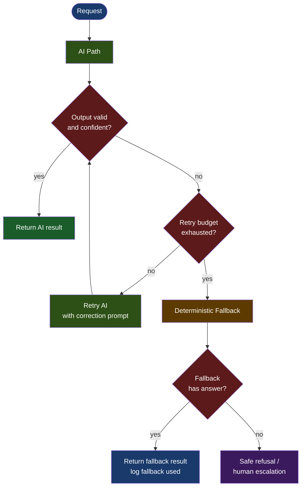

# H08 — Non-AI Fallback Path

**One-line summary:** A deterministic fallback executes when the AI path cannot be trusted.

## Problem

An AI path fails in ways that are hard to predict: the model times out, produces output that fails validation, hallucinates a required value, or enters a reasoning loop. Systems that have no fallback either crash, block indefinitely, or silently emit bad output. In high-stakes or high-reliability contexts, "the AI was uncertain" is not an acceptable production outcome — there must always be a defined behavior when the AI path cannot be trusted.

## Solution

For every AI-handled operation, define a deterministic fallback path that executes when the AI path fails, produces invalid output, or exceeds its retry budget. The fallback may be a rule-based heuristic, a lookup table, a safe default value, a human escalation, or a hard refusal — but it is code, not another model call. The fallback is always correct (within its narrower scope) even if less capable than the AI path.

## Solution Structure

<details>
<summary><b>Non-AI Fallback Path — execution flow</b></summary>



</details>

## When to Use

- The operation has a known safe default or a rule-based answer for common cases.
- Availability or reliability requirements exceed what a model can guarantee.
- The output feeds a downstream system that cannot tolerate null or invalid values.
- Regulatory or safety constraints require a defined behavior even when AI is unavailable.
- The AI path has a measurable failure rate that exceeds acceptable thresholds.

## When NOT to Use

- The task is inherently open-ended and has no deterministic approximation — in this case, fail loudly rather than silently degrade.
- The fallback would produce output so degraded that it misleads users into trusting a wrong answer.
- The cost of maintaining two paths (AI + fallback) exceeds the risk being mitigated.

## Implementation Notes

- The fallback must be simpler and more constrained than the AI path — not another AI call.
- Log every fallback activation with the reason (timeout, validation failure, retry exhausted) so you can track the AI path's reliability over time.
- Communicate fallback activation to the caller: "This response was generated by the rule-based fallback because the AI path failed validation."
- AWS guidance: use deterministic execution logic unless AI is genuinely needed — this means the fallback is often the right default and AI is the enhancement.
- Design the fallback first, then add the AI path on top — this forces a clear definition of what the system must do without AI.
- Test the fallback independently of the AI path; it must work correctly in complete isolation.

## Related Patterns

- [H02-programmatic-gate](H02-programmatic-gate.md): A gate blocks when conditions fail; a Fallback Path provides an alternative when the AI path fails.
- [H06-schema-validator](H06-schema-validator.md): Schema validation failure is a common trigger for engaging the fallback path.
- [H01-deterministic-override](H01-deterministic-override.md): Override fixes individual fields; Fallback Path replaces the entire AI result.

## Related Families

- [Family D — Verification](../D-verification/README.md): Verification steps detect AI path failures; the fallback path is the response to those failures.
- [Family O — Output](../O-output/README.md): Output quality checks trigger fallback activation.

## Example

**Before (no fallback):**

```
# pseudocode — no fallback

function classifyTicket(ticketText):
    result = callModel(classificationPrompt + ticketText)
    return result.category   # undefined if model times out or hallucinates
```

Model times out during peak load. Tickets pile up unclassified. SLA violated.

**After (Non-AI Fallback Path):**

```
# pseudocode

# Deterministic fallback — keyword-based classifier
function fallbackClassify(ticketText):
    text = ticketText.lower()
    if any(kw in text for kw in ["crash", "error", "exception", "500"]):
        return Category.BUG
    if any(kw in text for kw in ["how to", "how do i", "guide", "tutorial"]):
        return Category.QUESTION
    if any(kw in text for kw in ["slow", "latency", "timeout", "performance"]):
        return Category.PERFORMANCE
    return Category.GENERAL   # safe default — human triage

# AI path with fallback
function classifyTicket(ticketText):
    try:
        result = callModelWithTimeout(classificationPrompt + ticketText, timeoutMs=3000)
        errors = CategorySchema.validate(result)
        if errors is empty:
            return result.category
        log.warn("AI classification failed validation", errors=errors)
    except TimeoutError:
        log.warn("AI classification timed out")
    except ModelError as e:
        log.error("AI classification error", error=e)

    # Fallback — always correct within its scope
    category = fallbackClassify(ticketText)
    log.info("fallback_used", category=category, reason="ai_path_failed")
    return category
```

Every ticket gets classified. Fallback usage is tracked and drives AI path improvement.

## Sources

- **AWS Prescriptive Guidance** — Amazon Web Services architecture team; particularly strong on deterministic control patterns. [Agentic AI Patterns](https://docs.aws.amazon.com/prescriptive-guidance/latest/agentic-ai-patterns/agent-patterns.html) | [System Design and Security](https://docs.aws.amazon.com/prescriptive-guidance/latest/agentic-ai-security/best-practices-system-design.html)
- **Anthropic Engineering** — AI safety company; authors of Claude. [Building Effective Agents](https://www.anthropic.com/engineering/building-effective-agents)
- **Microsoft Azure Architecture Center** — Microsoft's cloud architecture team. [AI Agent Design Patterns](https://learn.microsoft.com/en-us/azure/architecture/ai-ml/guide/ai-agent-design-patterns)
- **Google Cloud Architecture Center** — Google's cloud architecture team. [Choose a Design Pattern for Agentic AI](https://docs.cloud.google.com/architecture/choose-design-pattern-agentic-ai-system)
