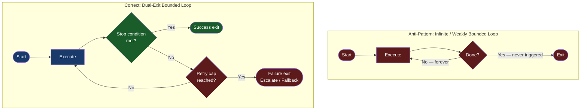

# Infinite / Weakly Bounded Agent Loop

**Family:** I — Reliability & Recovery
**Type:** Anti-Pattern

## Problem

An agent loop has no hard exit condition, or its exit condition is so weak (e.g., `while not done` where `done` is never set) that it runs indefinitely. The loop continues until it hits an external limit — context window exhaustion, token budget depletion, wall-clock timeout, or operator intervention. By that point, significant resources have been wasted and the system may be in an inconsistent state. Downstream work is blocked and the failure is often silent until budget alarms fire.

## Solution

Every loop must have both a success-based exit ([Stop Condition](../patterns/stop-condition.md)) and a failure-based exit ([Bounded Retry](../patterns/bounded-retry.md)). Neither alone is sufficient. Define both before the loop is written — not after it is running.

## Solution Structure

<b>Infinite Loop vs. Properly Bounded Loop</b>

## When to Use (Recognition Signals)

Recognize this anti-pattern when you see:

- A loop controlled only by `while True`, `while not complete`, or a condition that depends on the model setting a flag reliably.
- No numeric counter or cap on iterations anywhere in the loop.
- "Max retries" is configurable but defaults to infinity or a very large number (e.g., 1,000,000).
- The loop has a stop condition but no retry cap — success is required; failure has no exit.
- The loop has a retry cap but the stop condition is `while errors > 0` — if errors never reach zero, the cap is the only exit and it may be set too high.
- Agent cost alarms are the de facto termination mechanism.

## Why It Happens

- Optimistic design: the assumption that the loop will always eventually succeed.
- Deferred hardening: "we'll add a cap later" — and later never comes.
- Implicit trust in model behavior: assuming the model will set `done = true` reliably.
- Framework omission: using an LLM orchestration framework whose default loop has no cap.
- Unclear success criteria: when "done" is not well-defined, a stop condition cannot be written.

## Trade-offs

| Appears to provide | Actually provides |
|---|---|
| Persistence — the agent "keeps trying until it succeeds" | Budget exhaustion — unbounded cost with no guaranteed termination |
| Flexibility — no artificial ceiling on attempts | Unpredictability — task duration and cost are undefined |
| Simplicity — no cap logic to write | Hidden fragility — failures are silent until external limits fire |

## Example

A web-scraping agent is given a list of 1,000 URLs to process. The loop condition is `while remaining_urls`. A subset of URLs are permanently broken (404s). The agent retries them indefinitely, never removing them from `remaining_urls` because that only happens on success. The loop runs for hours until a cloud cost alarm triggers manual intervention.

**Correct approach:** Add a per-URL retry cap (e.g., 3 attempts). After 3 failures, mark the URL as failed, remove it from `remaining_urls`, and log it for human review. The loop now terminates deterministically.

## Related Patterns (Cures)

- [Bounded Retry](../patterns/bounded-retry.md) — the direct fix: add a hard numeric cap
- [Stop Condition](../patterns/stop-condition.md) — the complementary fix: define what "done" means as a testable predicate
- [Structured Error Classification](../patterns/structured-error-classification.md) — permanent failures (404, auth errors) should not be retried at all
- [Human Escalation](../patterns/human-escalation.md) — unresolvable tasks should exit the loop and route to a human
- [Circuit Breaker](../patterns/circuit-breaker.md) — prevents loops from sustaining themselves against a known-broken resource

## Related Anti-Patterns

- [Retry Without New Information](retry-without-new-information.md) — often co-occurs: a loop that is both unbounded and informationally static

## Sources

- **Google Cloud Architecture Center** — Google's cloud architecture team; emphasizes strong termination conditions to avoid runaway loops. [Choose a Design Pattern for Agentic AI](https://docs.cloud.google.com/architecture/choose-design-pattern-agentic-ai-system)
- **Anthropic Engineering** — AI safety company; authors of Claude. [Building Effective Agents](https://www.anthropic.com/engineering/building-effective-agents)
- **AWS Prescriptive Guidance** — Amazon Web Services architecture team; defines Validation-Retry Loop and Structured Error Classification. [Agentic AI Patterns](https://docs.aws.amazon.com/prescriptive-guidance/latest/agentic-ai-patterns/agent-patterns.html)
