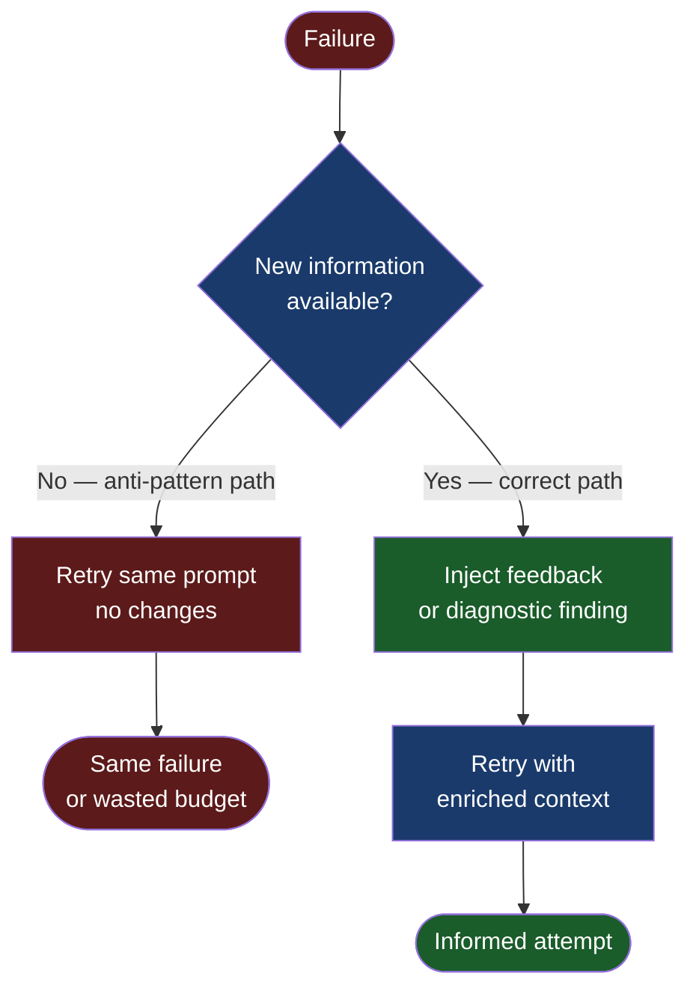

# Retry Without New Information

**Family:** I — Reliability & Recovery
**Type:** Anti-Pattern

## Problem

After a failure, the agent sends the same prompt — or a trivially restated version of it — without injecting any new information, feedback, or diagnostic findings. The model that failed the first time is statistically likely to fail the same way again. The retry wastes tokens and time, advances nothing, and if repeated in a loop, depletes the retry budget without ever creating a genuine recovery opportunity.

## Solution

Do not retry without first acquiring new information. The new information can come from a validator, an error message, a tool response, a diagnostic step, or a human. Inject it into the next attempt's context. If no new information is available and none can be obtained, do not retry — escalate or fall back instead.

The fix is any pattern in this family that injects actionable signal before retrying:
- [Retry-With-Feedback](../patterns/retry-with-feedback.md)
- [Validation-Retry Loop](../patterns/validation-retry-loop.md)
- [Root-Cause-Before-Retry](../patterns/root-cause-before-retry.md)

## Solution Structure

<b>Retry Without New Information — Failure vs. Recovery Path</b>

## When to Use (Recognition Signals)

Recognize this anti-pattern when you see:

- A retry loop where the prompt is identical or superficially rephrased across all attempts.
- No error message, validator output, or diagnostic result appears between the failure and the next attempt.
- The same wrong output is produced two or more times in a row.
- Retry count is incrementing but output quality is not improving.
- An agent is configured to "retry N times on failure" with no feedback injection logic.

## Why It Happens

- Defensive coding: "just add a retry" is treated as a reliability measure without understanding what makes a retry useful.
- Missing feedback extraction: the error signal exists but is not parsed and injected.
- Optimism: the assumption that the model "might get it right" on a second try without any new information.
- Framework defaults: many LLM orchestration libraries expose `max_retries` with no built-in feedback injection.

## Trade-offs

| Appears to provide | Actually provides |
|---|---|
| Resilience — the agent "tries harder" | Budget waste — N identical attempts burn N × cost |
| Coverage — multiple shots at the answer | False confidence — a high retry count obscures a systematic failure |
| Simplicity — easy to implement | Fragility — no systematic improvement path |

## Example

An agent calls a code-generation model. The output fails a syntax check. The retry logic sends the exact same prompt again. The model produces the same (or equally broken) code. This repeats 5 times until the retry cap fires. The agent escalates having learned nothing and spent 5× the tokens.

**Correct approach:** After the syntax check fails, inject the error message ("SyntaxError: unexpected token on line 12") as a user message before retrying. The model now has a specific, actionable signal.

## Related Patterns (Cures)

- [Retry-With-Feedback](../patterns/retry-with-feedback.md) — injects failure signal before every retry
- [Validation-Retry Loop](../patterns/validation-retry-loop.md) — gates retry on a validator that produces injectable feedback
- [Root-Cause-Before-Retry](../patterns/root-cause-before-retry.md) — diagnoses why before constructing the retry
- [Structured Error Classification](../patterns/structured-error-classification.md) — ensures the right kind of feedback is injected per error type
- [Human Escalation](../patterns/human-escalation.md) — when no new information can be obtained automatically

## Related Anti-Patterns

- [Infinite / Weakly Bounded Agent Loop](infinite-weakly-bounded-loop.md) — often co-occurs: a loop with no cap and no feedback injection

## Sources

- **OpenAI Engineering** — AI research company; authors of GPT and Codex. [A Practical Guide to Building AI Agents](https://openai.com/business/guides-and-resources/a-practical-guide-to-building-ai-agents/)
- **Anthropic Engineering** — AI safety company; authors of Claude. [Building Effective Agents](https://www.anthropic.com/engineering/building-effective-agents)
- **AWS Prescriptive Guidance** — Amazon Web Services architecture team; defines Validation-Retry Loop and Structured Error Classification. [Agentic AI Patterns](https://docs.aws.amazon.com/prescriptive-guidance/latest/agentic-ai-patterns/agent-patterns.html)
