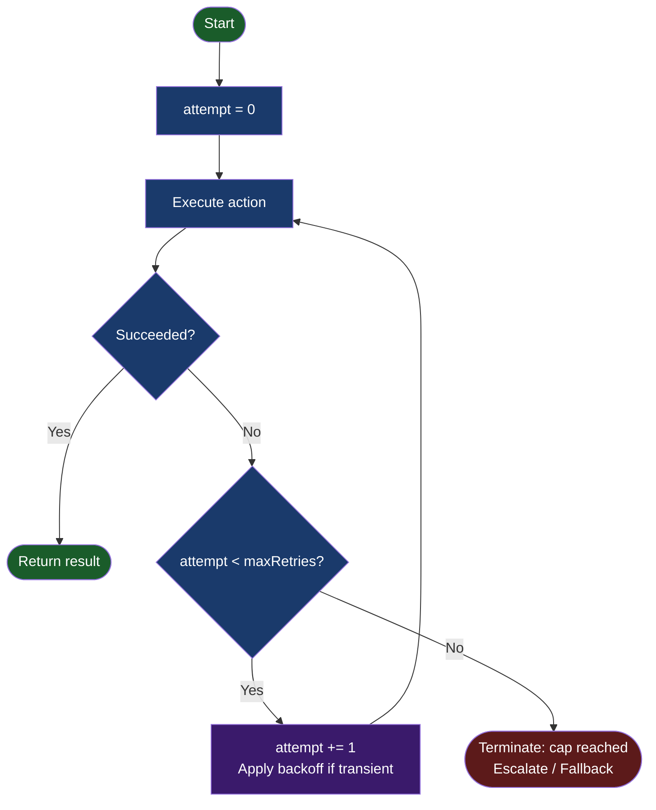

# Bounded Retry

**Family:** I — Reliability & Recovery
**Type:** Pattern

## Problem

Retry loops without a hard cap are dangerous. An agent that encounters a persistent failure — a broken tool, a model that keeps misunderstanding the task, or a flaky downstream service — will retry indefinitely, draining compute budget, blocking other work, and potentially causing runaway cost or downstream harm. Even well-intentioned loops become infinite loops without an explicit ceiling.

## Solution

Set a hard numeric cap on the maximum number of retry attempts before the loop terminates. When the cap is reached, the agent stops and either escalates, falls back, or surfaces the failure to the caller. The cap is a last-resort safety net that guarantees loop termination regardless of what happens inside it.

## Solution Structure

<details>
<summary><b>Bounded Retry — Retry Budget Flow</b></summary>



</details>

## Structure

```
function boundedRetry(action, maxRetries, backoffStrategy = none):
    attempt = 0

    while attempt <= maxRetries:
        result = tryExecute(action)

        if result.succeeded:
            return result

        attempt += 1

        if attempt <= maxRetries:
            wait(backoffStrategy.delay(attempt))  # optional; skip for non-transient errors

    # Cap reached — do not continue
    return Failure(
        reason = "Retry cap of " + maxRetries + " exceeded",
        lastError = result.error,
        attempts = attempt
    )

# Caller decides what to do on Failure:
#   escalate to human, fall back to alternative, surface error upstream
```

## When to Use

- Any retry loop — this pattern should be present in every loop without exception.
- Combined with backoff for transient errors (network, rate limits).
- As a safety net even when other termination conditions are also in place.
- When cost, latency, or downstream side-effect budgets are constrained.

## When Not to Use

- There is no retry loop — a single attempt does not need a retry cap.
- The cap alone is the only termination condition — pair with a [Stop Condition](stop-condition.md) based on success criteria rather than relying purely on the cap.

## Trade-offs

| Pro | Con |
|-----|-----|
| Guarantees loop termination — eliminates runaway agents | A cap that is too low aborts recoverable operations prematurely |
| Simple, cheap, and universally applicable | Does not distinguish between error types — pair with Structured Error Classification |
| Enables predictable worst-case cost and latency | Without backoff, rapid retries against rate-limited services may worsen the situation |
| Forces an explicit decision at cap (escalate vs. fallback) | Cap value requires tuning; wrong value is either too permissive or too strict |

## Example

A data-extraction agent calls a third-party API with a cap of 5. The API returns 503 on all 5 attempts (the service is down). On the 6th iteration, the cap check fires: the agent stops retrying, logs the failure with all attempt details, and routes to [Fallback Model/Workflow](fallback-model-workflow.md) which reads from a cached copy instead.

## Related Patterns

- [Stop Condition](stop-condition.md) — defines success-based exit; bounded retry defines failure-based exit — use together
- [Validation-Retry Loop](validation-retry-loop.md) — must be bounded
- [Retry-With-Feedback](retry-with-feedback.md) — must be bounded
- [Circuit Breaker](circuit-breaker.md) — a more sophisticated pattern that adapts the effective cap based on failure history
- [Structured Error Classification](structured-error-classification.md) — lets you apply different caps per error class

## Related Anti-Patterns

- [Infinite / Weakly Bounded Agent Loop](../anti-patterns/infinite-weakly-bounded-loop.md) — the direct consequence of omitting this pattern

## Sources

- **AWS Prescriptive Guidance** — Amazon Web Services architecture team; defines Validation-Retry Loop and Structured Error Classification. [Agentic AI Patterns](https://docs.aws.amazon.com/prescriptive-guidance/latest/agentic-ai-patterns/agent-patterns.html)
- **Google Cloud Architecture Center** — Google's cloud architecture team; emphasizes strong termination conditions to avoid runaway loops. [Choose a Design Pattern for Agentic AI](https://docs.cloud.google.com/architecture/choose-design-pattern-agentic-ai-system)
- **Anthropic Engineering** — AI safety company; authors of Claude. [Building Effective Agents](https://www.anthropic.com/engineering/building-effective-agents)
