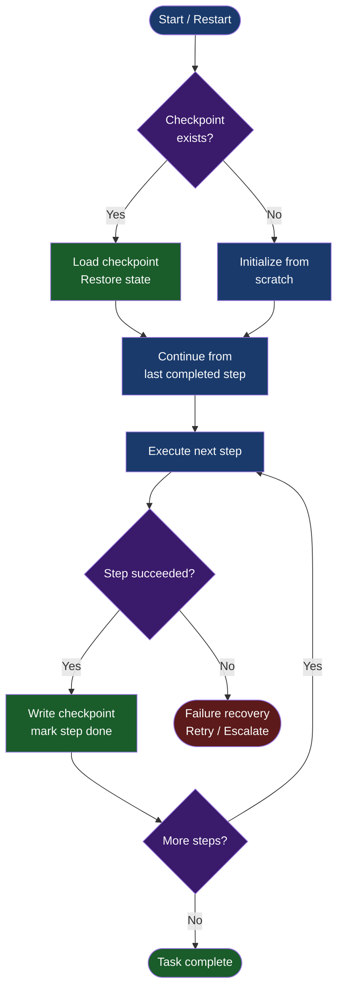

# Checkpoint and Resume

**Family:** I — Reliability & Recovery
**Type:** Pattern

## Problem

Long multi-step agent tasks fail partway through — due to crashes, timeouts, context-window exhaustion, rate limits, or external service outages. Without persisted progress, every failure restarts the task from the beginning. For tasks that take minutes or hours and involve expensive calls, this is both costly and disruptive. Repeated full restarts also multiply the chance of hitting the same failure point again.

## Solution

After each meaningful unit of work completes successfully, persist a checkpoint: what has been done, what remains, and enough state to resume without repeating completed steps. On failure or restart, the agent loads the most recent checkpoint and continues from there. Checkpoints are written to durable storage outside the agent's in-memory context.

## Solution Structure

<details>
<summary><b>Checkpoint and Resume — Persistence Flow</b></summary>



</details>

## Structure

```
CheckpointStore = persistentStorage()  # database, file system, object store

function resumableTask(steps, taskId):
    checkpoint = CheckpointStore.load(taskId) or Checkpoint(completedSteps=[], state={})

    for step in steps:
        if step.id in checkpoint.completedSteps:
            continue  # already done — skip

        result = step.execute(checkpoint.state)

        if result.failed:
            raise FailureAt(step, result.error)  # propagate to recovery handler

        checkpoint.state.merge(result.output)
        checkpoint.completedSteps.append(step.id)
        CheckpointStore.save(taskId, checkpoint)  # write before proceeding

    CheckpointStore.delete(taskId)  # clean up on success
    return checkpoint.state
```

## When to Use

- Tasks involve more than a few sequential steps where any single step has non-trivial cost.
- The agent runs in an environment where crashes, restarts, or context resets are possible.
- Steps have side effects (API writes, database mutations) that must not be replayed.
- Human escalation is in use — the agent must persist state before handing off to a human.
- Tasks span multiple agent invocations (e.g., a daily batch that continues from yesterday).

## When Not to Use

- Tasks are short enough that a full restart is cheap and fast.
- Steps are idempotent and stateless — replaying them is harmless and simpler than checkpointing.
- The checkpoint store itself is unreliable — a corrupt checkpoint can be worse than no checkpoint.
- The task is exploratory and the "right" path is discovered during execution, making intermediate checkpoints misleading.

## Trade-offs

| Pro | Con |
|-----|-----|
| Eliminates full-restart cost after partial failures | Adds I/O overhead: write to durable storage after each step |
| Enables safe human handoff with full state preserved | Checkpoint schema must evolve with task logic — versioning required |
| Prevents re-executing side-effectful steps on restart | Storage adds operational complexity (backup, cleanup, access control) |
| Works across agent restarts, context resets, and session boundaries | Buggy checkpoint logic can cause skipped steps or corrupted state |

## Example

A document-processing agent must run 200 PDFs through extraction, enrichment, and indexing — three steps each. After 47 PDFs, the agent's context window is exhausted and it is restarted. It loads the checkpoint, sees steps 1–47 complete, and resumes at PDF 48. The 47 completed API calls and database writes are not replayed.

## Related Patterns

- [Human Escalation](human-escalation.md) — requires persisted state before control transfers to a human
- [Fresh-Context Retry](fresh-context-retry.md) — checkpoint ensures progress is not lost when context is discarded
- [Bounded Retry](bounded-retry.md) — retry logic works at the step level; checkpoints work across steps
- [Family L — Memory & State](../../L-memory-state/README.md) — the broader family for state persistence patterns

## Related Anti-Patterns

- [Infinite / Weakly Bounded Agent Loop](../anti-patterns/infinite-weakly-bounded-loop.md) — checkpointing prevents loops from restarting wastefully from zero

## Sources

- **Microsoft Azure Architecture Center** — Microsoft's cloud architecture team. [AI Agent Design Patterns](https://learn.microsoft.com/en-us/azure/architecture/ai-ml/guide/ai-agent-design-patterns)
- **Anthropic Engineering** — AI safety company; authors of Claude. [Building Effective Agents](https://www.anthropic.com/engineering/building-effective-agents)
- **AWS Prescriptive Guidance** — Amazon Web Services architecture team; defines Validation-Retry Loop and Structured Error Classification. [Agentic AI Patterns](https://docs.aws.amazon.com/prescriptive-guidance/latest/agentic-ai-patterns/agent-patterns.html)
