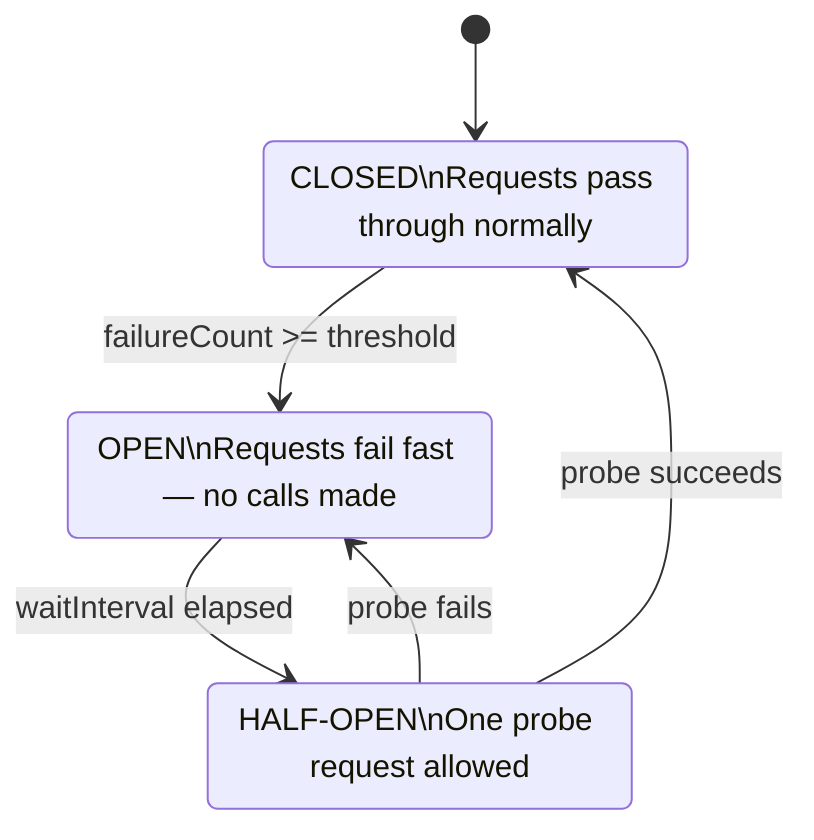

# Circuit Breaker

**Family:** I — Reliability & Recovery
**Type:** Pattern

## Problem

When a downstream service, model endpoint, or tool is degraded or down, agents keep sending requests to it. Each request fails, triggers a retry, and the retries themselves add load to an already-struggling service — making recovery slower. Meanwhile the agent wastes time and budget on attempts it already has strong evidence will fail. A fixed retry cap catches this eventually, but only after many wasted attempts.

## Solution

Track failure history across calls to a given resource. After a threshold of consecutive failures, trip the circuit: stop sending requests to the resource entirely and fail fast. After a configured wait interval, allow a single probe request. If the probe succeeds, close the circuit and resume normal operation. If it fails, reset the wait and keep the circuit open.

## Solution Structure

<details>
<summary><b>Circuit Breaker — State Machine</b></summary>



</details>

## Structure

```
CircuitBreaker(resource, failureThreshold = 5, waitInterval = 60s):
    state        = CLOSED
    failureCount = 0
    lastFailureAt = null

function call(request):
    match state:
        OPEN:
            if now() - lastFailureAt > waitInterval:
                state = HALF_OPEN
            else:
                return Failure("Circuit open — fast fail")

        HALF_OPEN:
            result = resource.execute(request)
            if result.succeeded:
                state = CLOSED
                failureCount = 0
                return result
            else:
                state = OPEN
                lastFailureAt = now()
                return Failure("Probe failed — circuit re-opened")

        CLOSED:
            result = resource.execute(request)
            if result.failed:
                failureCount += 1
                lastFailureAt = now()
                if failureCount >= failureThreshold:
                    state = OPEN
            else:
                failureCount = 0
            return result
```

## When to Use

- The agent makes repeated calls to an external service, model API, or tool that can fail in sustained ways.
- A degraded service is being made worse by retry traffic.
- You want fast failure rather than waiting out a full retry cycle on every request during an outage.
- The system has a [Fallback Model/Workflow](fallback-model-workflow.md) that should be activated immediately when a resource is unavailable.
- High-throughput agents where many parallel calls would all hit the same broken endpoint.

## When Not to Use

- The agent makes only a handful of calls to a resource — the overhead of state tracking is not justified.
- Failures are caused by request-specific errors (bad input, logic violations), not resource availability — a circuit breaker protects the resource, not the request.
- The resource does not support probing — a probe that has side effects (e.g., creates a record) is dangerous.
- The system has no alternative path to activate when the circuit is open.

## Trade-offs

| Pro | Con |
|-----|-----|
| Stops wasting budget on a known-broken resource immediately | Adds state management: circuit state must be shared across agent instances |
| Protects degraded downstream services from retry storms | Threshold and wait interval require tuning for each resource |
| Enables fast activation of fallback paths | A tripped circuit during a transient blip can cause unnecessary degraded-mode operation |
| Makes resource health visible as an observable state | Probe requests during HALF_OPEN must be safe to execute (idempotent, low-cost) |

## Example

An agent calls a vector search service 50 times per task. The service goes down. After 5 consecutive failures, the circuit breaker trips to OPEN. The next 45 calls fail fast without hitting the service. The [Fallback Model/Workflow](fallback-model-workflow.md) uses keyword search instead. After 60 seconds, a probe finds the service recovered; the circuit closes and subsequent tasks resume using vector search.

## Related Patterns

- [Bounded Retry](bounded-retry.md) — bounded retry operates per-request; circuit breaker operates across requests to a resource
- [Fallback Model/Workflow](fallback-model-workflow.md) — activated immediately when circuit trips to OPEN
- [Structured Error Classification](structured-error-classification.md) — transient errors are the class that triggers circuit tripping
- [Stop Condition](stop-condition.md) — an open circuit is an external stop condition on calls to the affected resource

## Related Anti-Patterns

- [Retry Without New Information](../anti-patterns/retry-without-new-information.md) — what happens without a circuit breaker: agents keep hitting a broken service with unchanged requests
- [Infinite / Weakly Bounded Agent Loop](../anti-patterns/infinite-weakly-bounded-loop.md) — circuit breakers prevent loops from being sustained by a failing resource

## Sources

- **Microsoft Azure Architecture Center** — Microsoft's cloud architecture team. [AI Agent Design Patterns](https://learn.microsoft.com/en-us/azure/architecture/ai-ml/guide/ai-agent-design-patterns)
- **AWS Prescriptive Guidance** — Amazon Web Services architecture team; defines Validation-Retry Loop and Structured Error Classification. [Agentic AI Patterns](https://docs.aws.amazon.com/prescriptive-guidance/latest/agentic-ai-patterns/agent-patterns.html)
- **Google Cloud Architecture Center** — Google's cloud architecture team; emphasizes strong termination conditions to avoid runaway loops. [Choose a Design Pattern for Agentic AI](https://docs.cloud.google.com/architecture/choose-design-pattern-agentic-ai-system)
