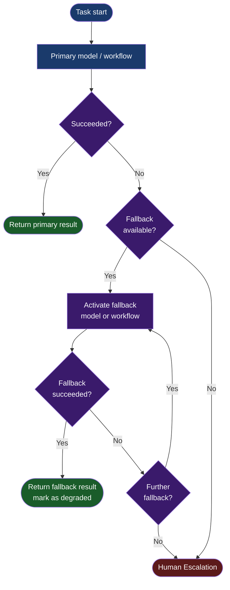

# Fallback Model / Workflow

**Family:** I — Reliability & Recovery
**Type:** Pattern

## Problem

The primary model or execution path can become unavailable, too expensive for repeated retries, or fundamentally incapable of completing a task. Waiting indefinitely for the primary path to recover — or exhausting budget on a path that cannot succeed — halts the agent and blocks downstream work. A system with only one execution path has a single point of failure.

## Solution

Define one or more alternative execution paths that can be activated when the primary path fails. The fallback may be a cheaper or simpler model, a rule-based system, a cached result, a reduced-scope response, or a different workflow altogether. The fallback activates automatically after the primary path exhausts its retry budget or is detected as unavailable.

## Solution Structure

<details>
<summary><b>Fallback Model / Workflow — Degradation Chain</b></summary>



</details>

## Structure

```
executionChain = [
    primaryModel(config = "high-capability"),
    fallbackModel(config = "smaller, cheaper"),
    ruleBasedWorkflow(),
    cachedResponseLookup()
]

function executeWithFallback(task):
    for executor in executionChain:
        result = executor.attempt(task)

        if result.succeeded:
            if executor != executionChain[0]:
                result.markDegraded(executor.label)
            return result

        log("Executor " + executor.label + " failed: " + result.error)

    # All paths exhausted
    return humanEscalation(task, attemptsLog)
```

## When to Use

- The primary model is unavailable, rate-limited, or too expensive for the retry budget.
- The task has a defined "good enough" tier — a simpler model or rule-based approach handles the common case even if it handles edge cases poorly.
- Latency requirements demand a response even if quality is reduced.
- A capability gap is detected (via [Structured Error Classification](structured-error-classification.md)) and an alternative path exists.
- The system must remain available during planned or unplanned primary downtime.

## When Not to Use

- No meaningful fallback exists — a degraded response that misleads is worse than no response.
- The task requires a specific model's capabilities (e.g., long-context reasoning, multimodal input) and no alternative can approximate it.
- The fallback produces outputs that are incompatible with downstream consumers expecting primary-quality results without warning.
- Adding a fallback creates complexity that obscures the real problem (a broken primary that should be fixed).

## Trade-offs

| Pro | Con |
|-----|-----|
| Maintains availability during primary failure | Fallback outputs may be lower quality — callers must handle degraded responses |
| Reduces wasted budget on an unrecoverable primary path | Requires designing, testing, and maintaining multiple execution paths |
| Enables graceful degradation rather than hard failure | Fallback activation must be observable — silent degradation is dangerous |
| Composable with Circuit Breaker to fast-path to fallback | Cascading failures can exhaust fallback chain if root cause is systemic |

## Example

A summarization agent uses a large model as primary. The model's API returns 503 for 3 consecutive attempts. The fallback chain activates: a smaller model produces a shorter, lower-detail summary. The result is marked `quality: degraded` in the response envelope. The caller renders a "summary may be incomplete" notice to the user. When the primary recovers, subsequent requests resume using it.

## Related Patterns

- [Bounded Retry](bounded-retry.md) — primary path retry cap is the trigger for fallback activation
- [Structured Error Classification](structured-error-classification.md) — capability gaps route directly to this pattern
- [Circuit Breaker](circuit-breaker.md) — can fast-track to fallback without exhausting retries when a sustained outage is detected
- [Human Escalation](human-escalation.md) — the terminal fallback when all automated paths are exhausted

## Related Anti-Patterns

- [Retry Without New Information](../anti-patterns/retry-without-new-information.md) — continuing to retry the primary when a fallback should have been activated

## Sources

- **Microsoft Azure Architecture Center** — Microsoft's cloud architecture team. [AI Agent Design Patterns](https://learn.microsoft.com/en-us/azure/architecture/ai-ml/guide/ai-agent-design-patterns)
- **AWS Prescriptive Guidance** — Amazon Web Services architecture team; defines Validation-Retry Loop and Structured Error Classification. [Agentic AI Patterns](https://docs.aws.amazon.com/prescriptive-guidance/latest/agentic-ai-patterns/agent-patterns.html)
- **Google Cloud Architecture Center** — Google's cloud architecture team; emphasizes strong termination conditions to avoid runaway loops. [Choose a Design Pattern for Agentic AI](https://docs.cloud.google.com/architecture/choose-design-pattern-agentic-ai-system)
