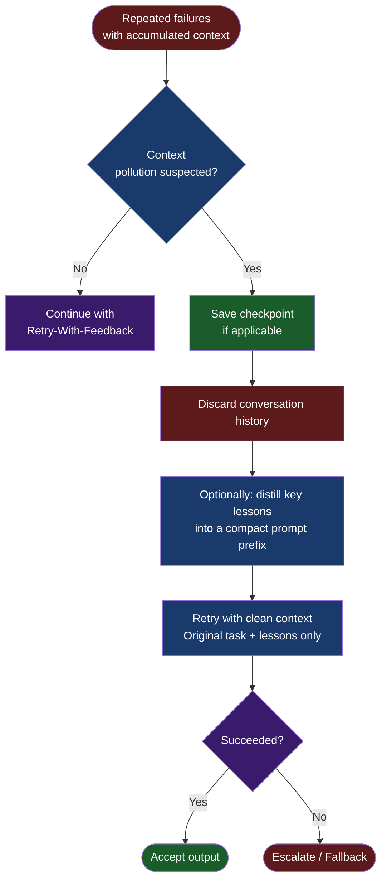

# Fresh-Context Retry

**Family:** I — Reliability & Recovery
**Type:** Pattern

## Problem

As an agent accumulates conversation history across multiple failed attempts, that history can become the source of new failures. Errors, incorrect assumptions, and bad intermediate outputs embedded in the context subtly bias every subsequent generation. The model anchors on prior mistakes, over-corrects for phantom constraints, or gets confused by contradictory information it produced earlier. More retries with the same polluted context make things worse, not better.

## Solution

Discard the accumulated conversation context entirely and retry the task from a clean state, as if it were the first attempt. The new run starts with only the original task description — or a freshly constructed prompt incorporating only the actionable lessons learned — without the failure history weighing on it.

## Solution Structure

<details>
<summary><b>Fresh-Context Retry — Context Reset Flow</b></summary>



</details>

## Structure

```
function freshContextRetry(originalTask, failureHistory, maxFreshAttempts):
    lessons = distillLessons(failureHistory)
    # distillLessons extracts only: what was tried, why it failed
    # It does NOT include failed outputs or confusing intermediate steps

    freshPrompt = buildCleanPrompt(
        task    = originalTask,
        context = lessons  # brief, structured, no failed text artifacts
    )

    attempt = 0
    while attempt < maxFreshAttempts:
        newContext = [freshPrompt]  # no history appended
        output = generate(newContext)

        if succeeded(output):
            return output

        attempt += 1

    return Failure("Fresh-context retry exhausted")

# Trigger heuristics for switching to this pattern:
# - same error repeated N times despite feedback injection
# - context length > 70% of window
# - model output quality is degrading across retries
```

## When to Use

- The same error recurs across multiple feedback-enriched retries, suggesting the model is stuck in a local failure mode reinforced by context.
- Context length is approaching the model's window limit and early content is being dropped.
- Output quality is visibly degrading across iterations (the model seems confused, not just wrong).
- A prior attempt produced content that directly contradicts the task goal and cannot easily be counteracted by appending new instructions.

## When Not to Use

- Failures are caused by missing information or capability, not context pollution — discarding context does not add capability.
- The task is stateful and prior context contains essential information (use [Checkpoint and Resume](checkpoint-and-resume.md) to preserve state, then discard only the failure noise).
- The failure is transient (network, rate limit) — context is not the problem; just retry with backoff.
- Only one or two retries have been attempted — it is too early to conclude context is the problem.

## Trade-offs

| Pro | Con |
|-----|-----|
| Breaks the failure cycle when context accumulation is the root cause | Loses the conversation history — any useful information must be explicitly extracted first |
| Restores the model to its default reasoning without anchoring bias | Distilling lessons adds complexity; done poorly, it carries forward the same bad assumptions |
| Can recover from confusing multi-turn dialogues | A fresh context does not fix a fundamental capability gap or a bad original prompt |
| Works across model sessions and agent restarts | Must be paired with Checkpoint and Resume if work was done before the context reset |

## Example

A coding agent is asked to refactor a module. After three feedback-injected retries it is still producing code that re-introduces a removed pattern. Inspection shows the context is 12,000 tokens and contains two full versions of incorrect code. A fresh-context retry is triggered: a two-sentence summary of what to avoid is prepended to the original task, all prior turns are dropped. The fourth attempt (first fresh one) succeeds.

## Related Patterns

- [Retry-With-Feedback](retry-with-feedback.md) — the pattern to exhaust first; switch to this when feedback injection is not working
- [Checkpoint and Resume](checkpoint-and-resume.md) — preserve completed work before discarding context
- [Bounded Retry](bounded-retry.md) — cap fresh-context retries just as any other retry loop
- [Root-Cause-Before-Retry](root-cause-before-retry.md) — diagnose whether context is actually the cause before discarding it

## Related Anti-Patterns

- [Retry Without New Information](../anti-patterns/retry-without-new-information.md) — fresh-context retry without lesson distillation is this anti-pattern in disguise

## Sources

- **Anthropic Engineering** — AI safety company; authors of Claude. [Building Effective Agents](https://www.anthropic.com/engineering/building-effective-agents)
- **OpenAI Engineering** — AI research company; authors of GPT and Codex. [A Practical Guide to Building AI Agents](https://openai.com/business/guides-and-resources/a-practical-guide-to-building-ai-agents/)
- **AWS Prescriptive Guidance** — Amazon Web Services architecture team; defines Validation-Retry Loop and Structured Error Classification. [Agentic AI Patterns](https://docs.aws.amazon.com/prescriptive-guidance/latest/agentic-ai-patterns/agent-patterns.html)
