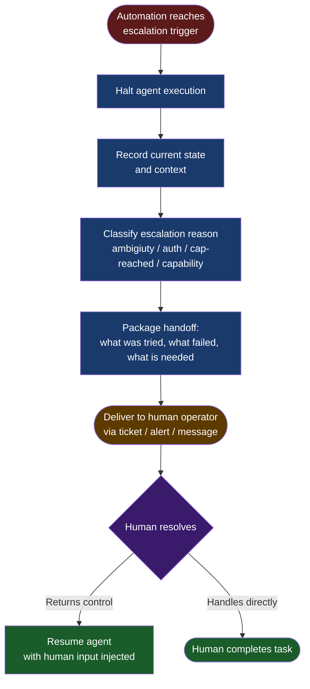

# Human Escalation

**Family:** I — Reliability & Recovery
**Type:** Pattern

## Problem

Automated agents are bounded by their training, context, and available tools. Some failures — ambiguous requirements, authorization decisions, tasks requiring real-world judgment, or errors the agent has exhausted all recovery paths on — cannot be resolved by retrying or falling back. An agent that keeps attempting these tasks silently degrades output quality, wastes budget, and may take harmful actions trying to find a solution it cannot reach.

## Solution

When automation cannot proceed, route the task to a human. The escalation is explicit: the agent stops work, records its state, packages what it knows (what it tried, what failed, what it needs), and delivers a structured handoff to a human operator. The human resolves the blocker or makes the decision, then optionally returns control to the agent.

## Solution Structure

<details>
<summary><b>Human Escalation — Handoff Flow</b></summary>



</details>

## Structure

```
escalationTriggers = [
    retryCapExceeded,
    authorizationRequired,
    ambiguousRequirements,
    capabilityGapDetected,
    highRiskActionRequired
]

function executeWithEscalation(task, agent):
    result = agent.attempt(task)

    if result.succeeded:
        return result

    for trigger in escalationTriggers:
        if trigger.matches(result.failure):
            handoff = EscalationPackage(
                taskId        = task.id,
                agentState    = agent.captureState(),
                attemptsLog   = agent.history,
                failureReason = result.failure,
                humanPrompt   = trigger.generateHandoffMessage(result)
            )
            notifyHuman(handoff)
            return PendingHumanAction(handoff)

    return result  # non-escalation failure: handle via other patterns
```

## When to Use

- The retry cap has been reached with no successful output.
- The task requires a decision that exceeds the agent's authorization scope.
- Requirements are ambiguous and cannot be resolved from available context.
- The agent has detected a high-risk or irreversible action that requires approval.
- A capability gap means no model or tool available can complete the task.

## When Not to Use

- The failure is transient and will resolve with time — retry with backoff instead.
- The error is a logic or format violation the model can fix with feedback — use [Retry-With-Feedback](retry-with-feedback.md).
- Human availability is not guaranteed and the task is time-critical — have a [Fallback Model/Workflow](fallback-model-workflow.md) as a parallel path.
- Escalating every small uncertainty — this trains operators to ignore escalations (alert fatigue).

## Trade-offs

| Pro | Con |
|-----|-----|
| Handles the full class of failures automation cannot reach | Introduces human latency — the task blocks until a human responds |
| Prevents harmful autonomous action in ambiguous situations | Requires a human-in-the-loop process and on-call capacity |
| Structured handoff makes the human's job tractable | Poorly packaged escalations create more work than they save |
| Preserves agent state so the human can resume rather than restart | Alert fatigue if escalation thresholds are set too low |

## Example

An agent is migrating database records. It encounters a record that matches two conflicting transformation rules. Its retry cap is not yet reached, but no amount of retrying resolves the ambiguity — the rule conflict is a data quality issue. The agent halts, packages the conflicting record, the two rules, and the attempted transformations, then opens a ticket for a data engineer. The engineer resolves the conflict; the agent resumes.

## Related Patterns

- [Bounded Retry](bounded-retry.md) — retry cap exhaustion is the primary escalation trigger
- [Structured Error Classification](structured-error-classification.md) — auth errors and capability gaps route directly to this pattern
- [Fallback Model/Workflow](fallback-model-workflow.md) — an automated alternative to escalation when human latency is unacceptable
- [Checkpoint and Resume](checkpoint-and-resume.md) — agent state must be persisted before escalating so the human can resume
- [Stop Condition](stop-condition.md) — escalation is one of the terminal outcomes of a well-defined loop
- [Family K — Human Control](../K-human-control/README.md) — the broader family governing human-agent oversight and control

## Related Anti-Patterns

- [Retry Without New Information](../anti-patterns/retry-without-new-information.md) — what agents do instead of escalating when they should have stopped

## Sources

- **Anthropic Engineering** — AI safety company; authors of Claude. [Building Effective Agents](https://www.anthropic.com/engineering/building-effective-agents)
- **Microsoft Azure Architecture Center** — Microsoft's cloud architecture team. [AI Agent Design Patterns](https://learn.microsoft.com/en-us/azure/architecture/ai-ml/guide/ai-agent-design-patterns)
- **OpenAI Engineering** — AI research company; authors of GPT and Codex. [A Practical Guide to Building AI Agents](https://openai.com/business/guides-and-resources/a-practical-guide-to-building-ai-agents/)
