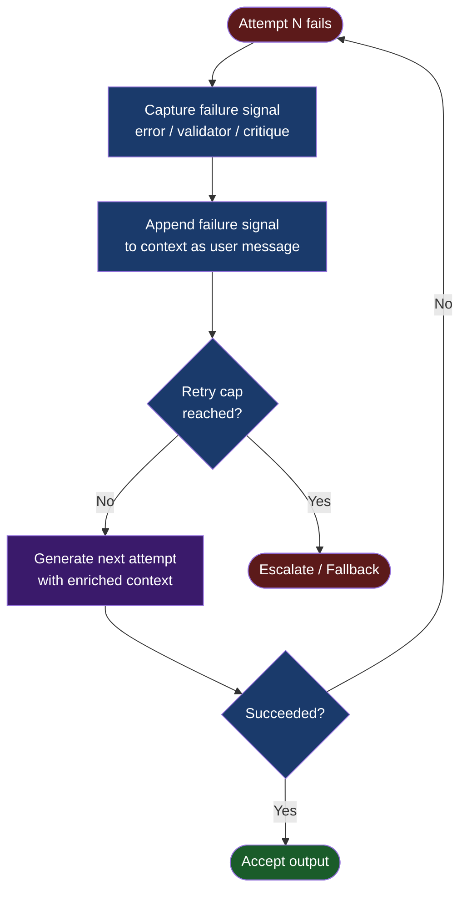

# Retry-With-Feedback

**Family:** I — Reliability & Recovery
**Type:** Pattern

## Problem

When an agent fails, the simplest recovery is to try again with the same input. But repeating an identical prompt to a model that already failed produces the same wrong output — or a different wrong output for the wrong reason. Without new information, retries waste tokens and time.

## Solution

Before retrying, inject the failure signal — the error message, the validator report, the tool exception, or the evaluator's critique — directly into the conversation context. The model then has explicit evidence of what went wrong and can correct its approach. Each retry carries forward everything learned from prior failures.

## Solution Structure

<details>
<summary><b>Retry-With-Feedback — Context Injection Flow</b></summary>



</details>

## Structure

```
function retryWithFeedback(prompt, executor, maxRetries):
    context = [systemMessage(prompt)]
    attempt = 0

    while attempt < maxRetries:
        output = executor(context)

        if succeeded(output):
            return output

        failureSignal = extractFailureReason(output)
        context.append(assistantMessage(output.rawContent))
        context.append(userMessage(
            "The previous attempt failed. Reason: " + failureSignal +
            "\nPlease correct the issue and try again."
        ))
        attempt += 1

    raise RetryCapExceeded(context)
```

## When to Use

- The failure signal is informative enough that the model can act on it (error messages, schema violations, tool exceptions with descriptions).
- Errors are model-caused rather than infrastructure-caused (transient network errors don't benefit from this; just wait and retry).
- The accumulated context from prior attempts does not yet crowd out the working space.
- You need more than one corrective attempt before escalating.

## When Not to Use

- The error message is opaque or uninformative — injecting noise does not help.
- Failures stem from a fundamentally wrong approach that context accumulation will not fix; use [Fresh-Context Retry](fresh-context-retry.md) instead.
- The task is simple enough that a single retry without feedback is sufficient.
- Context length is already near its limit — appending feedback may overflow the window.

## Trade-offs

| Pro | Con |
|-----|-----|
| Each retry is better informed than the last | Conversation context grows with every failure |
| Directly addresses the OpenAI principle: failures are evidence, not just cues to try harder | If the failure signal is misleading, feedback can steer the model in the wrong direction |
| Composable — works inside Validation-Retry Loop or as a standalone wrapper | Requires parsing or extracting a useful failure signal from raw exceptions |
| Minimal overhead; no architectural change to the agent | Does not help when the model lacks the capability to fix the identified problem |

## Example

An agent uses a code-execution tool to run generated Python. The first attempt raises `AttributeError: 'NoneType' object has no attribute 'split'`. The feedback injector appends the full traceback as a user message. On attempt 2 the model adds a null check. The execution succeeds.

## Related Patterns

- [Validation-Retry Loop](validation-retry-loop.md) — a structured loop that uses this pattern as its feedback step
- [Bounded Retry](bounded-retry.md) — caps the number of feedback-enriched retries
- [Root-Cause-Before-Retry](root-cause-before-retry.md) — a deeper diagnostic step before injecting feedback
- [Fresh-Context Retry](fresh-context-retry.md) — alternative when accumulated context becomes the problem
- [Structured Error Classification](structured-error-classification.md) — determines what kind of feedback to inject

## Related Anti-Patterns

- [Retry Without New Information](../anti-patterns/retry-without-new-information.md) — the failure mode this pattern directly prevents

## Sources

- **Anthropic Engineering** — AI safety company; authors of Claude. [Building Effective Agents](https://www.anthropic.com/engineering/building-effective-agents)
- **OpenAI Engineering** — AI research company; authors of GPT and Codex. [A Practical Guide to Building AI Agents](https://openai.com/business/guides-and-resources/a-practical-guide-to-building-ai-agents/)
- **AWS Prescriptive Guidance** — Amazon Web Services architecture team; defines Validation-Retry Loop and Structured Error Classification. [Agentic AI Patterns](https://docs.aws.amazon.com/prescriptive-guidance/latest/agentic-ai-patterns/agent-patterns.html)
