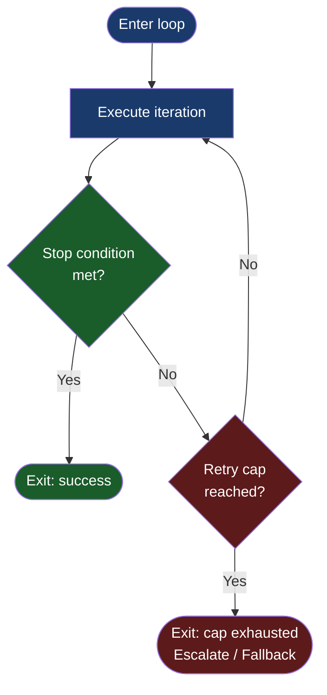

# Stop Condition

**Family:** I — Reliability & Recovery
**Type:** Pattern

## Problem

Retry loops need two kinds of exit: a success exit (the task is done) and a failure exit (give up). Most implementations define the failure exit via a retry cap, but neglect to define the success exit explicitly. Without a clear stop condition, agents continue looping even after the goal is achieved, or they keep searching for a "more complete" answer when a sufficient one already exists. This wastes resources and can cause agents to undo correct work.

## Solution

Before entering any loop, define and encode the exact condition that means "done." The stop condition is checked after every iteration. When it evaluates to true, the loop exits immediately regardless of remaining retry budget. The stop condition is success-oriented; [Bounded Retry](bounded-retry.md) is failure-oriented. Both must be present in every loop.

## Solution Structure

<details>
<summary><b>Stop Condition — Dual-Exit Loop</b></summary>



</details>

## Structure

```
# Stop conditions are defined before the loop starts, not discovered during it.

stopCondition = defineStopCondition(goal):
    # Examples:
    # - output passes all validators
    # - required fields are present and non-empty
    # - confidence score >= threshold
    # - tool returned status "complete"
    # - no remaining sub-tasks in queue

function loop(action, stopCondition, maxRetries):
    attempt = 0

    while attempt < maxRetries:
        output = action()

        if stopCondition(output):
            return Success(output)

        attempt += 1

    return Failure("Cap reached without satisfying stop condition")
```

## When to Use

- In every loop — a loop without a stop condition is by definition unbounded.
- When the success criteria can be expressed as a testable predicate on the output.
- When the loop drives a multi-step task where "done" is a state, not just an absence of errors.
- When the agent might otherwise continue refining an already-sufficient answer.

## When Not to Use

- There is no loop (single-shot tasks do not need a stop condition).
- The success criteria are entirely subjective or undefined — in that case, define them before building the loop, or do not use a loop.

## Trade-offs

| Pro | Con |
|-----|-----|
| Prevents over-iteration on already-correct output | Defining a precise, correct stop condition requires upfront design effort |
| Makes "done" explicit and testable | A poorly chosen condition can cause premature exit (false positive) |
| Pairs with Bounded Retry to provide complete loop safety | Some tasks have emergent completion that is hard to encode as a simple predicate |
| Documented stop conditions are a form of specification | May need multiple conditions ANDed together for complex goals |

## Example

A research agent iteratively searches and summarizes. Its stop condition is: "at least 5 distinct sources cited AND summary length between 200 and 500 words." After iteration 3, both conditions are true. The loop exits immediately — the agent does not spin up a 4th search even though the retry cap is 6.

## Related Patterns

- [Bounded Retry](bounded-retry.md) — the failure-side exit; stop condition is the success-side exit — always use together
- [Validation-Retry Loop](validation-retry-loop.md) — the validator output often serves as the stop condition
- [Human Escalation](human-escalation.md) — when no stop condition can be defined, a human defines "done"
- [Circuit Breaker](circuit-breaker.md) — an external mechanism that can force-exit a loop from outside

## Related Anti-Patterns

- [Infinite / Weakly Bounded Agent Loop](../anti-patterns/infinite-weakly-bounded-loop.md) — the direct consequence of a missing or weak stop condition

## Sources

- **Google Cloud Architecture Center** — Google's cloud architecture team; emphasizes strong termination conditions to avoid runaway loops. [Choose a Design Pattern for Agentic AI](https://docs.cloud.google.com/architecture/choose-design-pattern-agentic-ai-system)
- **Anthropic Engineering** — AI safety company; authors of Claude. [Building Effective Agents](https://www.anthropic.com/engineering/building-effective-agents)
- **AWS Prescriptive Guidance** — Amazon Web Services architecture team; defines Validation-Retry Loop and Structured Error Classification. [Agentic AI Patterns](https://docs.aws.amazon.com/prescriptive-guidance/latest/agentic-ai-patterns/agent-patterns.html)
