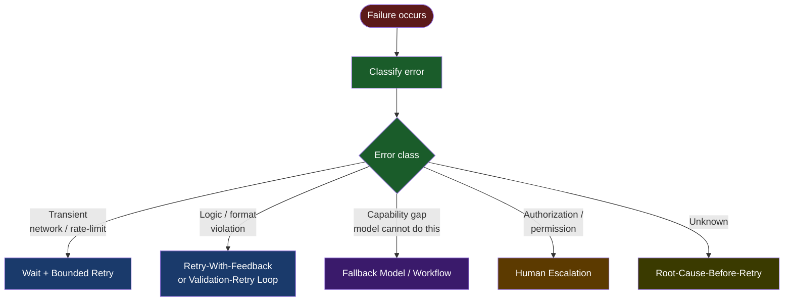

# Structured Error Classification

**Family:** I — Reliability & Recovery
**Type:** Pattern

## Problem

Not all failures warrant the same response. A network timeout should be retried after a delay. A schema violation should be retried with feedback. A permissions error should escalate immediately. A capability gap should fall back to a different model. Without classification, agents apply a single generic retry strategy to every failure type — wasting budget on unrecoverable errors and missing the right recovery action for recoverable ones.

## Solution

Before deciding what to do after a failure, classify the error into a known category. Each category maps to a specific recovery action. The classifier can be a rules-based switch, an LLM-assisted triage, or a combination. Once the error type is known, dispatch to the appropriate recovery pattern.

## Solution Structure

<details>
<summary><b>Structured Error Classification — Dispatch Flow</b></summary>



</details>

## Structure

```
enum ErrorClass:
    TRANSIENT       # timeout, rate limit, network blip
    LOGIC_VIOLATION # wrong format, constraint failure, bad output
    CAPABILITY_GAP  # model fundamentally cannot do this task
    AUTH_ERROR      # missing permission, quota exceeded
    UNKNOWN         # cannot determine cause

function classifyError(error) -> ErrorClass:
    if isRetryableHTTP(error) or isTimeout(error):
        return TRANSIENT
    if isSchemaError(error) or isValidationError(error):
        return LOGIC_VIOLATION
    if isPermissionDenied(error) or isQuotaExceeded(error):
        return AUTH_ERROR
    if isCapabilityRefusal(error):
        return CAPABILITY_GAP
    return UNKNOWN

function handleFailure(error, context):
    match classifyError(error):
        TRANSIENT       -> boundedRetryWithBackoff(context)
        LOGIC_VIOLATION -> retryWithFeedback(context, error)
        CAPABILITY_GAP  -> fallbackModelWorkflow(context)
        AUTH_ERROR      -> humanEscalation(context, error)
        UNKNOWN         -> rootCauseBeforeRetry(context, error)
```

## When to Use

- The agent encounters multiple distinct failure modes and a single retry strategy handles them poorly.
- You want deterministic routing: a given error class always triggers the same recovery path.
- Observability matters — classification makes failure reasons visible in logs and dashboards.
- You are building a long-running or high-stakes agent where wasted retries have real cost.

## When Not to Use

- The agent has a single, simple failure mode — classification overhead is not justified.
- Error signals are too coarse to classify reliably (e.g., a generic "500 Internal Server Error" with no detail).
- The system is a prototype where exhaustive error handling is premature.

## Trade-offs

| Pro | Con |
|-----|-----|
| Right action for every error class — no wasted retries on unrecoverable failures | Requires maintaining an error taxonomy and keeping it current |
| Makes recovery logic explicit and testable | Classification itself can fail or misclassify edge cases |
| Enables targeted observability — dashboards per error class | Upfront design cost to define classes and map them to recovery patterns |
| Composable with every other recovery pattern | Misclassification can route to the wrong recovery action, making things worse |

## Example

An agent calls an external API. Three failures occur in sequence: a 429 Too Many Requests (transient), a response missing a required JSON key (logic violation), and a 403 Forbidden (auth error). The classifier routes each to a different handler: exponential backoff, feedback-injected retry, and immediate human escalation respectively — instead of applying generic retry logic to all three.

## Related Patterns

- [Retry-With-Feedback](retry-with-feedback.md) — the recovery action for logic/format errors
- [Bounded Retry](bounded-retry.md) — the recovery action for transient errors
- [Human Escalation](human-escalation.md) — the recovery action for auth errors and unrecoverable failures
- [Fallback Model/Workflow](fallback-model-workflow.md) — the recovery action for capability gaps
- [Root-Cause-Before-Retry](root-cause-before-retry.md) — the recovery action for unknown errors
- [Circuit Breaker](circuit-breaker.md) — works alongside classification to halt retries on sustained transient failures

## Related Anti-Patterns

- [Retry Without New Information](../anti-patterns/retry-without-new-information.md) — what happens when all errors are treated identically

## Sources

- **AWS Prescriptive Guidance** — Amazon Web Services architecture team; defines Validation-Retry Loop and Structured Error Classification. [Agentic AI Patterns](https://docs.aws.amazon.com/prescriptive-guidance/latest/agentic-ai-patterns/agent-patterns.html)
- **Microsoft Azure Architecture Center** — Microsoft's cloud architecture team. [AI Agent Design Patterns](https://learn.microsoft.com/en-us/azure/architecture/ai-ml/guide/ai-agent-design-patterns)
- **OpenAI Engineering** — AI research company; authors of GPT and Codex. [A Practical Guide to Building AI Agents](https://openai.com/business/guides-and-resources/a-practical-guide-to-building-ai-agents/)
