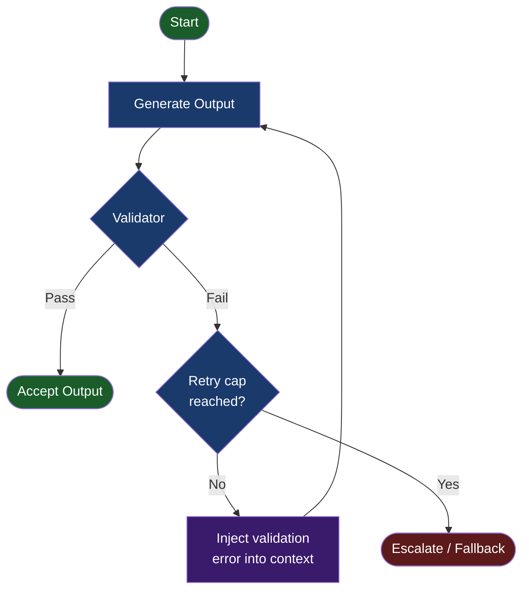

# Validation-Retry Loop

**Family:** I — Reliability & Recovery
**Type:** Pattern

## Problem

An agent produces output that looks plausible but may fail downstream: wrong format, missing fields, failed business rules, or invalid data. Without a gating step, bad output propagates silently, causing hard-to-trace failures later in the pipeline.

## Solution

Wrap the generation step in a loop that passes output through a validator before accepting it. If validation fails, the agent retries — optionally injecting the validation error into the next attempt's context. The loop exits when output passes or a retry cap is reached.

## Solution Structure

<details>
<summary><b>Validation-Retry Loop — Component Flow</b></summary>



</details>

## Structure

```
function validationRetryLoop(prompt, validator, maxRetries):
    attempt = 0
    context = [prompt]

    while attempt < maxRetries:
        output = generate(context)
        result = validator(output)

        if result.passed:
            return output

        attempt += 1
        context.append(assistantMessage(output))
        context.append(userMessage("Validation failed: " + result.errors))

    raise RetryCapExceeded(lastOutput, lastErrors)
```

## When to Use

- Output must conform to a schema, format, or set of business rules before being used.
- The validator is cheap relative to the generation cost.
- Errors are actionable — the model can fix them given the error description.
- You need a hard quality gate before output leaves an agent boundary.

## When Not to Use

- The validator itself is expensive or unreliable (adds noise instead of signal).
- Failures are not caused by model mistakes but by incorrect or ambiguous prompts — fix the prompt instead.
- The retry cap would be so low (1–2) that the loop adds complexity without meaningful benefit.
- Downstream consumers can handle imperfect output gracefully (validation would be premature optimization).

## Trade-offs

| Pro | Con |
|-----|-----|
| Catches format and constraint violations before they propagate | Adds latency per retry |
| Turns validator errors into self-correcting feedback | Loop may oscillate if validator criteria conflict with prompt intent |
| Explicit quality gate with deterministic exit | Retry cap must be tuned; too low misses easy fixes, too high wastes budget |
| Works with any deterministic or rule-based validator | Does not help when the model fundamentally cannot satisfy the constraint |

## Example

An agent generates a JSON payload for an API call. The validator checks that required fields are present and values are within range. On the first attempt the `priority` field is missing. The validator returns `"Missing required field: priority"`. The loop injects this error and the model regenerates with the field included. Output passes on attempt 2.

## Related Patterns

- [Retry-With-Feedback](retry-with-feedback.md) — the feedback-injection step used inside this loop
- [Bounded Retry](bounded-retry.md) — supplies the retry cap that limits the loop
- [Stop Condition](stop-condition.md) — defines the exit criteria (pass or cap)
- [Structured Error Classification](structured-error-classification.md) — can classify validator errors to decide whether retry is worthwhile
- [Root-Cause-Before-Retry](root-cause-before-retry.md) — use when validation keeps failing across retries

## Related Anti-Patterns

- [Retry Without New Information](../anti-patterns/retry-without-new-information.md) — what this pattern avoids by injecting validator output into each retry

## Sources

- **AWS Prescriptive Guidance** — Amazon Web Services architecture team; defines Validation-Retry Loop and Structured Error Classification. [Agentic AI Patterns](https://docs.aws.amazon.com/prescriptive-guidance/latest/agentic-ai-patterns/agent-patterns.html)
- **Anthropic Engineering** — AI safety company; authors of Claude. [Building Effective Agents](https://www.anthropic.com/engineering/building-effective-agents)
- **OpenAI Engineering** — AI research company; authors of GPT and Codex. [A Practical Guide to Building AI Agents](https://openai.com/business/guides-and-resources/a-practical-guide-to-building-ai-agents/)
