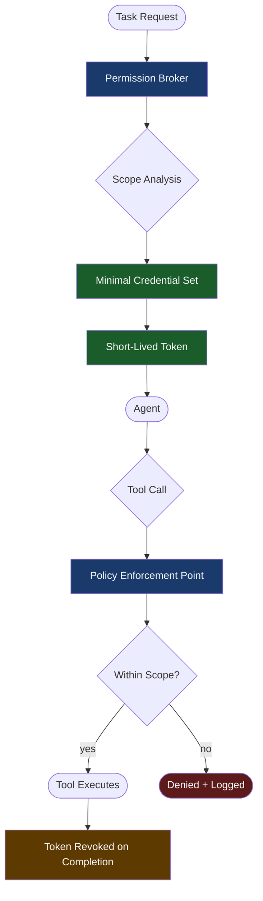

# Least Privilege
**Family:** J — Security & Trust Boundaries
**ID:** J01
**Also appears in:** F (execution isolation)

## Problem

Agents accumulate permissions granted for convenience rather than necessity. When a prompt injection attack or model error occurs, the blast radius is determined entirely by what the agent is allowed to do — not by what it was intended to do. An agent credentialed with broad database access, filesystem write permissions, and admin API tokens can cause catastrophic damage even from a single compromised session.

## Solution

Grant each agent and each tool invocation only the minimum permissions required to complete the specific task at hand. Permissions are scoped by task, not by agent identity. Credentials are short-lived, role-specific, and revoked immediately after task completion. No standing elevated privileges.

## Structure

<details>
<summary><b>Least Privilege — Component Structure</b></summary>



</details>

## Implementation Notes

- **Scope credentials to the operation, not the agent.** A "read email" task should receive a read-only OAuth token scoped to a single mailbox, not a service account with org-wide access.
- **Issue short-lived tokens.** Prefer tokens that expire within the task window (minutes to hours) over long-lived API keys.
- **Separate read and write credentials.** See [J11 — Read/Write Separation](J11-read-write-separation.md).
- **Enumerate required permissions before issuing them.** The orchestrator should declare what the task needs; the permission broker validates the list is minimal and consistent with the task type.
- **Log all permission grants.** The audit trail lives outside the model's reach.
- **Do not pass admin credentials through the context window.** They travel out-of-band to the tool layer.

Pseudocode — permission broker pattern:

```
function issue_task_credentials(task_descriptor):
    required_scopes = analyze_required_scopes(task_descriptor)
    assert required_scopes ⊆ ALLOWLIST[task_descriptor.type]
    token = credential_store.issue(
        scopes=required_scopes,
        ttl=task_descriptor.expected_duration + BUFFER,
        bound_to=task_descriptor.session_id
    )
    return token

function revoke_on_completion(session_id):
    credential_store.revoke_all(bound_to=session_id)
```

## Failure Modes

- **Scope creep over time.** Teams add permissions to fix one-off failures and never remove them. Audit grants periodically.
- **Shared credentials across sessions.** One compromised session can leverage another session's permissions.
- **Permissions granted at agent startup rather than per-task.** Violates the principle; an idle agent holds live credentials.
- **Overly broad "convenience" scopes.** `admin:*` is not a least-privilege scope. Resist pressure to add it.

## Evidence

OWASP GenAI Top 10 for Agentic Applications 2026 identifies excessive agency and over-provisioned credentials as a primary risk vector for agentic systems.

AWS Prescriptive Guidance documents least privilege as a foundational control for agentic AI: temporary credentials, task-scoped roles, and explicit revocation on completion.

## Related Patterns

- [J02 — Sandbox](J02-sandbox.md)
- [J04 — Tool Gateway](J04-tool-gateway.md)
- [J10 — Capability Minimization](J10-capability-minimization.md)
- [J11 — Read/Write Separation](J11-read-write-separation.md)
- [Anti-pattern: Model as Security Boundary](anti-patterns/AP-model-as-security-boundary.md)

## Sources

- OWASP GenAI Security Project — Open Web Application Security Project; defines the top 10 risks for LLM and agentic applications. [OWASP Top 10 for Agentic Applications 2026](https://genai.owasp.org/resource/owasp-top-10-for-agentic-applications-for-2026/)
- AWS Prescriptive Guidance — Amazon Web Services architecture team; strong on least privilege, session isolation, read/write separation. [System Design and Security](https://docs.aws.amazon.com/prescriptive-guidance/latest/agentic-ai-security/best-practices-system-design.html)
