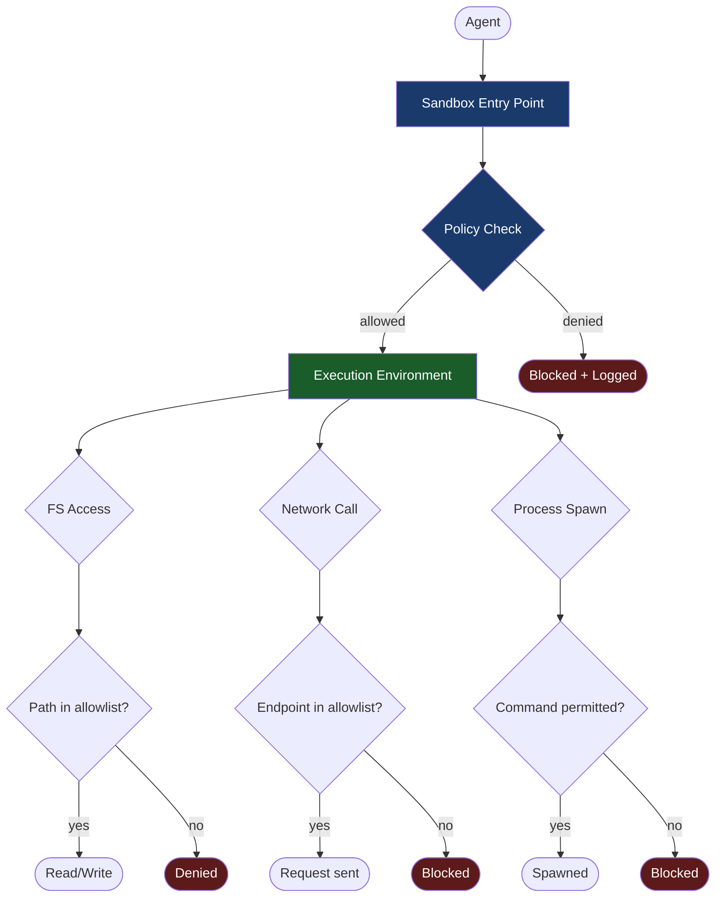

# Sandbox
**Family:** J — Security & Trust Boundaries
**ID:** J02
**Also appears in:** F (execution isolation)

## Problem

When an agent executes code or shell commands, a compromised or misdirected model can access the host filesystem, spawn processes, open network connections, or read environment variables containing secrets. A single prompt injection in untrusted content — a file, a web page, a user message — can weaponize the execution environment against the host system or the broader network.

## Solution

Isolate all agent-controlled execution in a constrained environment — container, VM, or language-level sandbox — that enforces explicit allow-lists for filesystem paths, network endpoints, and system calls. The sandbox is a structural control: it operates at the OS or hypervisor layer, independent of what the model decides to do.

## Structure

<details>
<summary><b>Sandbox — Component Structure</b></summary>



</details>

## Implementation Notes

- **Choose the right isolation layer.** Language-level sandboxes (e.g., seccomp, gVisor, Firecracker microVMs) provide stronger guarantees than process-level isolation alone.
- **Default-deny.** The sandbox blocks everything not explicitly permitted. Do not start from a permissive baseline and carve out exceptions.
- **Ephemeral filesystems.** Mount a fresh, empty working directory per task. No residual state from prior sessions.
- **Network egress control.** Outbound calls should require an explicit allow-list entry. See [J09 — External Communication Restriction](J09-external-comm-restriction.md).
- **No host mounts.** Do not bind-mount host directories containing secrets, credentials, or sensitive data into the sandbox.
- **Immutable base image.** The sandbox image should be read-only except for the designated working directory.

Pseudocode — sandbox invocation:

```
function run_in_sandbox(code, task_context):
    sandbox = SandboxFactory.create(
        image=IMMUTABLE_BASE_IMAGE,
        working_dir=ephemeral_dir(task_context.session_id),
        network_allowlist=task_context.required_endpoints,
        fs_allowlist=["/tmp/work"],
        max_cpu=task_context.cpu_budget,
        max_memory=task_context.memory_budget,
        ttl=task_context.max_duration
    )
    result = sandbox.execute(code)
    sandbox.destroy()
    return result
```

## Failure Modes

- **Sandbox escape via kernel exploits.** MicroVM-level isolation (Firecracker, gVisor) reduces this risk compared to container-only isolation.
- **Secrets injected via environment variables.** The sandbox environment must not inherit host env vars. Pass secrets via a secrets manager, not env.
- **Overly permissive network allowlist.** An allowlist entry for `*.amazonaws.com` is essentially unrestricted egress.
- **Shared working directory between sessions.** Residual files from one session can influence the next. Always use ephemeral per-session directories.
- **Sandbox not applied to all code paths.** If the agent can choose between sandboxed and unsandboxed execution paths, attackers will target the unsandboxed path.

## Evidence

OWASP GenAI Top 10 for Agentic Applications 2026 identifies unsafe code execution as a top risk; sandboxing is the primary mitigation.

AWS Prescriptive Guidance recommends execution isolation as a core control for agentic AI, citing ephemeral compute and network segmentation.

## Related Patterns

- [J01 — Least Privilege](J01-least-privilege.md)
- [J09 — External Communication Restriction](J09-external-comm-restriction.md)
- [J10 — Capability Minimization](J10-capability-minimization.md)
- [Anti-pattern: Overpowered Coding Agent](../anti-patterns/AP-overpowered-coding-agent.md)
- [Family F — Execution Isolation](../../F-harness-environment/README.md)

## Sources

- OWASP GenAI Security Project — Open Web Application Security Project; defines the top 10 risks for LLM and agentic applications. [OWASP Top 10 for Agentic Applications 2026](https://genai.owasp.org/resource/owasp-top-10-for-agentic-applications-for-2026/)
- AWS Prescriptive Guidance — Amazon Web Services architecture team; strong on least privilege, session isolation, read/write separation. [System Design and Security](https://docs.aws.amazon.com/prescriptive-guidance/latest/agentic-ai-security/best-practices-system-design.html)
- Anthropic Engineering — AI safety company; authors of Claude. [Building Effective Agents](https://www.anthropic.com/engineering/building-effective-agents)
