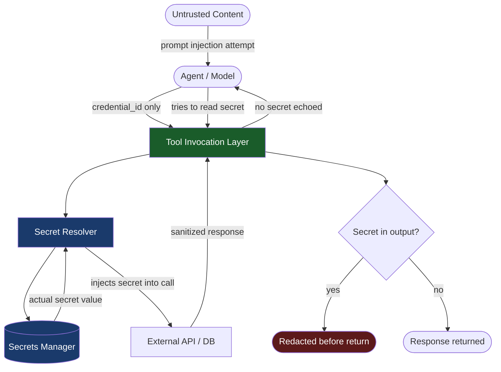

# Secret Isolation
**Family:** J — Security & Trust Boundaries
**ID:** J03

## Problem

Secrets — API keys, database passwords, OAuth tokens, private keys — placed in a context window or returned in tool outputs are exposed to the model. A prompt injection attack embedded in any untrusted content the model processes can instruct the model to repeat, summarize, or exfiltrate those secrets via a subsequent tool call. The model does not need malicious intent for this to succeed; it only needs to follow an instruction it was deceived into treating as legitimate.

## Solution

Secrets never enter the context window and never appear in tool outputs. They are injected directly into tool or API calls at the infrastructure layer, bypassing the model entirely. The model receives only opaque references (e.g., a credential ID or alias) — never the credential value. Secret resolution happens at execution time, outside the model's observation.

## Structure

<details>
<summary><b>Secret Isolation — Component Structure</b></summary>



</details>

## Implementation Notes

- **Pass only opaque references.** The model receives a handle like `db-prod-read` — never the password. The tool layer resolves it.
- **Secrets manager over environment variables.** Env vars leak through log output, error messages, and subprocess inheritance. Use a dedicated secrets manager (Vault, AWS Secrets Manager, etc.).
- **Sanitize all tool outputs.** Scan responses before returning them to the model. If a secret pattern appears in a response (e.g., due to a misconfigured API), redact it before the model sees it.
- **Rotate secrets frequently.** Short-lived secrets limit the damage window if exfiltration occurs.
- **Never log full tool call arguments.** Argument values may contain secrets passed through inadvertently. Log argument keys and types only.

Pseudocode — secret-isolated tool invocation:

```
function invoke_tool_with_secret(tool_name, args, session):
    resolved_args = {}
    for key, value in args:
        if is_credential_reference(value):
            resolved_args[key] = secrets_manager.resolve(value, session.identity)
        else:
            resolved_args[key] = value
    raw_result = tools[tool_name].execute(resolved_args)
    return sanitize_secrets(raw_result)

function sanitize_secrets(text):
    for pattern in SECRET_PATTERNS:
        text = redact(text, pattern)
    return text
```

## Failure Modes

- **Secrets in system prompt.** Developers paste API keys into the system prompt for convenience. Any injected instruction can then exfiltrate them.
- **Tool outputs echoing credentials.** Some APIs return the credential used in the response body. Sanitization must catch this.
- **Logging full prompts.** Observability pipelines that log full context windows capture any secrets present. Log structure, not content.
- **Model asked to "repeat your instructions."** If the system prompt contains secrets, this common jailbreak retrieves them directly.

## Evidence

Simon Willison coined the "lethal trifecta": an agent with private data, untrusted content, and external communication is a ready-made exfiltration pipeline. Secrets in the context window are the private data component of that trifecta.

OWASP GenAI identifies prompt injection (LLM01) as the mechanism by which in-context secrets are exfiltrated.

## Related Patterns

- [J01 — Least Privilege](J01-least-privilege.md)
- [J06 — Untrusted Context Isolation](J06-untrusted-context-isolation.md)
- [J09 — External Communication Restriction](J09-external-comm-restriction.md)
- [Anti-pattern: Overpowered Coding Agent](anti-patterns/AP-overpowered-coding-agent.md)

## Sources

- Simon Willison — independent developer and AI commentator; coined the "lethal trifecta" (private data + untrusted content + external communication). [The Lethal Trifecta for AI Agents](https://simonwillison.net/2025/Jun/16/the-lethal-trifecta/)
- OWASP GenAI Security Project — Open Web Application Security Project; defines the top 10 risks for LLM and agentic applications. [Prompt Injection](https://genai.owasp.org/llmrisk/llm01-prompt-injection/) | [OWASP Top 10 for Agentic Applications 2026](https://genai.owasp.org/resource/owasp-top-10-for-agentic-applications-for-2026/)
- AWS Prescriptive Guidance — Amazon Web Services architecture team; strong on least privilege, session isolation, read/write separation. [System Design and Security](https://docs.aws.amazon.com/prescriptive-guidance/latest/agentic-ai-security/best-practices-system-design.html)
