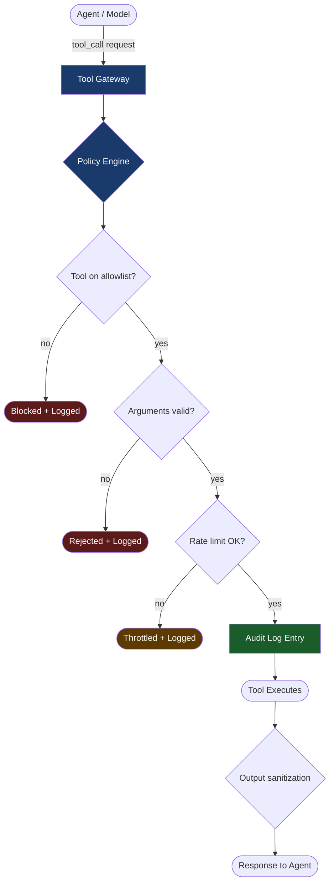

# Tool Gateway
**Family:** J — Security & Trust Boundaries
**ID:** J04
**Also appears in:** G (tool design)

## Problem

Agents invoke tools based on model decisions. Without a centralized enforcement layer, every tool is a potential attack surface: prompt injection can trigger arbitrary tool calls, model errors can invoke destructive operations, and there is no audit trail of what was called, when, and with what arguments. Individual tool implementations cannot reliably enforce cross-cutting policies because the model chooses which tool to call and with what arguments.

## Solution

All tool calls route through a single policy-enforcement gateway before execution. The gateway validates the call against a declared policy (allowed tools, allowed argument ranges, rate limits, session context), logs the invocation, and either forwards it to the tool or blocks it. No tool is reachable except through the gateway.

## Structure

<details>
<summary><b>Tool Gateway — Component Structure</b></summary>



</details>

## Implementation Notes

- **Declare tool allowlists per task type.** A summarization task has no legitimate reason to call a file-delete tool. Allowlists are task-scoped, not agent-scoped.
- **Validate argument shapes and ranges.** Reject calls where arguments are outside expected types or value ranges. An argument of `path: "../../etc/passwd"` should never reach a file-read tool.
- **Rate-limit all write operations.** Burst write limits catch runaway loops before they cause mass damage.
- **Make the audit log immutable.** The model cannot delete log entries. Ship them to append-only storage outside the agent's reach.
- **Sanitize outputs before returning.** Tool responses can contain injected instructions. Strip or quote content that looks like model instructions.
- **One gateway, all tools.** Do not allow tools to be called directly even in test paths. Side channels become production attack surfaces.

Pseudocode — gateway dispatch:

```
function gateway_dispatch(tool_name, args, session):
    policy = load_policy(session.task_type)
    assert tool_name in policy.allowed_tools
    validate_args(tool_name, args, policy.arg_constraints[tool_name])
    check_rate_limit(session.id, tool_name, policy.rate_limits)
    audit_log.append(session.id, tool_name, args_schema(args), timestamp())
    result = tool_registry[tool_name].execute(args)
    return sanitize_output(result)
```

## Failure Modes

- **Gateway bypassed in development.** Tools called directly during testing; the bypass path remains accessible in production.
- **Allowlist too broad.** `allowed_tools: ["*"]` provides no protection.
- **Arguments logged in full.** Audit logs contain sensitive argument values. Log argument structure, not values.
- **No output sanitization.** Injected instructions in tool responses are passed directly back to the model, enabling secondary injection.
- **Per-tool enforcement instead of centralized.** Inconsistent policies across tools create gaps. Centralize everything.

## Evidence

OWASP GenAI Top 10 for Agentic Applications 2026 identifies tool misuse and excessive agency as top risks; a centralized gateway is the structural mitigation.

AWS Prescriptive Guidance recommends explicit tool allowlists and argument validation as core agentic AI security controls.

## Related Patterns

- [J01 — Least Privilege](J01-least-privilege.md)
- [J05 — Deterministic Authorization](J05-deterministic-authorization.md)
- [J08 — Human Approval Gate](J08-human-approval-gate.md)
- [J10 — Capability Minimization](J10-capability-minimization.md)
- [Anti-pattern: Model as Security Boundary](../anti-patterns/AP-model-as-security-boundary.md)
- [Family G — Tool Design](../../G-tool-action-design/README.md)

## Sources

- OWASP GenAI Security Project — Open Web Application Security Project; defines the top 10 risks for LLM and agentic applications. [OWASP Top 10 for Agentic Applications 2026](https://genai.owasp.org/resource/owasp-top-10-for-agentic-applications-for-2026/) | [OWASP LLM Top 10](https://genai.owasp.org/llm-top-10/)
- AWS Prescriptive Guidance — Amazon Web Services architecture team; strong on least privilege, session isolation, read/write separation. [System Design and Security](https://docs.aws.amazon.com/prescriptive-guidance/latest/agentic-ai-security/best-practices-system-design.html) | [Agentic AI Patterns](https://docs.aws.amazon.com/prescriptive-guidance/latest/agentic-ai-patterns/agent-patterns.html)
- Anthropic Engineering — AI safety company; authors of Claude. [Building Effective Agents](https://www.anthropic.com/engineering/building-effective-agents)
