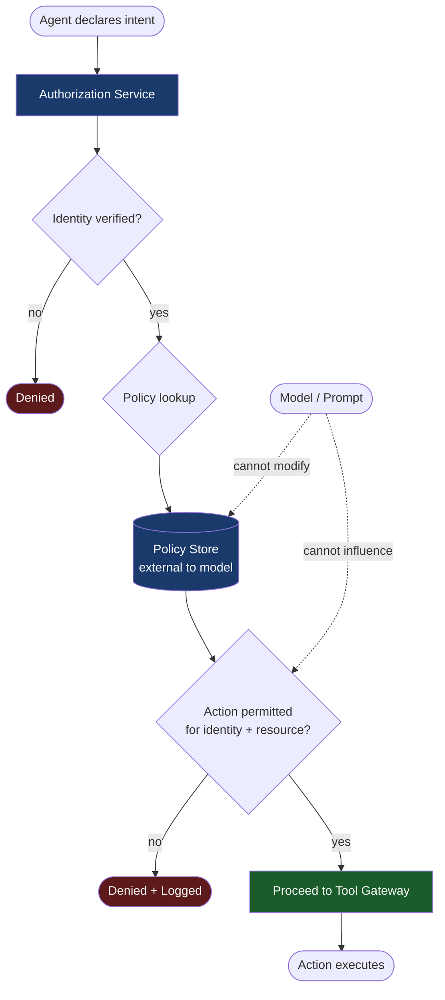

# Deterministic Authorization
**Family:** J — Security & Trust Boundaries
**ID:** J05
**Also appears in:** H (deterministic control)

## Problem

When authorization decisions are delegated to the model ("decide whether the user should be allowed to do X"), the model becomes the security boundary. Models can be manipulated through prompt injection, jailbreaks, or context manipulation to grant access they should deny. Authorization is a deterministic, rule-based function — it is categorically unsuitable for a probabilistic text predictor.

## Solution

All authorization decisions are made by deterministic code outside the model. The model never evaluates whether an action is permitted; it only declares intent. A separate authorization layer — a policy engine, ACL check, or RBAC evaluator — makes the binary permit/deny decision based on the authenticated identity, the requested resource, and a policy document the model cannot modify.

## Structure

<details>
<summary><b>Deterministic Authorization — Component Structure</b></summary>



</details>

## Implementation Notes

- **Identity comes from the session, not the prompt.** The model cannot claim an identity. The authenticated user or service identity is established at session creation and passed as session metadata to the authorization layer.
- **Policy store is append-only and out of model reach.** The model cannot read or modify authorization policies.
- **Use established policy formats.** OPA/Rego, AWS IAM policies, or Cedar provide auditable, testable policy languages. Avoid ad-hoc code.
- **Deny by default.** An authorization miss (no matching policy) results in denial, never implicit permit.
- **Log all authorization decisions.** Both grants and denials, with full context (identity, resource, action, policy matched).
- **Never ask the model "should this be allowed?"** That is not an authorization check; it is a conversation.

Pseudocode — deterministic authorization check:

```
function authorize(session, action, resource):
    identity = session.verified_identity  // set at auth time, not by model
    policy = policy_store.lookup(identity, action, resource)
    if policy is None:
        audit_log.append(DENY, identity, action, resource, "no_policy")
        raise AuthorizationDenied()
    if policy.effect == DENY:
        audit_log.append(DENY, identity, action, resource, policy.id)
        raise AuthorizationDenied()
    audit_log.append(PERMIT, identity, action, resource, policy.id)
    return PERMIT
```

## Failure Modes

- **Model asked to evaluate access.** "Given the user said they are an admin, should they be allowed to delete this?" — this is not authorization; it is prompt injection waiting to happen.
- **Identity from the prompt.** If the model can set or override identity claims, authorization is bypassed by assertion.
- **Permissive defaults.** A missing policy that defaults to permit means any new resource is publicly accessible until a deny rule is added.
- **Authorization bypassed for "internal" calls.** Service-to-service calls within the agent system still require authorization. Internal does not mean trusted.

## Evidence

OWASP GenAI Top 10 for Agentic Applications 2026 identifies model reliance for security decisions as a critical risk, specifying that authorization must be enforced by deterministic systems external to the model.

AWS Prescriptive Guidance documents identity-based authorization as a non-negotiable control for agentic AI: the model declares intent; deterministic code decides.

## Related Patterns

- [J04 — Tool Gateway](J04-tool-gateway.md)
- [J07 — Session Isolation](J07-session-isolation.md)
- [J08 — Human Approval Gate](J08-human-approval-gate.md)
- [Anti-pattern: Model as Security Boundary](anti-patterns/AP-model-as-security-boundary.md)
- [Family H — Deterministic Control](../H-deterministic-control/README.md)

## Sources

- OWASP GenAI Security Project — Open Web Application Security Project; defines the top 10 risks for LLM and agentic applications. [OWASP Top 10 for Agentic Applications 2026](https://genai.owasp.org/resource/owasp-top-10-for-agentic-applications-for-2026/) | [Prompt Injection](https://genai.owasp.org/llmrisk/llm01-prompt-injection/)
- AWS Prescriptive Guidance — Amazon Web Services architecture team; strong on least privilege, session isolation, read/write separation. [System Design and Security](https://docs.aws.amazon.com/prescriptive-guidance/latest/agentic-ai-security/best-practices-system-design.html)
- Anthropic Engineering — AI safety company; authors of Claude. [Building Effective Agents](https://www.anthropic.com/engineering/building-effective-agents)
