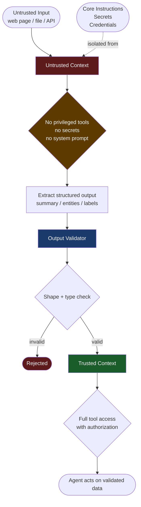

# Untrusted Context Isolation
**Family:** J — Security & Trust Boundaries
**ID:** J06

## Problem

Agents routinely process untrusted content: web pages fetched by a browsing tool, user-uploaded files, third-party API responses, database rows written by external systems. Any of this content can contain embedded instructions designed to hijack the agent's behavior — a prompt injection attack. When untrusted content is processed in the same context as the agent's core instructions and credentials, a single injected instruction can redirect the agent's goals, exfiltrate data, or invoke destructive tools.

## Solution

Untrusted inputs are processed in a separate, constrained context that has no access to privileged instructions, secrets, or high-impact tools. The untrusted context extracts only structured, typed outputs (summaries, classifications, entities) that are then validated before being passed to the trusted context. Raw untrusted content never appears in the same context window as privileged instructions.

## Structure

<details>
<summary><b>Untrusted Context Isolation — Component Structure</b></summary>



</details>

## Implementation Notes

- **Two-context model.** The untrusted processing context has a minimal system prompt with no credentials, no privileged tool access, and explicit instructions to extract only structured data.
- **Define a typed extraction schema.** The untrusted context returns a structured object (e.g., JSON with a fixed schema), not free text. This makes injected instructions structurally invalid.
- **Validate the extraction output.** Check that the returned object matches the expected schema and that values are within expected ranges. A "summary" field should not contain tool-call syntax.
- **Never pass raw content to the trusted context.** Pass only the validated structured extract.
- **Treat all external API responses as untrusted.** Third-party APIs can be compromised or return adversarially crafted content. The trust boundary applies to all external data, not just user input.

Pseudocode — two-context processing:

```
function process_untrusted(raw_content, extraction_schema):
    untrusted_ctx = Context(
        system_prompt=MINIMAL_EXTRACTION_PROMPT,
        tools=[],
        secrets={}
    )
    raw_extract = untrusted_ctx.invoke(
        prompt=f"Extract the following fields: {extraction_schema}\n\n{raw_content}"
    )
    validated = validate_schema(raw_extract, extraction_schema)
    return validated  // only typed, validated data crosses the boundary

function trusted_agent_act(validated_data):
    // trusted context acts only on validated structured data
    ...
```

## Failure Modes

- **Passing raw content to the trusted context "for context."** This defeats the isolation entirely. The trusted context must never see raw untrusted content.
- **Extraction schema too permissive.** A schema that allows a "notes" field of arbitrary text is a prompt injection pass-through.
- **Trusting extraction outputs without validation.** The untrusted context can itself be manipulated; its outputs must be validated structurally before the trusted context acts on them.
- **Single-context systems.** Many agentic frameworks process all content in one context. This is the root cause, not a configuration option.

## Evidence

Simon Willison identifies untrusted content in the context window as one leg of the lethal trifecta. Isolation is the structural defense: keep untrusted content away from privileged context.

OWASP GenAI identifies prompt injection (LLM01) as the primary mechanism; indirect injection through processed content is explicitly called out.

## Related Patterns

- [J03 — Secret Isolation](J03-secret-isolation.md)
- [J07 — Session Isolation](J07-session-isolation.md)
- [J09 — External Communication Restriction](J09-external-comm-restriction.md)
- [Anti-pattern: Overpowered Coding Agent](../anti-patterns/AP-overpowered-coding-agent.md)

## Sources

- Simon Willison — independent developer and AI commentator; coined the "lethal trifecta" (private data + untrusted content + external communication). [The Lethal Trifecta for AI Agents](https://simonwillison.net/2025/Jun/16/the-lethal-trifecta/) | [Living Dangerously with Claude](https://simonwillison.net/2025/Oct/22/living-dangerously-with-claude/)
- OWASP GenAI Security Project — Open Web Application Security Project; defines the top 10 risks for LLM and agentic applications. [Prompt Injection](https://genai.owasp.org/llmrisk/llm01-prompt-injection/) | [OWASP Top 10 for Agentic Applications 2026](https://genai.owasp.org/resource/owasp-top-10-for-agentic-applications-for-2026/)
