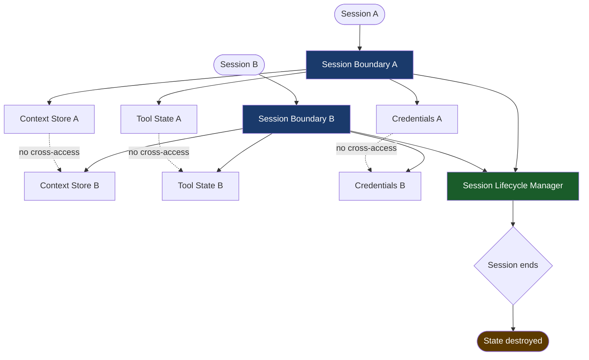

# Session Isolation
**Family:** J — Security & Trust Boundaries
**ID:** J07

## Problem

In multi-tenant or multi-session agentic systems, state from one session can leak into another through shared memory, shared tool state, shared caches, or shared context storage. This creates two failure modes: data leakage between tenants (a security breach) and context pollution between sessions (a correctness failure that becomes a security failure when the polluted context changes authorization behavior or tool invocations).

## Solution

Each session has a fully isolated state boundary. No session shares memory, context, tool state, or credentials with any other session. Session data is scoped by a session ID that is set at creation and cannot be influenced by the model. Session state is destroyed on completion. Blast radius of any compromise is bounded to a single session.

## Structure

<details>
<summary><b>Session Isolation — Component Structure</b></summary>



</details>

## Implementation Notes

- **Session ID is immutable and set by the orchestrator.** The model cannot read, modify, or influence the session ID. It is used as the partition key for all state storage.
- **Partition all storage by session ID.** Context stores, tool call logs, scratch pads, and credential bindings are all keyed by session ID. Cross-session reads are rejected at the storage layer, not by the model.
- **Ephemeral session stores.** Prefer in-memory or TTL-backed stores that auto-expire on session end. Do not rely on explicit cleanup; make expiry automatic.
- **No shared global state.** Avoid module-level or process-level state that accumulates across sessions. This includes LRU caches keyed only by content hash — two sessions with the same query must not share results if the results are session-sensitive.
- **Audit trail per session.** Each session has its own isolated audit log entry that can be reviewed independently.

Pseudocode — session-scoped state access:

```
function get_context(session_id, key):
    store = context_store.partition(session_id)
    return store.get(key)  // raises if session_id not owned by caller

function set_context(session_id, key, value):
    store = context_store.partition(session_id)
    store.set(key, value, ttl=SESSION_TTL)

function end_session(session_id):
    context_store.destroy_partition(session_id)
    credential_store.revoke_all(bound_to=session_id)
    audit_log.finalize(session_id)
```

## Failure Modes

- **Shared in-memory cache across sessions.** A cache hit from session A populates data for session B. Common in frameworks that cache model responses by prompt hash.
- **Session state written to a shared database table without tenant partition.** A query without a `WHERE session_id = ?` clause reads across all sessions.
- **Credentials not revoked on session end.** Long-lived credentials bound to a session continue to be usable after the session ends.
- **Context store not cleared between sessions in a worker pool.** Worker reuse without state reset means each new session inherits the prior session's context.

## Evidence

AWS Prescriptive Guidance explicitly documents session isolation as a core agentic AI security control, with blast-radius containment as the primary goal.

OWASP GenAI Top 10 for Agentic Applications 2026 identifies cross-session data leakage as a risk in multi-tenant agentic deployments.

## Related Patterns

- [J01 — Least Privilege](J01-least-privilege.md)
- [J05 — Deterministic Authorization](J05-deterministic-authorization.md)
- [J06 — Untrusted Context Isolation](J06-untrusted-context-isolation.md)
- [J11 — Read/Write Separation](J11-read-write-separation.md)

## Sources

- AWS Prescriptive Guidance — Amazon Web Services architecture team; strong on least privilege, session isolation, read/write separation. [System Design and Security](https://docs.aws.amazon.com/prescriptive-guidance/latest/agentic-ai-security/best-practices-system-design.html) | [Agentic AI Patterns](https://docs.aws.amazon.com/prescriptive-guidance/latest/agentic-ai-patterns/agent-patterns.html)
- OWASP GenAI Security Project — Open Web Application Security Project; defines the top 10 risks for LLM and agentic applications. [OWASP Top 10 for Agentic Applications 2026](https://genai.owasp.org/resource/owasp-top-10-for-agentic-applications-for-2026/)
