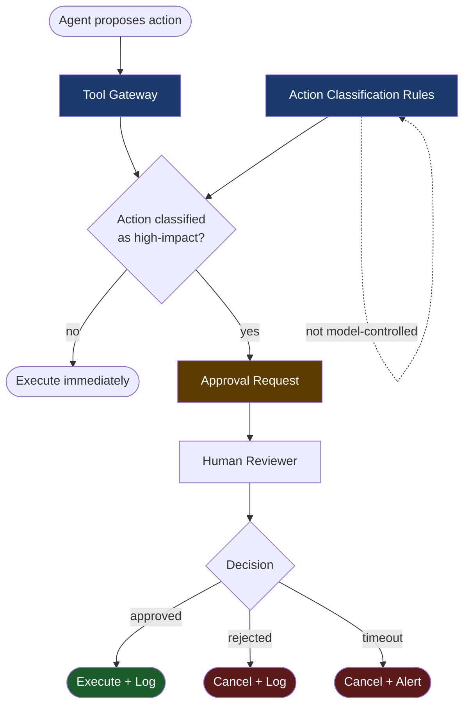

# Human Approval Gate
**Family:** J — Security & Trust Boundaries
**ID:** J08
**Also appears in:** K (human oversight)

## Problem

Agents can be instructed — through prompt injection, model error, or ambiguous task specification — to take irreversible or high-impact actions: deleting records, sending emails, making purchases, deploying code, or modifying access controls. Once taken, these actions cannot be undone. The cost of a false positive (blocked legitimate action) is low; the cost of a false negative (unchecked destructive action) can be catastrophic.

## Solution

Any action classified as irreversible or high-impact is paused before execution, and an explicit human approval is required to proceed. The approval request includes the full action description, the arguments, and the reason the agent proposes to take it. The agent cannot proceed until a human responds. The gate is enforced at the tool gateway layer — not by the model deciding to ask.

## Structure

<details>
<summary><b>Human Approval Gate — Component Structure</b></summary>



</details>

## Implementation Notes

- **Classification is deterministic, not model-driven.** The list of high-impact action types is a static configuration that the model cannot modify. Examples: `delete`, `send`, `deploy`, `grant`, `purchase`.
- **The approval request must be self-contained.** The reviewer must be able to make an informed decision without referring back to the agent. Include: action name, all arguments (redacted for secrets), proposed reason, estimated impact.
- **Set a timeout with a safe default.** If no approval arrives within the timeout window, cancel the action. Do not default to proceed.
- **Log the full approval lifecycle.** Request sent, by whom, when; decision, by whom, when; action taken or cancelled.
- **Do not allow the model to reclassify actions.** If the model argues that a deletion is "safe" and should not require approval, that argument should be disregarded. Classification rules are fixed.
- **Batch low-latency approvals.** For interactive workflows, surface approvals in the UI where the user is already working rather than requiring out-of-band notification.

Pseudocode — approval gate:

```
function execute_with_gate(tool_name, args, session):
    if is_high_impact(tool_name, args):
        request_id = approval_queue.enqueue(
            tool=tool_name,
            args=redact_secrets(args),
            session=session.id,
            proposed_reason=session.current_goal,
            timeout=APPROVAL_TIMEOUT
        )
        decision = approval_queue.wait(request_id)
        if decision != APPROVED:
            raise ActionCancelled(request_id)
    return tool_registry[tool_name].execute(args)
```

## Failure Modes

- **Classification maintained by the model.** The model decides whether its own action is high-impact. This is trivially bypassed.
- **Approval UI buried in a log.** Humans ignore approvals they cannot easily act on. The gate becomes rubber-stamp approval or silent timeout-cancellation.
- **Timeout defaults to proceed.** Under load, timeouts fire frequently and actions proceed unapproved.
- **Approval scope too narrow.** Only "delete" is gated; "bulk update" with destructive semantics is not. Classify by effect, not just verb.

## Evidence

Anthropic Engineering recommends human-in-the-loop gates for irreversible agentic actions as a core pattern in effective agent design.

OWASP GenAI Top 10 for Agentic Applications 2026 identifies unchecked autonomous action as a primary risk, with human oversight gates as the mitigation.

## Related Patterns

- [J04 — Tool Gateway](J04-tool-gateway.md)
- [J05 — Deterministic Authorization](J05-deterministic-authorization.md)
- [J10 — Capability Minimization](J10-capability-minimization.md)
- [Anti-pattern: Model as Security Boundary](../anti-patterns/AP-model-as-security-boundary.md)
- [Family K — Human Oversight](../../K-human-control/README.md)

## Sources

- Anthropic Engineering — AI safety company; authors of Claude. [Building Effective Agents](https://www.anthropic.com/engineering/building-effective-agents)
- OWASP GenAI Security Project — Open Web Application Security Project; defines the top 10 risks for LLM and agentic applications. [OWASP Top 10 for Agentic Applications 2026](https://genai.owasp.org/resource/owasp-top-10-for-agentic-applications-for-2026/)
