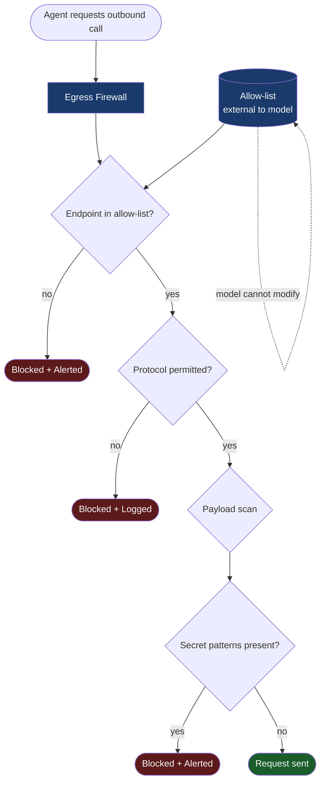

# External Communication Restriction
**Family:** J — Security & Trust Boundaries
**ID:** J09

## Problem

An agent with unrestricted outbound network access is a ready-made exfiltration channel. A prompt injection attack embedded in any content the agent processes can instruct the agent to send data to an attacker-controlled endpoint — email, HTTP webhook, DNS lookup, or any other outbound protocol. This is the third leg of Simon Willison's lethal trifecta: private data + untrusted content + external communication. When all three are present simultaneously, exfiltration requires only a single injected instruction.

## Solution

All outbound network calls require an explicit entry in a static allow-list maintained outside the model's reach. Any call to an endpoint not on the allow-list is blocked at the network layer before it leaves the agent's execution environment. The allow-list is minimal, reviewed, and version-controlled. New entries require human approval.

## Structure

<details>
<summary><b>External Communication Restriction — Component Structure</b></summary>



</details>

## Implementation Notes

- **Enforce at the network layer, not the application layer.** The model can bypass application-level checks by crafting tool calls in unexpected ways. Network-layer enforcement (firewall rules, egress proxy) cannot be bypassed by model behavior.
- **Allow-list by full hostname and protocol, not by domain pattern.** `*.amazonaws.com` permits exfiltration to attacker-controlled S3 buckets. List specific hostnames and ports.
- **Block DNS-based exfiltration.** Attackers use DNS lookups to encode exfiltrated data in subdomains. DNS egress should be restricted to a known resolver with query logging.
- **Scan outbound payloads for secret patterns.** Before any allowed outbound call, scan the payload for credential patterns (API key formats, JWTs, private key headers). Block if found.
- **Alert on blocked attempts.** Blocked egress calls are security events, not routine noise. Alert the operations team immediately.
- **Review and minimize the allow-list periodically.** Entries added for one task and never removed expand the exfiltration surface over time.

Pseudocode — egress enforcement:

```
function send_request(url, payload, session):
    hostname = parse_hostname(url)
    protocol = parse_protocol(url)
    assert hostname in EGRESS_ALLOWLIST, f"Blocked: {hostname} not allowed"
    assert protocol in PERMITTED_PROTOCOLS
    assert not contains_secret_patterns(payload)
    audit_log.append(session.id, "egress", hostname, timestamp())
    return http_client.send(url, payload)
```

## Failure Modes

- **Allow-list managed by the model or populated dynamically from model output.** The model can add itself to the allow-list via an injected instruction.
- **HTTP allowed but not audited.** Calls succeed but there is no record of what data was sent where.
- **DNS not restricted.** Outbound HTTP is blocked but DNS queries are unrestricted; data is exfiltrated via subdomain encoding.
- **Allow-list entries too broad.** A wildcard entry permits calls to any subdomain of a large domain, including attacker-controlled ones.
- **No payload scanning.** An API call to an allowed endpoint carries exfiltrated private data in a query parameter or request body.

## Evidence

Simon Willison identifies external communication as the third leg of the lethal trifecta. Restricting external communication is the structural control that breaks the trifecta even when the other two legs are present.

OWASP GenAI Top 10 for Agentic Applications 2026 calls out data exfiltration via agent-initiated network calls as a primary risk vector.

## Related Patterns

- [J03 — Secret Isolation](J03-secret-isolation.md)
- [J06 — Untrusted Context Isolation](J06-untrusted-context-isolation.md)
- [J02 — Sandbox](J02-sandbox.md)
- [J08 — Human Approval Gate](J08-human-approval-gate.md)
- [Anti-pattern: Overpowered Coding Agent](anti-patterns/AP-overpowered-coding-agent.md)

## Sources

- Simon Willison — independent developer and AI commentator; coined the "lethal trifecta" (private data + untrusted content + external communication). [The Lethal Trifecta for AI Agents](https://simonwillison.net/2025/Jun/16/the-lethal-trifecta/) | [Living Dangerously with Claude](https://simonwillison.net/2025/Oct/22/living-dangerously-with-claude/)
- OWASP GenAI Security Project — Open Web Application Security Project; defines the top 10 risks for LLM and agentic applications. [OWASP Top 10 for Agentic Applications 2026](https://genai.owasp.org/resource/owasp-top-10-for-agentic-applications-for-2026/) | [Prompt Injection](https://genai.owasp.org/llmrisk/llm01-prompt-injection/)
- AWS Prescriptive Guidance — Amazon Web Services architecture team; strong on least privilege, session isolation, read/write separation. [System Design and Security](https://docs.aws.amazon.com/prescriptive-guidance/latest/agentic-ai-security/best-practices-system-design.html)
