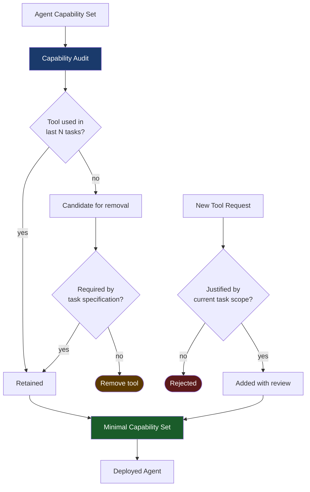

# Capability Minimization
**Family:** J — Security & Trust Boundaries
**ID:** J10

## Problem

Agent systems accumulate capabilities over time: tools are added for new features, permissions are broadened to fix one-off failures, and APIs are integrated without removing older ones. Each capability is an additional attack surface. An agent with 40 tools, broad filesystem access, and multiple external API integrations presents a far larger attack surface than one with 5 focused tools — even if the agent's task scope never changed. The attack surface grows while the task scope stays constant.

## Solution

Regularly audit and remove capabilities that are not required for the agent's current task scope. Capability minimization is a structural discipline, not a one-time setup. Tools are removed, not just disabled. Permissions are revoked, not just scoped down. The goal is the smallest possible capability set that still allows the agent to accomplish its intended tasks.

## Structure

<details>
<summary><b>Capability Minimization — Component Structure</b></summary>



</details>

## Implementation Notes

- **Treat tool addition as a security decision.** Every new tool added to an agent increases the blast radius of a compromise. Require a documented justification and a reviewer sign-off.
- **Remove tools, do not just disable them.** A disabled tool can be re-enabled; a removed tool requires deliberate re-addition. Removal is the stronger control.
- **Audit tool usage periodically.** Log which tools are invoked and how often. Tools with zero invocations over a review period are removal candidates.
- **Separate agents by task scope.** An agent that does code review and an agent that deploys to production should be separate agents with separate capability sets. Do not combine for convenience.
- **Apply minimization to permissions, not just tools.** Database read permission for 10 tables when only 2 are used is a capability excess. Scope to the used tables.
- **Document the rationale for every retained capability.** If you cannot explain why a capability is needed, it is a removal candidate.

Pseudocode — capability audit:

```
function audit_capabilities(agent, review_period):
    usage = tool_usage_log.aggregate(agent.id, since=now() - review_period)
    for tool in agent.tools:
        if tool.name not in usage or usage[tool.name].count == 0:
            flag_for_removal(agent.id, tool.name, reason="unused")
    for permission in agent.permissions:
        if permission not in agent.task_specification.required_permissions:
            flag_for_removal(agent.id, permission, reason="not_in_spec")
    return removal_candidates(agent.id)
```

## Failure Modes

- **"We might need it later."** Capabilities are retained speculatively. Every speculative capability is permanent attack surface.
- **Tool removal treated as breaking change.** Teams resist removal because they are uncertain whether a tool is truly unused. Solve this with usage logging, not retention.
- **Capability minimization applied only at initial setup.** The agent is minimal on day one and accumulates capabilities over months. Minimization requires ongoing audit.
- **Shared capability sets across agents.** All agents use the same tool registry. Minimization for one agent is ineffective if others share its credentials and tools.

## Evidence

OWASP GenAI Top 10 for Agentic Applications 2026 identifies excessive agency — over-provisioned tools, permissions, and autonomy — as a top risk for agentic applications.

AWS Prescriptive Guidance recommends minimizing agent capability sets as a core security control, citing attack surface reduction as the primary goal.

## Related Patterns

- [J01 — Least Privilege](J01-least-privilege.md)
- [J02 — Sandbox](J02-sandbox.md)
- [J04 — Tool Gateway](J04-tool-gateway.md)
- [J11 — Read/Write Separation](J11-read-write-separation.md)
- [Anti-pattern: Overpowered Coding Agent](../anti-patterns/AP-overpowered-coding-agent.md)

## Sources

- OWASP GenAI Security Project — Open Web Application Security Project; defines the top 10 risks for LLM and agentic applications. [OWASP Top 10 for Agentic Applications 2026](https://genai.owasp.org/resource/owasp-top-10-for-agentic-applications-for-2026/) | [OWASP LLM Top 10](https://genai.owasp.org/llm-top-10/)
- AWS Prescriptive Guidance — Amazon Web Services architecture team; strong on least privilege, session isolation, read/write separation. [System Design and Security](https://docs.aws.amazon.com/prescriptive-guidance/latest/agentic-ai-security/best-practices-system-design.html) | [Agentic AI Patterns](https://docs.aws.amazon.com/prescriptive-guidance/latest/agentic-ai-patterns/agent-patterns.html)
