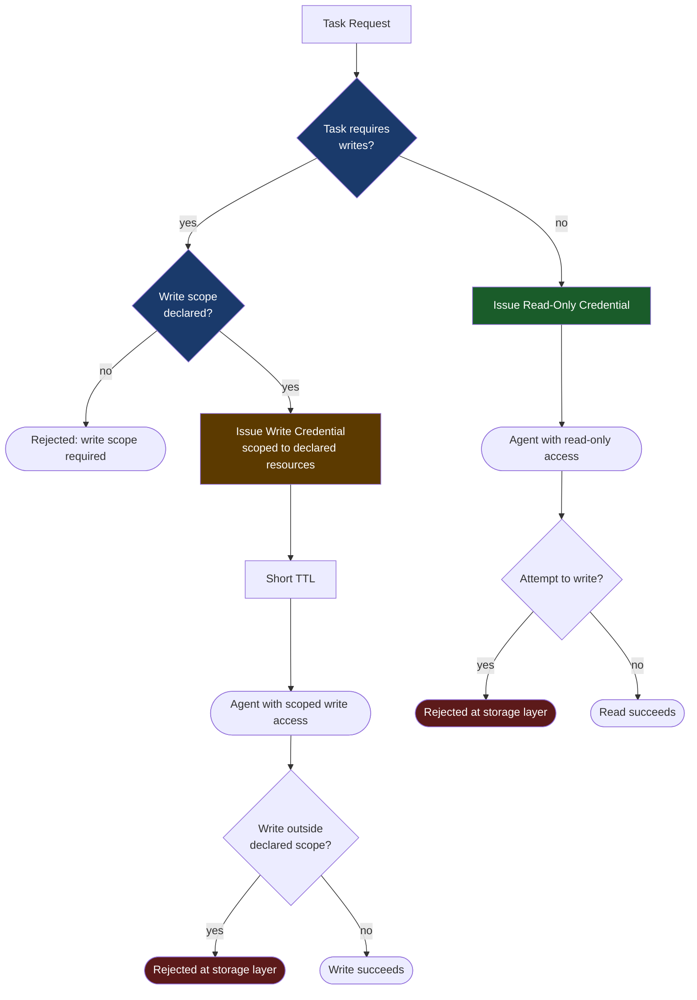

# Read/Write Separation
**Family:** J — Security & Trust Boundaries
**ID:** J11

## Problem

Agents granted read-write access to data stores can be manipulated — through prompt injection or model error — into modifying, deleting, or corrupting data they were only supposed to read. Many tasks require read access; few require write access; yet write permissions are commonly granted by default because it is simpler. The difference in blast radius between a read-only compromise and a read-write compromise is enormous.

## Solution

Read and write permissions are granted separately. The default credential for any agent task is read-only. Write credentials are issued only for tasks that have been explicitly identified as requiring writes, scoped to the specific resources that will be written, and valid only for the duration of the write operation. Read and write credentials are distinct, non-interchangeable tokens.

## Structure

<details>
<summary><b>Read/Write Separation — Component Structure</b></summary>



</details>

## Implementation Notes

- **Default to read-only.** Any task that does not explicitly declare write requirements receives a read-only credential. There is no opt-out.
- **Write scope must be declared before credential issuance.** The orchestrator specifies exactly which resources will be written: table names, bucket paths, API endpoints. Vague declarations ("might need to write something") are rejected.
- **Write credentials have a shorter TTL than read credentials.** A read credential may be valid for a session; a write credential should expire after the expected write window.
- **Enforce at the storage layer.** Read-only enforcement must happen at the database/storage layer (not just in application logic) so that a compromised agent cannot bypass it by making direct connections.
- **Log all write operations.** Reads are sampled; writes are logged in full. Every write is a potential state change that must be auditable.
- **Separate read and write replicas where infrastructure allows.** Routing read traffic to read replicas and write traffic to a primary is a natural enforcement point.

Pseudocode — credential issuance with read/write separation:

```
function issue_credentials(task):
    read_cred = credential_store.issue_read(
        resources=task.required_read_resources,
        ttl=SESSION_TTL
    )
    if task.requires_writes:
        assert task.write_scope is not None
        write_cred = credential_store.issue_write(
            resources=task.write_scope,
            ttl=WRITE_TTL
        )
        return Credentials(read=read_cred, write=write_cred)
    return Credentials(read=read_cred, write=None)
```

## Failure Modes

- **Read-write credential used for read-only tasks "for simplicity."** Eliminates the protection entirely for those tasks.
- **Write scope declared as the entire database.** Technically compliant but functionally equivalent to no scope.
- **Enforcement only in application code.** Direct database connections (e.g., via a SQL tool) bypass application-layer enforcement.
- **Write credentials not revoked after the write window.** A write credential that persists through the rest of the session remains exploitable.
- **No logging of writes.** Without an audit trail, write-based attacks are undetectable until their effects manifest.

## Evidence

AWS Prescriptive Guidance explicitly recommends read/write separation as a core agentic AI security pattern, noting that most agent tasks require only read access and that write permissions should be granted separately and minimally.

OWASP GenAI Top 10 for Agentic Applications 2026 identifies excessive data access permissions as a primary risk, with separation of read and write as a key mitigation.

## Related Patterns

- [J01 — Least Privilege](J01-least-privilege.md)
- [J05 — Deterministic Authorization](J05-deterministic-authorization.md)
- [J07 — Session Isolation](J07-session-isolation.md)
- [J10 — Capability Minimization](J10-capability-minimization.md)

## Sources

- AWS Prescriptive Guidance — Amazon Web Services architecture team; strong on least privilege, session isolation, read/write separation. [System Design and Security](https://docs.aws.amazon.com/prescriptive-guidance/latest/agentic-ai-security/best-practices-system-design.html) | [Agentic AI Patterns](https://docs.aws.amazon.com/prescriptive-guidance/latest/agentic-ai-patterns/agent-patterns.html)
- OWASP GenAI Security Project — Open Web Application Security Project; defines the top 10 risks for LLM and agentic applications. [OWASP Top 10 for Agentic Applications 2026](https://genai.owasp.org/resource/owasp-top-10-for-agentic-applications-for-2026/)
