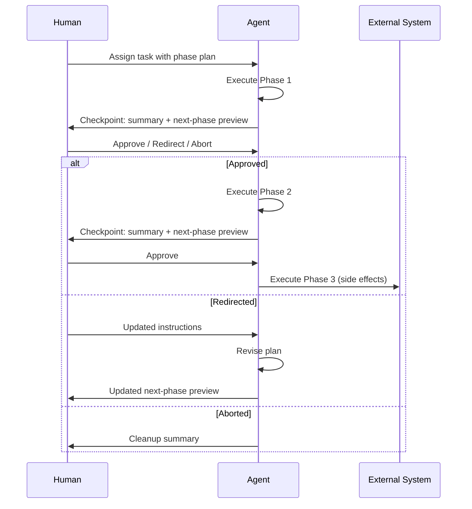

# K01 — Human-in-the-Loop Checkpoint

## Intent

Pause agent execution at predefined points and require explicit human approval before proceeding to the next phase.

## Problem

An agent executing a multi-step plan accumulates decisions and state changes as it runs. By the time a mistake is discovered, several irreversible downstream actions may already have occurred. Without deliberate pause points, humans can only review outcomes, not shape them. The agent may also drift from the original intent across many steps, and a checkpoint is the only mechanism to catch that drift before it compounds.

## Solution

The plan is divided into phases. Between phases, the agent stops completely, presents a summary of what it did and what it intends to do next, and waits for the human to approve, redirect, or abort. The human's approval is the gate that lets the agent enter the next phase. The agent carries no implicit authority to proceed on its own — the checkpoint is a hard stop, not a soft suggestion.

The agent must present, at each checkpoint:
1. What was accomplished in the completed phase (with evidence: diffs, outputs, counts)
2. What the next phase will do (with concrete scope — files, systems, users affected)
3. Any anomalies, surprises, or decisions that deviated from the original plan
4. An explicit prompt for approval, modification, or abort

## Structure

<details>
<summary><b>Checkpoint Flow</b></summary>



</details>

## When to Use

- The task has distinct phases where the output of one phase shapes the approach of the next
- Early phases are reversible (planning, analysis) but later phases are not (writes, deploys, sends)
- The human needs to verify intermediate results before committing to downstream work
- New agents or new action classes where trust has not yet been established (Trust Ladder Level 0–1)
- Regulatory or compliance contexts where an audit trail of human approval per phase is required
- Long-running tasks where the human cannot monitor continuously but needs control points

## When NOT to Use

- Fully deterministic, short-lived, trivially reversible tasks where stopping adds only friction
- High-frequency pipelines where latency from human approval would break SLA requirements
- Agents operating at Trust Ladder Level 3–4 on a well-scoped, well-understood action class
- Situations where the human has pre-approved the full plan and checkpoints add no new information

## Implementation Notes

**Defining checkpoint locations:**
Place checkpoints at phase transitions where: (a) the action class changes (analysis → write), (b) the blast radius increases, or (c) new external systems come into scope. Do not insert checkpoints mid-phase.

**Checkpoint presentation format:**
```
CHECKPOINT — Phase N complete
────────────────────────────────
Completed: <bullet summary of what was done>
Evidence:  <diffs, counts, key outputs>
Anomalies: <anything that deviated from plan, or "none">

Next phase: <name>
Scope:      <files / systems / users affected>
Estimated:  <time / resource cost>

Actions available: [Approve] [Redirect: <instructions>] [Abort]
```

**Timeout handling:**
If the human does not respond within a configured timeout, the agent must NOT proceed. It should re-surface the checkpoint with a timeout warning. If the timeout expires a second time, the agent should abort the task and notify the human.

**Resuming after redirect:**
When the human redirects rather than approving, the agent must re-derive the plan from the new instructions before presenting the updated next-phase preview. It must not blend old and new plans silently.

**Implementation sketch:**
```
function executeWithCheckpoints(plan):
    for each phase in plan.phases:
        results = executePhase(phase)
        
        if not plan.isFinalPhase(phase):
            summary = buildCheckpointSummary(phase, results, plan.nextPhase(phase))
            response = awaitHumanDecision(summary, timeout=plan.checkpointTimeout)
            
            if response.action == ABORT:
                runCleanup(results)
                return ABORTED
            
            if response.action == REDIRECT:
                plan = revisePlan(plan, phase, response.instructions)
                // re-present updated next phase preview before proceeding
                continue
            
            // APPROVE — fall through to next phase
    
    return COMPLETED
```

## Tradeoffs

| Force | Impact |
|-------|--------|
| Latency | Each checkpoint adds human response time to total task duration; unsuitable for real-time pipelines |
| Throughput | Reduces parallelism; the agent is idle while waiting for approval |
| Oversight | Maximum oversight per phase — human has full visibility and control before each irreversible step |
| Trust erosion | Overuse for low-risk tasks trains humans to approve without reading, defeating the purpose |
| Auditability | Every checkpoint creates a natural audit record of human decisions |
| Scope drift | Checkpoints catch and surface scope drift before it compounds |

## Related Patterns

- [K02 — High-Risk Action Gate](K02-high-risk-action-gate.md) — K01 is phase-level; K02 fires on specific action types regardless of phase
- [K04 — Review Before Side Effect](K04-review-before-side-effect.md) — K04 is the fine-grained version: review any single external state change; K01 is coarser
- [K05 — Draft/Preview Before Apply](K05-draft-preview-before-apply.md) — K05 is a lightweight K01 scoped to file writes; consider K05 inside a K01 phase
- [K06 — Human-on-the-Loop Monitoring](K06-human-on-the-loop-monitoring.md) — K06 is the non-blocking alternative; use K06 when the human need not block the agent but should be able to intervene
- [Family B — Task Decomposition](../B-task-decomposition/README.md) — K01 checkpoints map naturally to plan-approval gates between decomposed phases

## Example

A data-migration agent is given a task: migrate 50,000 customer records from a legacy database to a new schema.

Phase 1 (analysis): The agent reads the legacy schema, samples 100 records, and produces a migration mapping. At the checkpoint, it presents the mapping and flags 3 records with anomalous nulls. The human reviews the mapping, approves the null-handling strategy, and approves Phase 2.

Phase 2 (dry run): The agent runs the migration against a staging copy and reports that 49,997 records mapped cleanly, 3 required manual fixes. At the checkpoint, the human reviews the 3 exceptions, provides resolution rules, and approves Phase 3.

Phase 3 (production write): The agent executes the production migration with the approved rules. No further checkpoint needed — the human already approved the exact approach.

Without checkpoints, the agent would have applied its own null-handling assumption to production data in Phase 3, potentially corrupting 3 records with no human awareness.

## Sources

- **Anthropic Engineering** — AI safety company; authors of Claude; recommends human-in-the-loop for irreversible actions. [Building Effective Agents](https://www.anthropic.com/engineering/building-effective-agents)
- **Google Cloud Architecture Center** — Google's cloud architecture team; explicitly names Human-in-the-Loop as an agent design pattern. [Choose a Design Pattern for Agentic AI](https://docs.cloud.google.com/architecture/choose-design-pattern-agentic-ai-system)
- **Microsoft Azure Architecture Center** — Microsoft's cloud architecture team; stresses human participation in multi-agent workflows. [AI Agent Design Patterns](https://learn.microsoft.com/en-us/azure/architecture/ai-ml/guide/ai-agent-design-patterns)
- **OpenAI Engineering** — AI research company. [A Practical Guide to Building AI Agents](https://openai.com/business/guides-and-resources/a-practical-guide-to-building-ai-agents/)
